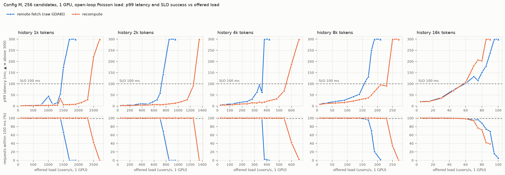

# HSTU remote KV over RDMA / GIN: measured results

Companion to the study doc (`hstu-kv-rdma-study.md`, plan in §10). Platform: Eos, 2 × DGX H100, CX-7 NDR 400G,
driver 535.129.03 + CUDA 13.3 forward compatibility, NGC PyTorch 26.07, NCCL 2.32.7 (source build).
Node A = inference (GPU k with NIC k), node B = KV store (host memory). Raw logs: `logs/p0/`, result rows: `results/`.

Started 2026-11-24 23:15. Status per phase is at the top of each section.

## Summary (P0–P6, config M = 8 layers × 1024 unless noted)

1. **Every transport reaches line rate for KV-sized transfers.** GIN-GDAKI, raw GDAKI, GIN-Proxy and CPU verbs all
   move remote host memory into GPU memory at 49.3–49.4 GB/s per GPU, and their request latencies and serving curves
   agree within 1% once a request moves more than a few MB. Requests are transfer-bound: latency = bytes ÷ 49.4 GB/s +
   about one layer of local compute.
2. **What separates them is cost and robustness, not speed:**

   | | CPU per GPU | Needs SM slots | 8 GPUs at once (node) | Store side | Smallest request (S, 1k, B = 1) |
   |---|---|---|---|---|---|
   | GIN-GDAKI | none (with `NCCL_RMA_DISABLE=1`) | yes (post/wait kernels) | **~230–270 GB/s with host-memory windows** (GPU-memory windows: line rate) | NCCL rank with a GPU | 0.255 ms |
   | raw GDAKI | none | yes | **395 GB/s** | GPU-less ibverbs process | 0.231 ms |
   | GIN-Proxy | one core, always | yes | ~230 GB/s (host windows) | NCCL rank with a GPU | 0.278 ms |
   | CPU verbs | up to one core while transferring | no | **395 GB/s** | GPU-less ibverbs process | 0.227 ms |

3. **Fetch vs recompute:** recompute efficiency is 18–58% of BF16 peak, driven by history length. Recompute wins at
   ≤ 8k tokens (1.5–2× the serving throughput at 1k and 4k); the two meet at ~12–16k; fetching wins beyond (1.6× at 32k).
   At 16k they saturate together (92 vs 85 users/s per GPU), the regime where the hybrid (P7) should roughly double
   throughput.
4. **Writes (W) never slow the scores.** They hide behind compute for long prefixes and short updates; fresh sequences
   are NIC-bound (1 GiB durable in 22.8 ms). GPU-initiated writes cost no CPU.
5. **Waiting inside the attention kernel (P4) buys nothing for transfer-bound requests** (±0.2%; −7% only for the
   tiniest requests). PDL never helped. CUDA graphs matter (−0.3 ms per small request). The ceiling of per-tile waits is
   the ~1-layer tail, 0–5% for M/D.
6. **GPU vs CPU (P6):** GPU-initiated transfers stall behind kernels that hold every SM (+18 ms in the test); stream
   priority does not help; **a green context reserving 8 SMs for the transfer kernels removes the stall**. CPU verbs is
   immune to SM pressure but costs a core per GPU while transferring.
7. **Recommendation for the POC path:** raw GDAKI (or GIN-GDAKI with GPU-memory windows) with its post/wait kernels on a
   small green context; CPU verbs as the fallback when no SMs can be reserved. Avoid GIN host-memory windows at scale on
   Eos (cause not isolated) and GIN-Proxy (a busy core per GPU for no gain). Next levers: the hybrid (P7) and a local KV
   cache (P8), each worth more than any transport choice.

---

## Kickoff

- **Push access:** works. Branch `hstu-kv-rdma-poc` on `geoffreyQiu/recsys-examples` (SSH alias `github-recsys-poc`).
  The first connection needed GitHub's host key; I added it to `~/.ssh/known_hosts` after checking its fingerprint
  against GitHub's published Ed25519 key (`SHA256:+DiY3wvvV6TuJJhbpZisF/zLDA0zPMSvHdkr4UvCOqU`).
- **Prebuilt image (`gitlab-master…/distributed-recommender:devel_latest`): not usable yet.**
  1. Compute nodes reach the registry only when bypassing the site proxy (`no_proxy=gitlab-master.nvidia.com`; via the proxy: HTTP 403 on CONNECT).
  2. With the proxy bypassed, GitLab rejects the stored enroot credentials: `jwt/auth` returns 401. GitLab expects the GitLab **username** and a token with `read_registry` scope; the stored login is an e-mail address.
- **Fallback used (as agreed):** `pytorch-26.07.sqsh` + a reduced FBGEMM HSTU build (`tools/build-hstu-attn.sh`):
  sm_90a, forward only, BF16, head dims 128/256, causal/context/target masks. **21 compile units, ~2 minutes**, 13 MB.
  CUDA 13 note: g++ needs `include/cccl` on its path for CUTLASS (`cuda/std/...`); nvcc adds it by itself.
- **Allocations:** 20–65 idle nodes during the run → up to 2 two-node jobs (job A 6652949, job B 6653065, 4 h each) plus a 1-node build job in the first hour.

---

## P0: micro-benchmarks ✅ (2026-11-24 23:29–23:59)

GiB/s = 2^30 B/s; line rate of one NDR port = 49.6 GB/s = 46.2 GiB/s.

### (a) GIN get, remote host memory → local GPU (`ginGetBW_perf --remote_mem_type host`)

| Backend | CTAs × threads | 4 KiB | 64 KiB | 256 KiB | 1 MiB | 64 MiB |
|---|---|---|---|---|---|---|
| GIN-GDAKI | 1 × 32 | 1.9 | 29.6 | 40.8 | 41.3 | **39.4 GiB/s** |
| GIN-GDAKI | 2 × 32 | 3.6 | 46.0 | 46.1 | 46.2 | **46.2 (line)** |
| GIN-GDAKI | 4 × 32 | 7.0 | 46.1 | 46.2 | 46.2 | 46.2 |
| GIN-GDAKI | 4 × 32, aggregated doorbells (`--gin_ag`) | **30.0** | 46.1 | 46.2 | 46.2 | 46.2 |
| GIN-GDAKI | 4 × 32, `--gin_rsm cta` | 8.6 | 46.1 | 46.2 | 46.2 | 46.2 |
| GIN-Proxy | 1 × 32 | 0.6 | 7.1 | 16.3 | 29.2 | **39.2** |
| GIN-Proxy | 2 × 32 | 1.3 | 13.9 | 29.1 | 46.0 | 46.1 |
| GIN-Proxy | 4 × 32 | 2.5 | 28.8 | 46.1 | 46.2 | 46.2 |

- **One context (= one QP per peer) caps RDMA READ at ~42 GB/s; two reach line rate.** This is a per-QP read limit (puts on one QP reach 48.8 GB/s, below). The POC spreads every request's gets over several contexts (4: see P2, where queued reads needed more).
- **Small messages:** GDAKI is 3–5× Proxy per CTA; GDAKI's aggregated doorbells (`ncclGinOptFlagsAggregateRequests`) give another 4× at 4 KiB. Irrelevant for non-paged KV (messages are MiBs) but matters for paged KV (P8).

### (b) GIN put, local GPU → remote host memory

| Backend | CTAs × threads | 4 KiB | 64 KiB | 256 KiB | 64 MiB |
|---|---|---|---|---|---|
| GIN-GDAKI | 1 × 32 | 2.0 | 31.2 | 46.1 | **45.5 GiB/s** |
| GIN-GDAKI | 4 × 32 | 7.4 | 46.1 | 46.1 | 46.2 |
| GIN-Proxy | 1 × 32 | 24.0 | 45.8 | 46.1 | 44.5 |
| GIN-Proxy | 4 × 32 | 40.4 | 46.1 | 46.1 | 46.2 |

(Proxy's small puts look fast because adjacent puts are likely coalesced by the proxy; not relevant to KV sizes.)

### (c, d) CPU verbs (perftest), host ↔ GPU

| Test | Result |
|---|---|
| `ib_read_bw`, B host → A GPU0, 1 pair | 396.5 Gb/s (49.6 GB/s) |
| `ib_read_bw`, **all 8 GPUs of A reading B's host memory at once** | **3,129 Gb/s total (391 GB/s)**; per pair 381–397 |
| `ib_write_bw`, A GPU0 → B host, 1 pair / 8 pairs | 395.6 / 3,087 Gb/s total |
| Read and write at once on GPU0 / mlx5_0 | read 396.0 + write 395.9 Gb/s: **full duplex** |

**The store's DRAM feeds 8 NICs at ~line rate**, so per-node fetch bandwidth is 8 × ~49 GB/s.

### (e) Latency, 8–64 B from remote host memory into GPU memory

| Path | Latency |
|---|---|
| CPU verbs, `ib_read_lat` (64 B) | 5.91 µs avg (min 5.82, p99 6.12) |
| GIN-GDAKI get (8 B) | 6.30 µs |
| GIN-Proxy get (8 B) | 7.37 µs |

### (f) Split-phase across kernels ✅ (`bench/p0f_tickets.py`)

8 layers × 4 users × 4096 tokens × 4 KiB = 512 MiB per request; a post kernel issues all 64 gets (spread over 2
contexts) and stores 2 tickets per layer, then exits; later kernels wait on layer l's tickets and check its data
against the store's seeded pattern.

| | GIN-GDAKI | GIN-Proxy |
|---|---|---|
| Data checks (immediate, after a 5 ms busy kernel, interleaved with 200 µs "layers") | all pass | all pass |
| Negative control (check the last layer without waiting) | 8,388,608 stale words (all) | same |
| Post kernel (64 gets + 16 tickets) | 48–51 µs | 33–34 µs |
| Layer l ready at | 1.37 ms × (l + 1) | 1.39 ms × (l + 1) |
| Bandwidth | 49.2–49.4 GB/s | 48.6–48.8 GB/s |
| Write + **strong signal commit into the store's host memory**, checked by the store's CPU | 0 mismatched words | 0 |

- **§5.1 confirmed for both backends:** tickets taken in one kernel are waited on in another; waits block until the data has landed.
- **Commit into host memory works with a strong signal** (§11 open item closed).
- GIN-Proxy's very first request after init was slow (first layer at 6.3 ms): one-time warm-up.

### (g) GDAKI doorbell mode and CPU threads

- **GPU-SM doorbell is supported on Eos:** forcing `NCCL_GIN_GDAKI_NIC_HANDLER=2` runs at full bandwidth, no "CPU proxy" fallback; CQ in device memory; `mcst=0`.
- DOCA's `[ERR] Failed to create UMEM with DMABUF` lines are the dma-buf probe failing (no dma-buf on Eos) before it falls back to nvidia_peermem. Harmless.
- **Busy CPU threads during a run** (thread names via `NCCL_SET_THREAD_NAME=1`):
  - GDAKI: the test's main thread (spinning in stream sync) and **`NCCL RMA PPrg`** at 100%.
  - Proxy: those two and **`NCCL GIN P`** (the GIN proxy) at 100%.
- `NCCL RMA PPrg` is the progress thread of NCCL's *host* RMA API (`ncclPutSignal`…), started with the communicator whether or not that API is used. **`NCCL_RMA_DISABLE=1`** removes it; all POC GIN runs set it. So GDAKI costs no CPU core, Proxy costs one per GPU.

### (h) Shared PCIe ingress (RDMA read and H2D into the same GPU)

| | H2D copy | RDMA read |
|---|---|---|
| Alone | 55.8 GB/s | 49.6 GB/s |
| Together | **28.1 GB/s** | **28.2 GB/s** |

The two split the GPU's ~56 GB/s ingress evenly. Reads + writes (ingress + egress) don't interfere (d).

### (i) Green contexts ✅

Work on driver 535.129.03 with CUDA 13.3 forward compatibility: a 16-SM green context ran 1,024 blocks on exactly
16 SMs. Usable in P6.

### Other platform findings

- **GIN windows must have the same size on every rank** in NCCL 2.32.7 ("elastic GIN": `all ranks must have identical
  segment configurations`), although the docs say sizes may differ. The POC registers equal, 1 GiB-rounded windows.
- `ginGetBW_perf` and friends only run with exactly 2 ranks; the 8-pair GIN case is measured by the POC (P2).

---

## P1: POC skeleton and baselines ✅ (2026-11-25 00:00–00:40)

**Built:** `examples/hstu-poc` on branch `hstu-kv-rdma-poc` (layout in its README): model (`hstu_poc/model.py`, the
repo's layer math with FBGEMM's Hopper kernel), KV sources, grid runner (`bench/grid.py`), JIT-built transports.

**Correctness ✅** (`bench/p1_check.py`, configs S/M/D):
- **The non-paged C++ Hopper kernel handles a cached history directly** (queries shorter than keys + targets): relative
  error ≤ 7e-3 against a PyTorch reference of the repo's mask, for R (candidates only), W (prefix + new + candidates)
  and fresh sequences. **The two-call fallback is not needed.**
- **Cached path = recompute:** feeding the cached path with the K/V that recompute produced gives bit-identical candidate
  scores (all three configs).

**Grid:** configs S/M/D × L 1k–32k + skewed (lognormal, median 2k, p99 16k) × C 64/256/1024 × B 1–128, one GPU per cell,
CUDA graph per cell, back-to-back replays (`results/p1/compute.rank*.jsonl`, 1008 cells; host-H2D: `h2d1`, `h2d8`).
Tables: `tools/report.py results/p1/compute.rank*.jsonl --config M --metric p50_ms` (or `eta`, `users_per_s`).

**Recompute efficiency η (fraction of 989 TFLOPS BF16), M, C = 256:**

| L \ B | 1 | 4 | 16 | 64 |
|---|---|---|---|---|
| 1k | 18% | 30% | 31% | 33% |
| 4k | 32% | 37% | 39% | 40% |
| 16k | 51% | 51% | 52% | 52% |
| 32k | 57% | 58% | 58% | 58% |

- **η grows with history length (attention share), barely with batch size.** The cost model's "η 30–50%" bracket was right; at 16k it is ~51%.

**Latency p50 (ms), M, C = 256, 1 GPU:**

| L | B=1 recompute | B=1 local hit | B=1 host H2D | B=8 recompute | B=8 local hit | B=8 host H2D |
|---|---|---|---|---|---|---|
| 1k | 0.77 | 0.65 | 0.76 | 3.49 | 1.10 | 5.43 |
| 4k | 2.12 | 1.17 | 2.69 | 14.4 | 1.63 | 20.2 |
| 16k | 11.7 | 3.29 | 10.4 | 94.0 | 3.73 | 78.9 |
| 32k | 36.5 | 6.06 | 20.7 | 296 | 6.72 | 157 |

- **A local hit is not free for long histories at small B:** 6 ms at 32k, because 256 queries give the kernel only ~8 CTAs per user (no split over keys). HSTU has no softmax, so a split-K variant is exact: an optimization lever for later.
- **Host H2D** runs at 53–55 GB/s on one GPU. **With all 8 GPUs at once it drops to ~300 GB/s per node** (22–38 GB/s per GPU, large spread). Caveat: these host buffers were not NUMA-pinned to each GPU's socket; the remote store pools were.

**Throughput ceilings per GPU (users/s, M, C = 256):** recompute 2,473 / 588 / 87 / 28 at 1k / 4k / 16k / 32k (best B);
local hit 9,375 / 6,637 / 2,965 / 1,696.

---

## P2 / P2b: workload R over the transports ✅ (00:00–01:00)

Same harness and timing for every source: one CUDA graph per cell (post kernel or CPU post at request start, a wait per
layer before attention), **isolated requests** (request i+1 starts after request i ends), data check of every cell's
fetched rows against the store pattern (**all 0 mismatches**). Results: `results/p2/one_*.jsonl`, `eight_*.jsonl`.

**Transports as built:**
- **GIN-GDAKI / GIN-Proxy:** NCCL 2.32.7 device API, 4 read contexts (see below), store = GIN host window on node B.
- **Raw GDAKI (P2b):** NCCL's bundled DOCA GPUNetIO built standalone (`tools/build-doca.sh`, 23 files, ~1 min); GPU-side
  RC QPs connected to **a GPU-less store (plain host memory + ibverbs, no CUDA)**. ~330 lines of host + device code.
- **CPU verbs:** RC QPs, a worker thread posts every read at request start and polls the CQ, per-layer host-mapped flags,
  1-thread spin kernel per layer. Same GPU-less store.

**p50 latency (ms), M, C = 256, 1 GPU (local hit / host H2D for reference):**

| L | B | GIN-GDAKI | raw GDAKI | GIN-Proxy | CPU verbs | host H2D | local hit | recompute |
|---|---|---|---|---|---|---|---|---|
| 1k | 1 | 0.78 | 0.78 | 0.87 | 0.77 | 0.74 | 0.65 | 0.77 |
| 4k | 1 | 2.88 | 2.87 | 2.92 | 2.87 | 2.60 | 1.18 | 2.12 |
| 16k | 1 | 11.3 | 11.3 | 11.4 | 11.4 | 10.1 | 3.29 | 11.7 |
| 32k | 1 | 22.6 | 22.5 | 22.6 | 22.6 | 20.0 | 6.1 | 36.5 |
| 4k | 8 | 21.9 | 21.9 | 21.9 | 22.0 | 19.8 | 1.63 | 14.4 |
| 16k | 8 | 87.2 | 87.2 | 87.2 | 87.2 | 77.7 | 3.74 | 94.0 |
| 32k | 8 | 174 | 174 | 174 | 174 | 155 | 6.61 | 296 |
| 16k | 64 | 695 | 695 | 695 | 695 | 625 | 21.0 | 736 |

- **All four transports run at line rate (49.3–49.4 GB/s) and are within 1% of each other** once a request moves more than a few MB. GIN-Proxy adds ~0.1 ms on the smallest requests.
- **Requests are transfer-bound:** latency = bytes / 49.4 GB/s + about one layer's local compute (the "tail", 0–5% for M/D).
- **Fetch vs recompute (the crossover):** recompute wins at ≤ 8k, fetch wins from ~12–16k, and by 38–41% at 32k, at every batch size (η is L-driven, so the crossover barely moves with B).
- **8 GPUs at once** (M, L 4k/16k, B 1/8/32; 8 pairs GPU k ↔ NIC k ↔ store rank k):

  | Transport | Per-GPU GB/s (GPUs 0–3 / 4–7) | Node total | Store |
  |---|---|---|---|
  | CPU verbs | 47–49 / 47–49 | **391–395 GB/s** | mmap'd host memory, NUMA of the NIC, plain `ibv_reg_mr` |
  | raw GDAKI | 47–49 / 47–49 | **391–395 GB/s** | same GPU-less store |
  | host H2D (local, reference) | 45–46 / 45–46 | 384–398 GB/s | – |
  | GIN-GDAKI | 35 / 23 (first run) | **~230 GB/s** | NCCL host window (`cuMemCreate HOST_NUMA`) |
  | GIN-Proxy | 35 / 23 | ~230 GB/s | same |

  **GIN with host-memory windows does not scale across concurrent pairs on Eos.** Investigation (7 pairs on GPUs 1–7):
  - Each pair alone reaches line rate, on either socket (GPU 5 alone: 49.3 GB/s).
  - NIC selection is right (GPU k → its own NIC, 1 connection); `NCCL_GIN_NCONNECTIONS=1` changes nothing.
  - My first store pools all sat on NUMA node 0 (`CU_DEVICE_ATTRIBUTE_HOST_NUMA_ID` is not reported by driver 535; fixed: NUMA node from sysfs). With correct placement: still 44 GB/s on socket 0 and 23 GB/s on socket 1.
  - Allocation granularity (2 MB, 1 GB) and `NCCL_IB_PCI_RELAXED_ORDERING=0`: no change.
  - **With the store's GIN window in GPU memory, all 7 pairs run at 49.3 GB/s.**

  So the limit is in NCCL's host-memory window path (registration of `HOST_NUMA` cuMem memory); plain ibverbs host stores scale. Root cause not isolated (next: compare the MR attributes NCCL uses for host cuMem windows with plain `ibv_reg_mr`, and IOMMU/ATS settings). **Practical rule: on Eos, use GPU-memory GIN windows, or raw GDAKI / CPU verbs for a host-memory store.**

**Tuning found on the way:**
- **GIN-GDAKI reads need ≥ 4 contexts (QPs)** when several large reads queue per QP: B = 8 × 16k gave 26.8 / 43–46 / **49.3** / 49.3 GB/s with 1 / 2 / 4 / 8 contexts. CPU-verbs QPs reach line rate with 2.
- **CPU cost per request** (process CPU while the host sleeps in a blocking event wait): GIN-GDAKI and raw GDAKI 0.04–0.9 ms (launches only); CPU verbs ≈ the whole transfer time (its worker polls the CQ); GIN-Proxy likewise (proxy thread).

**Rerun note:** the first 8-GPU GIN runs failed at start-up: PyTorch's JIT loader silently rebuilt the extension after a
source edit while the container's arch list still included `compute_75`. The extension now pins `TORCH_CUDA_ARCH_LIST=9.0a`
and each phase builds into its own directory; the 8-GPU runs were redone.

---

## P3: workload W over the transports ✅ (00:13–00:36)

Per layer, right after the layer's new K/V rows exist (they already sit contiguous in the local K/V buffer, so
"pack" costs nothing extra), the new tokens' K/V are written to the user's remote slot after the cached prefix.
Writes are timed to **durable**: a write-then-read fence on every QP (an 8-byte read served after the earlier writes
on that QP). Scores-ready vs durable come from GPU timestamps; after each cell the written ranges are read back from
the store and compared (**all 0 bad bytes**). GIN also commits with a strong signal. `results/p3/`.

**M, 1 GPU, p50 (ms):**

| B | P (prefix) | S (new) | C | Written | Scores: no writes / with GDAKI writes | Durable: GIN-GDAKI / GIN-Proxy / CPU verbs | CPU ms per request: GDAKI / Proxy / verbs |
|---|---|---|---|---|---|---|---|
| 1 | 0 | 4096 | 256 | 128 MiB | 2.37 / 2.40 | 2.92 / 2.92 / 2.90 | 0.09 / 3.07 / 2.97 |
| 1 | 0 | 16384 | 256 | 512 MiB | 12.28 / 12.13 | 13.24 / 13.17 / **12.47** | 0.17 / 13.62 / 12.79 |
| 1 | 2048 | 64 | 256 | 2 MiB | 0.85 / 0.86 | 0.89 / 0.89 / 0.87 | 0.04 / 1.00 / 0.83 |
| 1 | 16384 | 1024 | 256 | 32 MiB | 3.70 / 3.70 | 3.73 / 3.73 / 3.71 | 0.05 / 3.85 / 3.43 |
| 8 | 0 | 4096 | 256 | 1 GiB | 15.42 / 15.18 | 22.86 / 22.86 / 22.84 | 0.18 / 23.35 / 23.07 |
| 8 | 2048 | 1024 | 256 | 256 MiB | 5.18 / 5.17 | 5.92 / 5.92 / 5.81 | 0.12 / 6.10 / 5.90 |
| 8 | 16384 | 1024 | 256 | 256 MiB | 13.74 / 13.70 | 13.82 / 13.75 / 13.70 | 0.14 / 14.09 / 13.11 |
| 32 | 0 | 4096 | 256 | 4 GiB | 59.96 / 58.50 | 91.22 / 91.23 / 91.20 | 0.31 / 91.68 / 91.53 |
| 32 | 16384 | 1024 | 256 | 1 GiB | 50.03 / 49.63 | 51.24 / 51.07 / 50.24 | 0.31 / 51.81 / 48.03 |

- **Writes never slow the scores** (±1–2%): GPU-initiated puts are posted from a side stream; CPU-verbs writes are posted by the worker when the GPU flags each layer.
- **Long prefixes or short updates: writes are hidden** (durable 0.02–0.1 ms after the scores).
- **Fresh sequences and long updates are NIC-bound** (46–47 GB/s): durable = bytes / NIC rate, as the cost model predicted (1 GiB: 22.8 ms vs 14–15 ms of compute).
- **Transports tie**, except fresh 16k sequences (32 MiB segments), where GIN writes reach 41 GB/s vs ~43 GB/s for CPU verbs. **4 write contexts instead of 2 change nothing** (tested: 41.1–41.2 GB/s), so it is not a QP limit; it points at NCCL's put path into host-memory windows, like the 8-GPU read result in P2.
- **CPU:** GPU-initiated writes cost ~0.1 ms of CPU per request; CPU verbs and GIN-Proxy keep a core busy for the whole write.
- **8 GPUs at once** (GIN-GDAKI, M): same per-GPU results; CPU verbs rerun in the follow-up chain.
- Raw GDAKI has the read path only (writes would mirror GIN's put kernel; not needed to answer the transport question).

---

## P4: fused-wait experiments ✅ (00:40–00:50)

**Built:** a copy of FBGEMM's Hopper forward kernel (`attn/hstu_hopper`, 6 instantiations, ~1 min to build) with a wait
hook right before the producer warp's first K/V TMA load: (i) spin on a per-layer ready word (acquire load, then
`fence.proxy.async.global`), or PDL (`griddepcontrol.wait` there; the 5′a wait kernel triggers dependents on entry;
the kernel is launched with programmatic stream serialization via `cudaLaunchKernelEx`). For (i), a 1-thread poller on
a side stream publishes the ready words (GIN/raw: waits on the tickets; CPU verbs: relays the CPU's host flags).

**Correctness ✅** (`bench/p4_check.py`): posting delayed 2 ms, local K/V rows zeroed before each request. 5′a, the
copied kernel, PDL and fused (i) give **bit-identical scores** for raw GDAKI, GIN-GDAKI and CPU verbs; the no-wait
control differs every time. No deadlocks (the poller never depends on another kernel being scheduled).

**p50 latency (ms), 1 GPU, C = 256** (`results/p4/`; 18 cells × 4 transports × 4 variants):

| Transport | Config | L | B | 5′a, CUDA graph | 5′a, eager | PDL | fused (i) |
|---|---|---|---|---|---|---|---|
| GIN-GDAKI | S | 1k | 1 | 0.255 | 0.576 | 0.257 | **0.238** |
| raw GDAKI | S | 1k | 1 | 0.231 | 0.552 | 0.234 | **0.226** |
| CPU verbs | S | 1k | 1 | **0.227** | 0.546 | – | – |
| GIN-Proxy | S | 1k | 1 | 0.278 | 0.572 | 0.279 | – |
| GIN-GDAKI | M | 4k | 1 | 2.882 | 2.906 | 2.884 | 2.886 |
| GIN-GDAKI | M | 16k | 8 | 87.166 | 87.170 | 87.173 | 87.177 |

- **The wait variants change nothing for transfer-bound requests** (±0.2%): latency = transfer + about one layer's compute, and the wait-kernel boundary inside a CUDA graph is ~1 µs.
- **Fused (i) helps only tiny requests** (S, 1k, B = 1: −7% GIN-GDAKI, −2% raw). **PDL never measurably helps.**
- **CUDA graphs matter:** eager launching adds 0.3 ms to small requests and 0.6–2 ms of CPU per request.
- **Smallest requests:** CPU verbs 0.227 ≈ raw GDAKI 0.231 < GIN-GDAKI 0.255 < GIN-Proxy 0.278 ms (GIN's post kernel covers 4 contexts; Proxy adds a CPU hop).
- **(ii) per-tile waits: not built.** Its ceiling is the tail after the last layer's data lands, measured as request minus pure transfer time: 0–5% for M/D (e.g. 0.40 ms of 11.27 at M 16k B=1), up to ~0.13–0.3 ms for small S requests. The bigger levers for these requests are moving fewer bytes (the hybrid, P7) or more bandwidth.

---

## P5: thin serving layer, throughput at p99 ✅ (00:50–01:20)

**Built:** `hstu_poc/serving.py` + `bench/p5.py` (no Triton): open-loop Poisson arrivals, homogeneous requests (history L,
256 candidates); dynamic batcher (powers of two up to 32, never padded; a batch forms when a KV region is free and the
GPU is idle, 32 requests wait, or the oldest waited 2 ms); **fetch at admission** into two ping-pong regions (GIN /
raw GDAKI: post kernel on a fetch stream; CPU verbs: the worker posts), so batch k+1's transfer overlaps batch k's
compute; one CUDA graph per (batch size, region); latency = arrival → scores ready. Strategies: remote fetch over each
transport, recompute (no cache), local GPU hit (upper bound). Config M, 1 GPU. `results/p5/`.

**Max throughput (users/s) with p99 ≤ target** (offered rates are discrete, so these are lower bounds):

| L | Strategy | p99 ≤ 10 ms | ≤ 20 ms | ≤ 50 ms | ≤ 100 ms | Saturation | Transport CPU (cores) |
|---|---|---|---|---|---|---|---|
| 1k | remote fetch (GIN-GDAKI, raw GDAKI) | 1,195 | 1,195 | 1,195 | 1,446 | 1,446 | 0.00 |
| 1k | recompute | 1,960 | 1,960 | 1,960 | 2,380 | 2,380 | – |
| 1k | local hit | ≥ 8,017 | | | | ≥ 8,017 | – |
| 4k | remote fetch: GIN-GDAKI / raw GDAKI / GIN-Proxy / CPU verbs | 100 | 192 | 298 | 347 | 348 (all four) | 0.00 / 0.00 / 1.00 / 1.00 |
| 4k | recompute | 193 | 377 | 439 | 542 | 549 | – |
| 4k | local hit | ≥ 3,190 | | | | ≥ 3,190 | – |
| 16k | remote fetch (all four) | – | 11 | 39 | 39 | 87–92 | as above |
| 16k | recompute | – | – | 19 | 39 | 85 | – |
| 16k | local hit | 789 | | | | ≥ 789 | – |

- **Fetching is NIC-bound in serving too:** saturation ≈ 49.4 GB/s ÷ KV bytes per user (1k: 1,540/s; 4k: 368/s; 16k: 92/s), reached at 94–100%. Batching cannot raise it (bytes per user are fixed).
- **The four transports give the same curves** (within 1% at every load point); they differ only in CPU: GIN-GDAKI and raw GDAKI use none; GIN-Proxy keeps a core busy all the time; CPU verbs uses up to a core while transfers run (0.12–0.43 cores at 10–40 users/s with 16k histories).
- **Recompute vs fetch:** at 1k and 4k recompute serves 1.5–2× more users at each p99 target (and 1.6× at saturation). At 16k the two saturate together (85 vs 92/s); fetch has lower p50 near saturation (38 vs 62 ms at 80/s). This is the regime where the **hybrid (P7)** pays: both resources busy, predicted ~175 users/s at 16k.
- **A local hit is 10–20× cheaper than either**: a local KV cache with a decent hit rate (P8) is worth more than any transport choice.
- The serving loop itself busy-polls one CPU core (Python, 10 µs completion granularity).
- **Reruns:** raw GDAKI's 1k curve and CPU verbs' 16k curve were rerun and match GIN-GDAKI's (raw 1k saturates at 1,446/s; verbs 16k at 91.8/s; CPU verbs uses 0.14–1.0 cores rising with load).
- **Open bug (intermittent):** in the serving loop, raw GDAKI and CPU verbs occasionally stop with `CUDA error: unspecified launch failure` under heavy batching (4 of ~12 sweeps, on both nodes, at 1k ≈ 1,400 users/s or 16k ≥ 60 users/s); GIN-GDAKI / GIN-Proxy never did (0 of 6). Repeating the same loads mostly passes. What raw GDAKI and CPU verbs share, and GIN does not, is the local buffer (plain `cudaMalloc` + `nvidia_peermem` MR vs NCCL's `ncclMemAlloc`). One GPU core dump was captured but its analysis was lost to a filter in my wrapper; `tools/gpu_core_wrap2.sh` now keeps the report and the core. A hunt afterwards (8 more runs at the trigger loads, 24 load points, both transports) did not reproduce it. The per-request benchmarks (P2–P4, isolated requests) never failed. Next step: run the serving sweeps under `gpu_core_wrap2.sh` until it fires, and try `ncclMemAlloc` for the raw/verbs buffers.

---

## P6: GPU vs CPU balance ✅ (00:55–01:27)

**(a) Transfers next to a job that holds every SM** (`bench/p6.py`): a hog kernel fills every SM slot for 20 ms on
another stream; 2 ms later one request's KV transfer is issued; time from issue to "data usable" (GPU-initiated: a
wait kernel has seen the last layer complete; CPU verbs: the worker has). p50 of 7 trials, ms:

| Transport | Request | no hog | hog | hog + high-priority stream | hog + green context (8 SMs) | busy process on the worker's core |
|---|---|---|---|---|---|---|
| GIN-GDAKI | B=1 × 1k (32 MiB) | 0.71 | **18.63** | 18.63 | **0.78** | – |
| GIN-GDAKI | B=2 × 4k (256 MiB) | 5.45 | **23.37** | 23.35 | **5.52** | – |
| GIN-Proxy | B=1 × 1k | 0.75 | 18.67 | 18.67 | 0.81 | – |
| GIN-Proxy | B=2 × 4k | 5.47 | 23.38 | 23.38 | 5.52 | – |
| raw GDAKI | B=1 × 1k | 0.70 | 18.63 | 18.63 | 0.77 | – |
| raw GDAKI | B=2 × 4k | 5.44 | 23.37 | 23.37 | 5.50 | – |
| CPU verbs | B=1 × 1k | 0.70 | 0.82 | 0.82 | 0.83 | 0.72 |
| CPU verbs | B=2 × 4k | 5.44 | 5.55 | 5.56 | 5.56 | 5.46 |

- **Every GPU-initiated path waits for a free SM slot**: the post (and wait) kernels cannot start until the hog's blocks finish (+17.9 ms here = the hog's remaining time). GIN-Proxy is affected too: its post and wait are GPU kernels even though a CPU thread drives the NIC.
- **Stream priority does not help** (it never preempts resident blocks), as expected (§5.2).
- **A green context with 8 SMs reserved for the transfer kernels removes the delay** (+0.03–0.07 ms vs no hog). H100 rounds a 2-SM request up to 8 SMs (the split granularity), i.e. 6% of the GPU.
- **CPU verbs is immune to SM pressure** (+0.1 ms) and barely notices a competing busy process on its core (+0.02 ms): the worker wakes, posts and polls within its time slices. Its price is the core: busy for the whole transfer.

**(b) At the serving level** (`tools/p6_serving.sh`): the P5 server (M, 4k, 256 candidates, fetch at admission)
next to a co-located job that holds every SM slot 5 ms out of every 10 ms. "green" = the co-located job runs in a
124-SM green context and the fetch posts in an 8-SM one (the serving compute stays in the default context).
p50 / p99 latency (ms):

| Transport | Co-located job | 100 users/s | 200 users/s | 300 users/s | Transport CPU cores at 300/s |
|---|---|---|---|---|---|
| GIN-GDAKI / raw GDAKI | none | 2.9 / 9.6 | 3.3 / 12.2 | 8.8–8.9 / 33.4 | 0.00 |
| CPU verbs | none | 3.0 / 9.0 | 3.1 / 12.2 | 8.4 / 30.5 | 0.82 |
| GIN-GDAKI / raw GDAKI | every SM, 50% of the time | **7.3 / 16.7** | 10.6 / 22.2 | 16.0 / 38.2 | 0.00 |
| CPU verbs | every SM, 50% of the time | 6.2 / 13.4 | 7.2 / 16.9 | 12.5 / 36.5 | 0.82 |
| GIN-GDAKI, green | 124 SMs, 50% of the time | **3.1 / 9.8** | 3.5 / 12.8 | 9.3 / 35.1 | 0.00 |
| raw GDAKI, green | 124 SMs, 50% of the time | **3.0 / 9.7** | 3.4 / 12.7 | 9.2 / 34.5 | 0.00 |

- **Unpartitioned, a co-located job that fills the SMs hurts GPU-initiated fetch most** (p50 ×2.5 at 100/s); CPU verbs suffers less (its posting does not wait for SMs) but still stalls with the compute.
- **Partitioning the SMs with green contexts restores near-baseline latency** for GIN-GDAKI and raw GDAKI, with no CPU cost: the better configuration under co-location.
- **CPU budget:** CPU verbs ≈ 0.27 / 0.53 / 0.82 cores at 100 / 200 / 300 users/s (one core per GPU near the NIC limit), GIN-Proxy 1.0 core at any load, GDAKI paths 0. Per 8-GPU node near saturation: ~8 cores for CPU verbs or GIN-Proxy, none for GDAKI.

**Recommendation per load regime:**
- **Dedicated inference GPUs, transfer-bound (the measured case):** any transport reaches the NIC limit; prefer raw GDAKI or GIN-GDAKI (no CPU) with its transfer kernels on a small green context.
- **GPU shared with heavy co-located kernels:** partition SMs (green contexts) and keep GPU-initiated transfers in the small partition; without partitioning, CPU verbs is the more robust choice.
- **CPU-starved hosts:** GDAKI paths (zero cores); avoid GIN-Proxy (a busy core per GPU for nothing).
- **Store without GPUs / host-memory store at node scale on Eos:** raw GDAKI or CPU verbs (GIN host windows reach only ~230 GB/s per node here).
