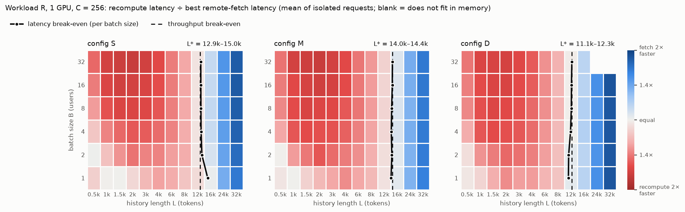
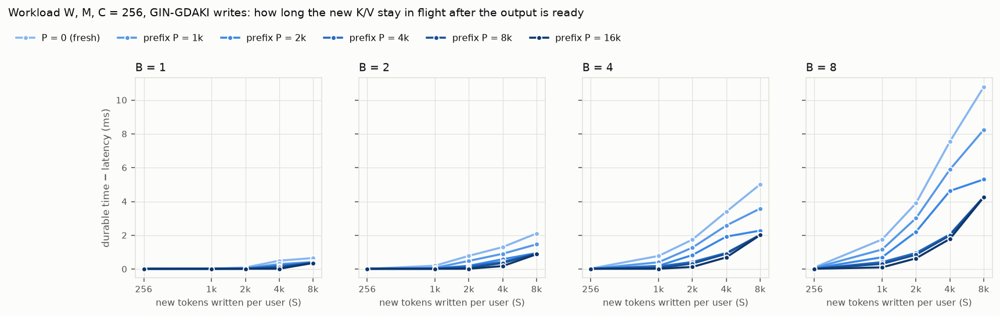
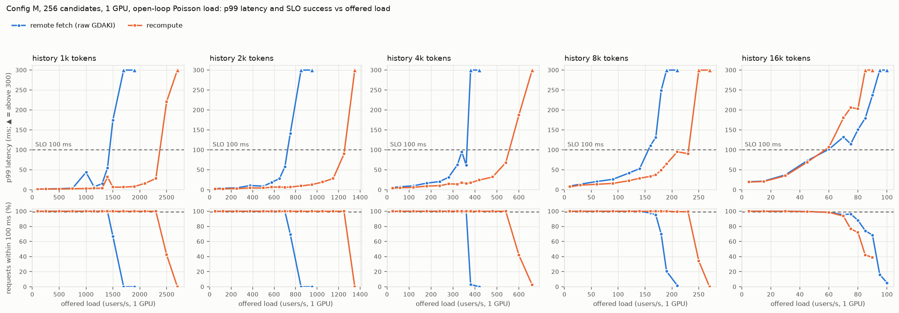
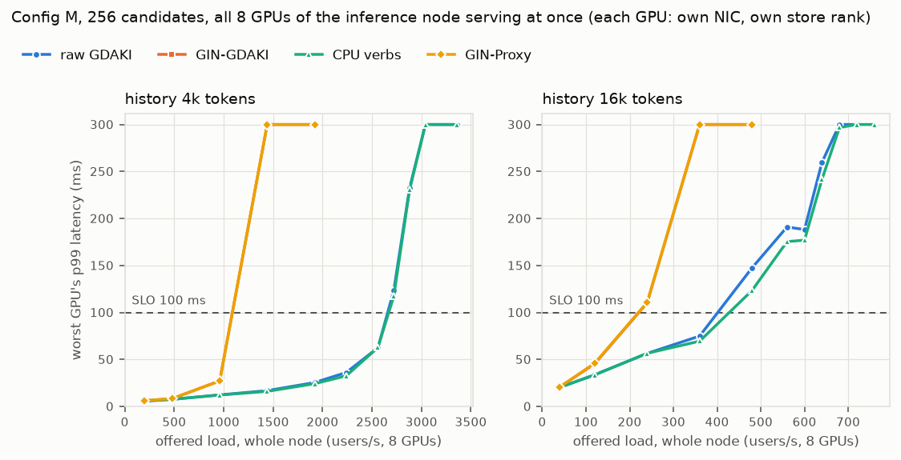

# HSTU remote KV over RDMA / GIN: measured results

Companion to the study doc (`hstu-kv-rdma-study.md`, plan in §10). Platform: Eos, 2 × DGX H100, one CX-7 NDR 400G NIC
per GPU, driver 535.129.03 + CUDA 13.3 forward compatibility, NGC PyTorch 26.07, NCCL 2.32.7 (source build).
Node A = inference (GPU k with NIC k), node B = KV store (host memory). Raw logs (`logs/`), result rows (`results/`)
and run scripts live in the study folder on Eos; the analysis scripts behind every table and figure are also in
`examples/hstu-poc/tools/`.

**Revision 2 (2026-11-25, 02:00–04:15)** answers the review of the first pass (kept in
`archive/results-first-pass-2026-11-25.md`): tables use means; every grid has B = 1/2/4/8 and L = 1k/2k/4k/8k/16k;
new are the fetch-vs-recompute break-even (P2c), a regular grid for workload W (P3b), a regular wait-variant grid
with PDL explained (P4b), and serving against offered load with a 100 ms SLO, success rate and data checks, on one
GPU and on all eight (P5b). Also new: a primer for P6, and the root causes of the serving crash (Xid 31/43) and of
GIN's host-window limit. Each review question is answered in [Review answers](#review-answers).

---

## Answer first

### 1. When does fetching the history's K/V over RDMA beat recomputing it?

**Above ~12–14k history tokens on this hardware, at any batch size.** Below that, recomputing the history is faster
and needs no store.

| Config | B=1 | B=2 | B=4 | B=8 | B=16 | B=32 | Throughput break-even |
|---|---|---|---|---|---|---|---|
| S (3 layers × 512) | 15.0k | 13.2k | 13.0k | 12.9k | 12.9k | 12.9k | 12.7k |
| M (8 × 1024) | 14.0k | 14.2k | 14.0k | 14.1k | 14.3k | 14.4k | 14.4k |
| D (16 × 1024) | 11.1k | 11.2k | 11.9k | 12.1k | 12.2k | 12.3k | 12.3k |

(Break-even history length L*: the request latency of the best transport equals recompute's. Throughput
break-even: the per-GPU serving ceilings are equal. Workload R, 256 candidates, 1 GPU; details in [P2c](#p2c-break-even-fetch-vs-recompute).)

- **The line is vertical.** Fetch cost grows with the bytes (B × L) and recompute cost with the tokens (B × L, plus the
  quadratic attention term), so the batch size cancels out; only the history length decides.
- **The margin is thin on both sides:** fetching costs 0.68 ms per 1k history tokens per user (M, 49.4 GB/s),
  recompute 0.4–0.8 ms per 1k up to ~12k, then more (attention is quadratic). At 32k fetching is 1.6× faster (M).
  (At M, 1k, B = 1 the two tie within 0.3%; L* is the length above which fetching stays faster.)
- **So the break-even is very sensitive to NIC speed.** Scaling only the transfer part of the measurements: with a
  1.5× faster NIC (~600 Gb/s) L* drops to 4–5k for B ≥ 4; at 2× (800 Gb/s class) fetching wins from 0.5k on. That is
  an estimate, not a measurement.
- **Serving confirms it** (P5b, one GPU, p99 ≤ 100 ms): recompute serves 2,300 / 1,250 / 540 / 230 users/s at
  1k / 2k / 4k / 8k, fetching 1,400 / 700 / 360 / 140; at 16k both serve 45–60. Past ~14k fetching wins (P2c: 1.6×
  faster per request at 32k) and saturates higher (16k: 92 vs 85 users/s).

### 2. Which transport?

**On one GPU they tie: all four move remote host memory into GPU memory at the NIC's limit (49.4 GB/s), and request
latencies agree within 1% above ~3 ms per request. They differ in what they cost and in how they scale.**

| | raw GDAKI | GIN-GDAKI | CPU verbs | GIN-Proxy |
|---|---|---|---|---|
| 1 GPU, KV-sized requests | line rate | line rate | line rate | line rate |
| Smallest requests (S, 0.5k / 1k, B = 1) | 0.204 / 0.226 ms (+6% / +0%) | 0.232 / 0.253 ms (+21% / +12%) | **0.193 / 0.225 ms** | 0.245 / 0.273 ms (+27% / +21%) |
| 8 GPUs at once, host-memory store | **394 GB/s** per node | **~230 GB/s on Eos**: the driver puts every GIN host window on socket 0 (fixable, see P2b) | **394 GB/s** | ~230 GB/s (same cause) |
| Serving, all 8 GPUs, p99 ≤ 100 ms (node users/s, 4k / 16k) | **2,587 / 357** | 962 / 123 (same cause) | **2,587 / 357** | 962 / 123 |
| CPU per GPU | none | none (with `NCCL_RMA_DISABLE=1`) | up to 1 core, proportional to load | 1 core, always |
| Needs a free SM to start a transfer | yes (fix: 8-SM green context) | yes (same fix) | **no** | yes |
| Store side | any host with a NIC, no GPU | an NCCL rank: CUDA + a GPU on the store | any host with a NIC | an NCCL rank |
| What you maintain | QP setup, key exchange, tickets (DOCA GPUNetIO, ~330 lines) | NCCL windows + device API | QPs, a worker thread, host flags | as GIN-GDAKI |

**Recommendation for the HSTU inference POC:**
- **Fastest today on Eos: raw GDAKI** (or CPU verbs). Line rate at node scale: with all 8 GPUs serving it meets the
  SLO at 2.7–2.9× the load GIN does on Eos. No CPU, the lowest small-request latency of the GPU-initiated paths, and
  a GPU-less store. Run its post/wait kernels in an 8-SM green context so a busy GPU cannot delay transfers (P6).
- **GIN-GDAKI is equally fast per GPU and simpler to own** (NCCL handles QPs, keys and completion tracking). It becomes
  the first choice once its host windows sit on the NIC's socket: a newer driver that honors
  `cuMemCreate(HOST_NUMA, id)`, or a GPU-memory store. The 8-pair control in P2b reproduces GIN's ~230 GB/s with raw
  GDAKI by putting the store on socket 0, so nothing else in GIN is limiting.
- **CPU verbs** when SMs cannot be reserved and the host has a spare core per GPU.
- **Not GIN-Proxy**: a core per GPU busy at all times, slower small requests, no upside here.

### 3. What moves the needle next

The transport choice is settled; what changes throughput now is moving fewer bytes or more bandwidth:
the hybrid (P7: recompute short histories, fetch long ones, or fetch the tail and recompute the head), a local KV
cache (P8: a local hit serves 4× (1k) to ~30× (16k) more users per GPU than the better of the two strategies), and
faster NICs (see the sensitivity above).

---

## Review answers

| Review point | Answer | Section |
|---|---|---|
| Xid 31 / 43 on jobs 6652949 (eos0185) and 6653065 (eos0132) | The serving crash. Caused by the old serving loop's object lifetime (an old server freed by Python's cycle collector while the next one was capturing its graphs), not by a transport: GIN-Proxy hit it too. Reproduced 3 of 3, fixed and verified. | [P5b](#the-serving-crash-xid-31--43) |
| Is p50 better than the mean? | Neither in general. The tables now use the mean: it is what capacity depends on. Over 1,288 P2c cells the two differ by 0.02% (median), 0.5% (95th pct.), 1.8% (max). Serving uses p99 against the SLO. | [Method](#method) |
| B = 4 and L = 2k / 8k | In every grid now (P2c, P3b, P4b, P5b). | – |
| P2: break-even line, recompute vs the best RDMA | L* ≈ 14k (M), 13–15k (S), 11–12k (D), flat in B. | [P2c](#p2c-break-even-fetch-vs-recompute) |
| P3: B = 4, S = 1k/2k/8k, a regular grid; what is "score"? | Regular grid B × prefix P × new S. The doc now uses two terms instead: **latency** (performance: request start → the request's output is ready) and **output** (correctness: what the request returns, one score per candidate item). | [Method](#method), [P3b](#p3b-workload-w-on-a-regular-grid) |
| P4: what is PDL, which kernel? | Programmatic Dependent Launch; the attention kernel was launched with it, right after the wait kernel. | [P4b](#p4b-wait-variants-on-a-regular-grid) |
| P5: drop local hit; x-axis folding; error/success rate; keep p99 in a reasonable range | Re-plotted against offered load (one point per x), p99 capped at 3 × SLO, success = share of requests within 100 ms without data errors, sampled data checks; local hit dropped from the plot. | [P5b](#p5b-serving-against-offered-load-slo-100-ms) |
| P6: 101-style intro; what is "hog"? | Added: SMs and blocks, why GPU-initiated transfers can wait, the hog kernel, green contexts. | [P6](#p6-gpu-vs-cpu-balance) |
| Which RDMA implementation gives the best performance? | See [Answer first](#2-which-transport). | – |

---

## Method

**Request timing (P2–P4).** One CUDA graph per cell (the whole request: embedding, layers, head, KV movement);
requests are isolated (request i+1 starts after request i ends); latency = GPU events around the request; 10–300
requests per cell (a 1–1.5 s budget); fetched rows are compared with the store's seeded pattern after each cell (0
mismatches everywhere).

**Statistics: mean, not p50.** The mean is total time ÷ requests: what capacity depends on (a GPU serving back to back
completes 1/mean requests per second), and it includes the occasional slow request. The median is the typical request
and ignores rare outliers (a CPU hiccup in the poster), which makes it steady for micro-benchmarks but hides them. In
these isolated-request benchmarks the distributions are narrow: over 1,288 P2c cells, |mean ÷ p50 − 1| is 0.02% at
the median, 0.48% at the 95th percentile and 1.8% at most. Tables report the mean; serving reports p99 against the
SLO (what a latency target is written against).

**Terms.**
- **Latency** (performance): request start → the request's output is ready. P2–P4 time it on the GPU for isolated
  requests; in serving (P5b) it runs from the request's arrival, so it includes queueing and batching.
- **Output** (correctness): what a request returns. HSTU ranks C candidate items (256 here) for one user; the output is
  one score per candidate (a probability per task, from the head MLP). Correctness checks compare outputs, or the K/V
  bytes that were moved, with a reference.
- **Durable time** (workload W): request start → the new tokens' K/V are confirmed in the remote store. It can end after
  the output is ready; durable time − latency is how long the writes stay in flight after it.
- **Workload R**: the whole history is cached remotely; fetch it, compute the candidates. **W**: a prefix P is already
  local, S new history tokens are computed now and written to the store, plus the candidates.
- **5′a / PDL / fused**: ways to wait for a layer's K/V before its attention (P4b).
- **Hog**: a synthetic kernel that occupies every SM (P6).

**Harness fix found in this pass (CPU verbs).** The verbs worker writes per-layer flags = the sequence number of the
last finished request, and each new benchmark cell restarted its own counter at 0, so a cell's first request or two
did not wait for their data when the previous cell had ended on a larger number. With long transfers (≥ 250 ms) this
also spoiled the iteration estimate and queued a backlog: in the first-pass P2c run, three CPU-verbs cells were
+2–4% (a 1.5–3 s first request). Sources and writers now continue one sequence per engine; CPU verbs was rerun.
The serving loop was never affected (it already kept one counter per engine).

---

## P0: micro-benchmarks ✅ (2026-11-24 23:29–23:59)

GiB/s = 2^30 B/s; line rate of one NDR port = 49.6 GB/s = 46.2 GiB/s. Unchanged from the first pass.

### (a) GIN get, remote host memory → local GPU (`ginGetBW_perf --remote_mem_type host`, GiB/s)

| Backend | CTAs × threads | 4 KiB | 64 KiB | 256 KiB | 1 MiB | 64 MiB |
|---|---|---|---|---|---|---|
| GIN-GDAKI | 1 × 32 | 1.9 | 29.6 | 40.8 | 41.3 | **39.4** |
| GIN-GDAKI | 2 × 32 | 3.6 | 46.0 | 46.1 | 46.2 | **46.2 (line)** |
| GIN-GDAKI | 4 × 32 | 7.0 | 46.1 | 46.2 | 46.2 | 46.2 |
| GIN-GDAKI | 4 × 32, aggregated doorbells (`--gin_ag`) | **30.0** | 46.1 | 46.2 | 46.2 | 46.2 |
| GIN-Proxy | 1 × 32 | 0.6 | 7.1 | 16.3 | 29.2 | **39.2** |
| GIN-Proxy | 4 × 32 | 2.5 | 28.8 | 46.1 | 46.2 | 46.2 |

- **One context (= one QP per peer) caps RDMA READ at ~42 GB/s; two reach line rate.** The POC spreads every
  request's gets over 4 contexts (P2: queued reads needed more).
- **Small messages:** GDAKI is 3–5× Proxy per CTA; aggregated doorbells give another 4× at 4 KiB (matters for paged
  KV, P8).

### (b) GIN put, local GPU → remote host memory (GiB/s)

| Backend | CTAs × threads | 4 KiB | 64 KiB | 256 KiB | 64 MiB |
|---|---|---|---|---|---|
| GIN-GDAKI | 1 × 32 | 2.0 | 31.2 | 46.1 | **45.5** |
| GIN-GDAKI | 4 × 32 | 7.4 | 46.1 | 46.1 | 46.2 |
| GIN-Proxy | 4 × 32 | 40.4 | 46.1 | 46.1 | 46.2 |

### (c, d) CPU verbs (perftest), host ↔ GPU

| Test | Result |
|---|---|
| `ib_read_bw`, B host → A GPU0, 1 pair | 396.5 Gb/s (49.6 GB/s) |
| `ib_read_bw`, **all 8 GPUs of A reading B's host memory at once** | **3,129 Gb/s total (391 GB/s)**; per pair 381–397 |
| `ib_write_bw`, A GPU0 → B host, 1 pair / 8 pairs | 395.6 / 3,087 Gb/s total |
| Read and write at once on GPU0 / mlx5_0 | read 396.0 + write 395.9 Gb/s: **full duplex** |

### (e) Latency, 8–64 B from remote host memory into GPU memory

CPU verbs `ib_read_lat` 5.91 µs; GIN-GDAKI get 6.30 µs; GIN-Proxy get 7.37 µs.

### (f) Split-phase across kernels ✅

Tickets taken in one kernel are waited on in another, for GDAKI and Proxy; waits block until the data has landed
(negative control: all words stale without the wait); a write followed by a strong signal commits into the store's
host memory (0 mismatched words). Post kernel for 64 gets: 48–51 µs (GDAKI), 33–34 µs (Proxy).

### (g–i) Platform

- GPU-SM doorbells work on Eos (`NCCL_GIN_GDAKI_NIC_HANDLER=2`, CQ in device memory). No dma-buf: DOCA falls back to
  `nvidia_peermem` (the `Failed to create UMEM with DMABUF` lines are harmless).
- NCCL's host-RMA progress thread (`NCCL RMA PPrg`) spins a core unless `NCCL_RMA_DISABLE=1`; with it GIN-GDAKI uses no
  CPU core, GIN-Proxy one per GPU (`NCCL GIN P`).
- RDMA read and H2D into the same GPU split its ~56 GB/s ingress (28.2 + 28.1 GB/s); reads + writes do not interfere.
- Green contexts work on driver 535 + CUDA 13.3 compat (8-SM split granularity).
- GIN windows must have the same size on every rank in NCCL 2.32.7 ("elastic GIN").

---

## P1: POC skeleton and baselines ✅

**Built:** `examples/hstu-poc` on branch `hstu-kv-rdma-poc`: model (`hstu_poc/model.py`, the repo's layer math with
FBGEMM's Hopper kernel), KV sources, grid runner, transports (layout in its README).

**Correctness ✅** (`bench/p1_check.py`, S/M/D): the non-paged Hopper kernel handles a cached history directly
(queries shorter than keys, plus targets), its output is within 7e-3 (relative error) of a PyTorch reference of the repo's mask;
the cached path fed with recompute's K/V gives a bit-identical output.

**Recompute efficiency η** (achieved ÷ 989 TFLOPS BF16, from the P2c grid, C = 256):

| Config, L \ B | 1 | 2 | 4 | 8 | 16 | 32 |
|---|---|---|---|---|---|---|
| S, 1k | 7% | 11% | 14% | 17% | 18% | 19% |
| S, 2k | 11% | 17% | 19% | 21% | 22% | 23% |
| S, 4k | 19% | 23% | 25% | 27% | 28% | 29% |
| S, 8k | 28% | 33% | 34% | 35% | 36% | 36% |
| S, 16k | 42% | 42% | 42% | 42% | 43% | 43% |
| M, 1k | 18% | 24% | 30% | 31% | 31% | 33% |
| M, 2k | 23% | 31% | 32% | 33% | 35% | 36% |
| M, 4k | 32% | 34% | 37% | 38% | 39% | 40% |
| M, 8k | 40% | 42% | 44% | 45% | 45% | 46% |
| M, 16k | 51% | 52% | 51% | 51% | 52% | 52% |
| D, 1k | 21% | 26% | 30% | 31% | 31% | 32% |
| D, 2k | 27% | 30% | 32% | 33% | 34% | 35% |
| D, 4k | 32% | 35% | 36% | 37% | 38% | 38% |
| D, 8k | 40% | 41% | 42% | 42% | 42% | 43% |
| D, 16k | 47% | 47% | 47% | 47% | 47% | 48% |

- **η grows with the history length (the attention share), barely with the batch size** above B = 4. Small configs
  and short histories leave the GPU underused (S, 1k, B = 1: 7%).
- **A local hit is not free for long histories at small B** (M, 32k, B = 1: 6 ms): 256 queries give the kernel only
  ~8 CTAs per user. HSTU has no softmax, so a split-K variant would be exact: a lever for later.
- **Host H2D** (reference): 53–55 GB/s on one GPU; ~300 GB/s per node with 8 GPUs (host buffers not NUMA-pinned).

---

## P2: workload R over the transports ✅

**Transports as built:**
- **GIN-GDAKI / GIN-Proxy:** NCCL 2.32.7 device API, 4 read contexts, store = GIN host window on node B.
- **Raw GDAKI:** NCCL's bundled DOCA GPUNetIO built standalone (`tools/build-doca.sh`); GPU-side RC QPs connected to
  **a GPU-less store (plain host memory + ibverbs, no CUDA)**; ~330 lines of host + device code.
- **CPU verbs:** RC QPs, a worker thread posts every read at request start and polls the CQ, per-layer host-mapped
  flags, a 1-thread spin kernel before each layer's attention. Same GPU-less store.

### One GPU: mean request latency (ms), M, C = 256 (P2c grid)

| L | B | raw GDAKI | GIN-GDAKI | CPU verbs | GIN-Proxy | local hit | recompute |
|---|---|---|---|---|---|---|---|
| 1k | 1 | 0.772 | 0.804 | **0.767** | 0.863 | 0.646 | 0.769 |
| 1k | 2 | 1.45 | 1.46 | **1.45** | 1.47 | 0.692 | 1.11 |
| 1k | 4 | 2.81 | 2.82 | **2.81** | 2.83 | 0.829 | 1.83 |
| 1k | 8 | 5.54 | 5.55 | **5.53** | 5.56 | 1.11 | 3.51 |
| 2k | 1 | 1.47 | 1.48 | **1.47** | 1.5 | 0.821 | 1.22 |
| 2k | 2 | 2.83 | 2.84 | **2.82** | 2.85 | 0.882 | 1.83 |
| 2k | 4 | 5.54 | 5.56 | **5.54** | 5.56 | 1 | 3.53 |
| 2k | 8 | **11** | 11 | 11.1 | 11 | 1.28 | 6.76 |
| 4k | 1 | 2.87 | 2.88 | **2.86** | 2.92 | 1.18 | 2.12 |
| 4k | 2 | 5.58 | 5.59 | **5.58** | 5.6 | 1.24 | 3.99 |
| 4k | 4 | **11** | 11 | 11.1 | 11 | 1.35 | 7.37 |
| 4k | 8 | **21.9** | 21.9 | 21.9 | 21.9 | 1.64 | 14.3 |
| 8k | 1 | 5.67 | 5.68 | **5.66** | 5.71 | 1.89 | 4.73 |
| 8k | 2 | **11.1** | 11.1 | 11.2 | 11.1 | 1.93 | 8.98 |
| 8k | 4 | **21.9** | 22 | 22 | 22 | 2.04 | 17.2 |
| 8k | 8 | **43.6** | 43.7 | 43.7 | 43.7 | 2.34 | 33.6 |
| 16k | 1 | **11.3** | 11.3 | 11.3 | 11.3 | 3.3 | 11.7 |
| 16k | 2 | **22.1** | 22.1 | 22.2 | 22.1 | 3.35 | 23 |
| 16k | 4 | **43.8** | 43.8 | 43.8 | 43.8 | 3.46 | 46.8 |
| 16k | 8 | **87.1** | 87.2 | 87.2 | 87.2 | 3.73 | 93.3 |

(Bold: the fastest transport per row.)

- **All four transports run at line rate and agree within 1% above ~3 ms per request.** On smaller requests CPU verbs
  is fastest (its CPU posts the reads just before the graph launches, before any kernel runs): over the 214 cells
  (S/M/D × B 1–32 × L 0.5k–32k), raw GDAKI is up to 6% slower than the fastest, GIN-GDAKI up to 21%, GIN-Proxy up to
  34%; 40 cells differ by more than 1%, all with the fastest transport under 2.9 ms.
- **Requests are transfer-bound:** latency = bytes ÷ 49.4 GB/s + about one layer of local compute.
- **CPU per request:** GIN-GDAKI and raw GDAKI 0.04–0.9 ms (launches only); CPU verbs and GIN-Proxy ≈ the transfer
  time (their worker / proxy thread polls).

### P2b: 8 GPUs at once, and why GIN's host windows do not scale on Eos

8 pairs (GPU k ↔ NIC k ↔ store rank k), M, L 16k:

| Transport, store | Per-GPU GB/s, GPUs 0–3 / 4–7 | Node total |
|---|---|---|
| raw GDAKI, store pools on each NIC's NUMA node | 47.5–49.3 / 47.5–49.3 | **~394 GB/s** |
| CPU verbs, same store | 47–49 / 47–49 | 391–395 GB/s |
| GIN-GDAKI / GIN-Proxy, GIN host windows | 35 / 23 | **~230 GB/s** |
| **Control: raw GDAKI with every store pool forced onto NUMA node 0** | **34.4–35.4 / 22.5–22.7** | **~229 GB/s** |
| GIN-GDAKI, store window in GPU memory | 49.3 (7 pairs) | line rate |

**Root cause: the driver places every `HOST_NUMA` allocation on NUMA node 0.** On Eos (driver 535.129.03 kernel
module + CUDA 13.3 user-mode driver via forward compatibility), `cuMemCreate(CU_MEM_LOCATION_TYPE_HOST_NUMA, id = 1)`
lands on node 0 (`tools/numa_check.cu`, 16 GiB: node 0's free memory drops by 16.3 GiB and node 1's by 0;
`move_pages` reports node 0; a CPU thread reads it faster from socket 0, 11.5 vs 8.4 GB/s). Binding the calling
thread's memory policy or CPU affinity to node 1 does not help; `mmap` + `mbind` (the raw/verbs store) and
`cudaHostAlloc` land where asked. NCCL accepts only `cuMemCreate` memory of type `HOST_NUMA` or `DEVICE` as a window
(`src/dev_runtime_segments.cc:80`), so on Eos every GIN host window sits on socket 0 and the four NICs of socket 1
read across the inter-socket link. **The control reproduces GIN's numbers exactly with raw GDAKI once its store pools
are forced onto node 0**, so nothing else in GIN limits it. (The first pass "fixed" the node id from sysfs; the
driver ignored it.)

Remedies: a driver that honors the NUMA id (to be confirmed on a newer branch), a GPU-memory store window (line
rate, measured), or raw GDAKI / CPU verbs for a host-memory store.

**Tuning found on the way:** GIN-GDAKI reads need ≥ 4 contexts (QPs) when several large reads queue per QP (B = 8 ×
16k: 26.8 / 43–46 / 49.3 GB/s with 1 / 2 / 4 contexts); CPU-verbs QPs reach line rate with 2.

---

## P2c: break-even, fetch vs recompute

**Grid:** configs S/M/D × B 1/2/4/8/16/32 × L 0.5k, 1k, 1.5k, 2k, 3k, 4k, 6k, 8k, 12k, 16k, 24k, 32k × C = 256;
recompute, local hit and all four transports in one harness (isolated requests, CUDA graph per cell, mean of 10–300
requests). Recompute and local hit ran on all 16 GPUs of the allocation (cells spread round-robin; the GPUs are
independent), each transport on GPU 0 against the store on node B. Cells that do not fit in memory are blank
(D with B = 32 at ≥ 24k). `results/p2c/`, `tools/p2c_breakeven.py`.

The figure and the break-even table are in [Answer first](#1-when-does-fetching-the-historys-kv-over-rdma-beat-recomputing-it).

**Mean latency (ms), M, recompute / best fetch:**

| L \ B | 1 | 2 | 4 | 8 | 16 | 32 |
|---|---|---|---|---|---|---|
| 0.5k | **0.58** / 0.602 | **0.756** / 0.76 | **1.14** / 1.44 | **2.06** / 2.81 | **3.97** / 5.56 | **7.72** / 11.1 |
| 1k | 0.769 / **0.767** | **1.11** / 1.45 | **1.83** / 2.81 | **3.51** / 5.53 | **6.88** / 11 | **13.1** / 22 |
| 1.5k | **1.01** / 1.12 | **1.5** / 2.13 | **2.65** / 4.17 | **5.04** / 8.25 | **9.91** / 16.4 | **19.3** / 32.8 |
| 2k | **1.22** / 1.47 | **1.83** / 2.82 | **3.53** / 5.54 | **6.76** / 11 | **12.9** / 21.9 | **25.2** / 43.7 |
| 3k | **1.71** / 2.17 | **2.89** / 4.2 | **5.31** / 8.27 | **10.2** / 16.4 | **19.7** / 32.7 | **39** / 65.4 |
| 4k | **2.12** / 2.86 | **3.99** / 5.58 | **7.37** / 11 | **14.3** / 21.9 | **27.6** / 43.6 | **54.5** / 87.1 |
| 6k | **3.37** / 4.26 | **6.21** / 8.33 | **11.8** / 16.5 | **23** / 32.7 | **46** / 65.3 | **91.6** / 131 |
| 8k | **4.73** / 5.66 | **8.98** / 11.1 | **17.2** / 21.9 | **33.6** / 43.6 | **67** / 87 | **133** / 174 |
| 12k | **8.08** / 8.46 | **15.7** / 16.6 | **30.4** / 32.9 | **59.7** / 65.4 | **119** / 130 | **237** / 261 |
| 16k | 11.7 / **11.3** | 23 / **22.1** | 46.8 / **43.8** | 93.3 / **87.1** | 184 / **174** | 368 / **348** |
| 24k | 22.7 / **16.9** | 44.6 / **33.1** | 89.9 / **65.6** | 177 / **131** | 358 / **261** | 721 / **521** |
| 32k | 36.4 / **22.5** | 72.4 / **44.2** | 144 / **87.5** | 288 / **174** | 581 / **348** | 1,150 / **695** |

(Bold: the faster strategy. S and D in `results/p2c/`; `tools/p2c_breakeven.py results/p2c -o x.png --md` prints all three.)

**Throughput ceilings per GPU (users/s):** fetch = min(NIC rate ÷ KV bytes per user, local-hit compute at the best B);
recompute = its best B.

| L | S | M | D |
|---|---|---|---|
| 1k | 7,852 / 12,644 | 1,472 / 2,443 | 736 / 1,195 |
| 2k | 3,926 / 6,693 | 736 / 1,269 | 368 / 615 |
| 4k | 1,963 / 3,083 | 368 / 587 | 184 / 281 |
| 8k | 981 / 1,233 | 184 / 241 | 92 / 113 |
| 12k | 654 / 677 | 123 / 135 | 61 / 62 |
| 16k | 491 / 431 | 92 / 87 | 46 / 40 |
| 32k | 245 / 134 | 46 / 28 | 23 / 12 |

**Sensitivity to NIC speed (estimate):** the transfer part of each fetch measurement (bytes ÷ 49.4 GB/s) scaled down,
the rest of the request kept, never below the local-hit time:

| Config | NIC | B=1 | B=2 | B=4 | B=8 | B=16 | B=32 |
|---|---|---|---|---|---|---|---|
| M | 1× (400G, measured) | 14.0k | 14.2k | 14.0k | 14.1k | 14.3k | 14.4k |
| M | 1.5× (~600G) | 0.5k | 2.7k | 4.0k | 4.5k | 4.9k | 5.0k |
| M | 2× (800G) | ≤ 0.5k | ≤ 0.5k | ≤ 0.5k | ≤ 0.5k | ≤ 0.5k | ≤ 0.5k |
| S | 1.5× | ≤ 0.5k | 2.4k | 4.0k | 4.7k | 4.8k | 5.0k |
| D | 1.5× | ≤ 0.5k | ≤ 0.5k | 3.4k | 3.6k | 4.1k | 4.2k |

---

## P3b: workload W on a regular grid

Per layer, as soon as the layer's new K/V rows exist (they already sit contiguous in the local buffer), they are
written to the user's slot in the store after the cached prefix. **Latency** = request start → output ready;
**durable time** = request start → a write-then-read fence on every QP has returned (an 8-byte read served after the
earlier writes on that QP) and, for GIN, a strong signal. Both from GPU timestamps; after each cell the written ranges
are read back from the store and compared. Grid: M, C = 256, B 1/2/4/8 × prefix P 0/1k/2k/4k/8k/16k × new tokens S
256/1k/2k/4k/8k. `results/p3b/`, `tools/p3_report.py`.

- **The writes add no latency.** Latency is the same with and without the writes: over 120 cells × 3 transports the
  difference is −5.6% … +4.5% (median +0.45%; about as many cells got faster as slower, i.e. run-to-run noise). The
  writes run beside the compute (GPU-initiated puts on a side stream; CPU-verbs writes posted by the worker as the
  GPU flags each layer), and the output does not wait for them.
- **The writes finish after the output is ready. How long after** (durable time − latency, figure) **grows with the
  bytes written (B × S × 32 KiB) and shrinks with the prefix:** a longer prefix means more attention work per new token,
  behind which the writes hide. Short updates (S = 256): ≤ 0.1 ms at every B and P. B = 1: ≤ 0.7 ms. B = 8, S = 1k:
  1.8 ms for a fresh sequence, 0.1 ms with a 16k prefix; B = 8, S = 8k: 10.8 ms fresh, 4.3 ms with a 16k prefix.
  A design that must wait until the new K/V are durable before returning the output (for example so that the same
  user's next request can read them at once) has the durable time as its latency, i.e. longer by this amount.
- **Fresh sequences with large writes are NIC-bound:** durable = bytes ÷ NIC write rate (B = 8, S = 8k: 2 GiB
  durable in 46.2 ms = 46.5 GB/s with GIN-GDAKI, 47.1 GB/s with CPU verbs).
- **Transports tie within ~3%** on durable time; CPU verbs is slightly ahead on the largest writes (−3% at B = 8,
  P = 16k, S = 8k), GIN-Proxy slightly behind.
- **CPU:** GIN-GDAKI 0.04–0.35 ms per request (launches only); CPU verbs and GIN-Proxy keep a core busy for about the
  whole request.
- **Read-back of every written range: 0 mismatched bytes** in all 480 runs.
- Raw GDAKI has the read path only (writes would mirror GIN's put kernel; not needed to answer the transport question).

**Latency without writes → latency with GIN-GDAKI writes / durable time (means, ms), per batch size; rows = cached
prefix P, columns = new tokens S:**

**B = 1:**

| P \ S | 256 | 1k | 2k | 4k | 8k |
|---|---|---|---|---|---|
| 0k | 0.53 → 0.54 / 0.56 | 0.87 → 0.89 / 0.92 | 1.36 → 1.39 / 1.49 | 2.39 → 2.42 / 2.92 | 5.18 → 5.22 / 5.88 |
| 1k | 0.73 → 0.75 / 0.77 | 1.07 → 1.09 / 1.12 | 1.57 → 1.59 / 1.65 | 2.60 → 2.64 / 2.94 | 5.59 → 5.60 / 6.02 |
| 2k | 0.91 → 0.93 / 0.95 | 1.25 → 1.27 / 1.30 | 1.74 → 1.77 / 1.80 | 2.80 → 2.83 / 3.02 | 6.05 → 5.98 / 6.39 |
| 4k | 1.28 → 1.24 / 1.26 | 1.61 → 1.62 / 1.65 | 2.08 → 2.11 / 2.13 | 3.26 → 3.29 / 3.47 | 6.94 → 6.87 / 7.25 |
| 8k | 1.98 → 1.98 / 2.01 | 2.29 → 2.32 / 2.34 | 2.78 → 2.80 / 2.82 | 4.68 → 4.72 / 4.82 | 8.64 → 8.56 / 8.93 |
| 16k | 3.37 → 3.38 / 3.40 | 3.69 → 3.71 / 3.73 | 4.17 → 4.21 / 4.23 | 7.55 → 7.58 / 7.60 | 12.00 → 11.96 / 12.32 |

**B = 2:**

| P \ S | 256 | 1k | 2k | 4k | 8k |
|---|---|---|---|---|---|
| 0k | 0.67 → 0.69 / 0.71 | 1.27 → 1.30 / 1.50 | 2.11 → 2.14 / 2.93 | 4.44 → 4.48 / 5.79 | 9.75 → 9.50 / 11.61 |
| 1k | 0.87 → 0.89 / 0.91 | 1.47 → 1.50 / 1.57 | 2.41 → 2.44 / 2.93 | 4.89 → 4.92 / 5.83 | 10.60 → 10.33 / 11.80 |
| 2k | 1.05 → 1.07 / 1.09 | 1.64 → 1.66 / 1.72 | 2.78 → 2.81 / 3.01 | 5.35 → 5.32 / 5.91 | 11.47 → 11.27 / 12.22 |
| 4k | 1.40 → 1.41 / 1.43 | 1.99 → 1.99 / 2.02 | 3.49 → 3.52 / 3.68 | 6.25 → 6.15 / 6.58 | 13.24 → 13.10 / 14.03 |
| 8k | 2.09 → 2.11 / 2.13 | 2.68 → 2.69 / 2.71 | 4.91 → 4.94 / 5.02 | 8.33 → 8.24 / 8.60 | 16.69 → 16.50 / 17.41 |
| 16k | 3.48 → 3.48 / 3.50 | 4.06 → 4.12 / 4.14 | 7.81 → 7.83 / 7.85 | 12.76 → 12.69 / 12.88 | 23.59 → 23.42 / 24.31 |

**B = 4:**

| P \ S | 256 | 1k | 2k | 4k | 8k |
|---|---|---|---|---|---|
| 0k | 0.96 → 0.98 / 1.01 | 2.12 → 2.16 / 2.94 | 4.02 → 4.05 / 5.80 | 8.22 → 8.08 / 11.48 | 18.86 → 18.09 / 23.11 |
| 1k | 1.16 → 1.17 / 1.19 | 2.50 → 2.54 / 2.94 | 4.52 → 4.52 / 5.80 | 9.14 → 8.92 / 11.50 | 20.73 → 19.97 / 23.56 |
| 2k | 1.33 → 1.34 / 1.36 | 2.87 → 2.91 / 3.10 | 5.07 → 5.04 / 5.88 | 10.02 → 9.77 / 11.70 | 22.34 → 21.84 / 24.12 |
| 4k | 1.68 → 1.69 / 1.71 | 3.61 → 3.63 / 3.79 | 6.21 → 6.19 / 6.61 | 11.86 → 11.61 / 12.57 | 25.86 → 25.45 / 27.47 |
| 8k | 2.38 → 2.38 / 2.40 | 5.04 → 5.06 / 5.13 | 8.56 → 8.45 / 8.78 | 15.60 → 15.34 / 16.25 | 32.82 → 32.29 / 34.32 |
| 16k | 3.77 → 3.78 / 3.81 | 8.01 → 8.03 / 8.06 | 13.22 → 13.20 / 13.33 | 23.76 → 23.63 / 24.33 | 46.70 → 46.09 / 48.11 |

**B = 8:**

| P \ S | 256 | 1k | 2k | 4k | 8k |
|---|---|---|---|---|---|
| 0k | 1.62 → 1.64 / 1.73 | 4.02 → 4.07 / 5.83 | 7.68 → 7.62 / 11.52 | 15.76 → 15.32 / 22.87 | 37.34 → 35.37 / 46.16 |
| 1k | 1.81 → 1.84 / 1.92 | 4.65 → 4.67 / 5.83 | 8.71 → 8.51 / 11.52 | 17.62 → 16.97 / 22.86 | 40.82 → 38.77 / 47.02 |
| 2k | 2.01 → 2.04 / 2.09 | 5.24 → 5.22 / 5.92 | 9.71 → 9.41 / 11.63 | 19.49 → 18.61 / 23.24 | 44.20 → 42.73 / 48.04 |
| 4k | 2.44 → 2.48 / 2.50 | 6.52 → 6.43 / 6.85 | 11.72 → 11.51 / 12.47 | 23.11 → 22.72 / 24.78 | 51.04 → 50.00 / 54.28 |
| 8k | 3.33 → 3.43 / 3.45 | 8.91 → 8.87 / 9.18 | 15.88 → 15.68 / 16.53 | 30.38 → 30.00 / 31.99 | 64.96 → 63.72 / 67.98 |
| 16k | 5.26 → 5.28 / 5.30 | 13.87 → 13.84 / 13.94 | 24.28 → 24.12 / 24.76 | 45.86 → 45.13 / 46.91 | 92.88 → 91.33 / 95.59 |

**Durable time (mean ms) by transport and CPU time per request (ms), at the corners of the grid:**

| B | P | S | Written | Durable: GIN-GDAKI | CPU verbs | GIN-Proxy | CPU ms: GIN-GDAKI | CPU verbs | GIN-Proxy |
|---|---|---|---|---|---|---|---|---|---|
| 1 | 0k | 256 | 8 MiB | 0.56 | 0.56 | 0.57 | 0.05 | 0.57 | 0.68 |
| 1 | 0k | 8k | 256 MiB | 5.88 | 5.74 | 5.88 | 0.09 | 5.81 | 6.02 |
| 1 | 16k | 256 | 8 MiB | 3.40 | 3.40 | 3.42 | 0.05 | 3.07 | 3.52 |
| 1 | 16k | 8k | 256 MiB | 12.32 | 12.03 | 12.33 | 0.14 | 11.61 | 12.71 |
| 2 | 0k | 256 | 16 MiB | 0.71 | 0.70 | 0.71 | 0.05 | 0.73 | 0.81 |
| 2 | 0k | 8k | 512 MiB | 11.61 | 11.44 | 11.62 | 0.23 | 11.64 | 12.23 |
| 2 | 16k | 256 | 16 MiB | 3.50 | 3.52 | 3.55 | 0.04 | 3.21 | 3.64 |
| 2 | 16k | 8k | 512 MiB | 24.31 | 23.62 | 24.31 | 0.26 | 22.70 | 24.97 |
| 4 | 0k | 256 | 32 MiB | 1.01 | 1.01 | 1.02 | 0.04 | 1.05 | 1.12 |
| 4 | 0k | 8k | 1,024 MiB | 23.11 | 22.81 | 23.09 | 0.26 | 23.02 | 23.76 |
| 4 | 16k | 256 | 32 MiB | 3.81 | 3.80 | 3.82 | 0.04 | 3.52 | 3.92 |
| 4 | 16k | 8k | 1,024 MiB | 48.11 | 46.75 | 48.10 | 0.30 | 44.81 | 48.83 |
| 8 | 0k | 256 | 64 MiB | 1.73 | 1.72 | 1.74 | 0.06 | 1.79 | 1.87 |
| 8 | 0k | 8k | 2,048 MiB | 46.16 | 45.60 | 46.14 | 0.30 | 45.85 | 46.88 |
| 8 | 16k | 256 | 64 MiB | 5.30 | 5.28 | 5.29 | 0.08 | 4.98 | 5.42 |
| 8 | 16k | 8k | 2,048 MiB | 95.59 | 92.96 | 95.95 | 0.35 | 88.95 | 96.80 |

---

## P4b: wait variants on a regular grid

**The variants** (how layer l's attention waits for layer l's fetched K/V):
- **5′a** (default everywhere): a 1-thread *wait kernel* before each layer's attention spins until the layer's
  transfer has completed; FBGEMM's stock kernel runs after it. Captured in the request's CUDA graph.
- **5′a eager:** the same without a CUDA graph (every kernel launched by the CPU).
- **PDL:** Programmatic Dependent Launch (Hopper, CUDA ≥ 11.8). Normally kernel N+1 on a stream is launched only when
  kernel N has finished; with PDL, kernel N signals early (`griddepcontrol.launch_dependents`) that its dependent may
  start, and kernel N+1, launched with `cudaLaunchAttributeProgrammaticStreamSerialization`, runs its prologue and then
  blocks in `griddepcontrol.wait` until kernel N has completed and its writes are visible. **Here kernel N is the wait
  kernel and kernel N+1 is the attention kernel** (our copy of FBGEMM's Hopper forward, `attn/hstu_hopper`, launched
  through `cudaLaunchKernelExC` with the PDL attribute); only the attention kernel gets PDL. The wait kernel triggers
  on entry, so the attention kernel's launch, block placement, shared-memory and barrier setup, TMA descriptor
  prefetch and Q-tile load overlap the wait; its producer warp executes `griddepcontrol.wait` right before the first
  K/V load.
- **Fused (i):** no wait kernels; a 1-thread poller on a side stream publishes per-layer ready words, and the copied
  attention kernel's producer warp spins on its layer's word before the first K/V load.

**Correctness ✅** (`bench/p4_check.py`): posting delayed by 2 ms and the local K/V rows zeroed before each request;
5′a, the copied kernel, PDL and fused give bit-identical outputs for raw GDAKI, GIN-GDAKI and CPU verbs; a no-wait
control's output differs every time.

Grid: S and M × L 1k/2k/4k/8k/16k × B 1/2/4/8, C = 256. `results/p4b/`, `tools/p4_report.py`.

**Change of mean request latency vs 5′a in a CUDA graph (%), over the grid (S and M × L 1k–16k × B 1–8): median [min, max]**

| Transport | 5′a eager | PDL | fused (i) |
|---|---|---|---|
| raw GDAKI | +0.6 [+0.0, +162.1] | +0.0 [-0.0, +0.2] | +0.0 [-1.6, +0.2] |
| GIN-GDAKI | +0.6 [+0.1, +146.6] | +0.0 [-0.3, +0.3] | +0.1 [-3.8, +0.3] |
| CPU verbs | – | – | -0.0 [-2.9, +0.1] |
| GIN-Proxy | – | +0.0 [-0.8, +0.4] | – |

- **PDL never measurably helps** (−0.3 … +0.4%, i.e. noise). What it can overlap is the attention kernel's launch and
  prologue, a few µs per layer, and in a CUDA graph the gap between two kernels is ~1 µs; a transfer-bound request
  waits for its data anyway, now inside `griddepcontrol.wait` instead of before the launch.
- **Fused (i) helps only the smallest requests** (−1.6% raw GDAKI, −2.2% to −3.8% GIN-GDAKI, −2.9% CPU verbs, at 1k and
  B = 1, where the eight 1-thread wait kernels are a visible share of a 0.2–0.8 ms request); elsewhere ±0.3%.
- **CUDA graphs matter:** launching every kernel from the CPU (5′a eager) adds 0.35–0.40 ms to the
  smallest requests (1k, B = 1; +147–162% for S) and is invisible above a few ms. Every other measurement uses graphs.
- **Choice:** 5′a in a CUDA graph (simplest, as fast). Per-tile waits inside the kernel (variant (ii), not built)
  could at most remove the tail after the last layer's data lands (~one layer of compute, 0–5% for M and D).

**Config M: mean latency (ms) with 5′a in a CUDA graph; in brackets the change with PDL / fused (%)**

raw GDAKI:

| L \ B | 1 | 2 | 4 | 8 |
|---|---|---|---|---|
| 1k | 0.771 (+0.2 / +0.2) | 1.45 (+0.1 / +0.1) | 2.81 (+0.0 / +0.1) | 5.54 (+0.0 / +0.0) |
| 2k | 1.47 (+0.1 / +0.1) | 2.83 (+0.1 / +0.1) | 5.55 (-0.0 / +0.0) | 11 (-0.0 / +0.0) |
| 4k | 2.87 (+0.0 / +0.1) | 5.58 (+0.0 / +0.0) | 11 (+0.0 / +0.0) | 21.9 (+0.0 / +0.0) |
| 8k | 5.67 (+0.0 / +0.1) | 11.1 (+0.0 / +0.0) | 22 (+0.0 / +0.0) | 43.7 (-0.0 / +0.0) |
| 16k | 11.3 (-0.0 / +0.0) | 22.1 (+0.0 / +0.0) | 43.8 (+0.0 / +0.0) | 87.2 (-0.0 / +0.0) |

GIN-GDAKI:

| L \ B | 1 | 2 | 4 | 8 |
|---|---|---|---|---|
| 1k | 0.801 (+0.3 / -2.2) | 1.46 (+0.0 / +0.1) | 2.82 (-0.0 / +0.0) | 5.55 (+0.0 / +0.0) |
| 2k | 1.48 (+0.1 / +0.2) | 2.84 (+0.0 / +0.1) | 5.55 (+0.0 / +0.0) | 11 (-0.2 / +0.1) |
| 4k | 2.88 (+0.0 / +0.1) | 5.59 (+0.0 / +0.1) | 11 (+0.1 / +0.3) | 21.9 (-0.0 / +0.1) |
| 8k | 5.68 (+0.0 / +0.0) | 11.1 (-0.0 / +0.3) | 21.9 (-0.0 / +0.1) | 43.6 (+0.0 / +0.1) |
| 16k | 11.3 (+0.0 / +0.3) | 22.1 (+0.0 / +0.1) | 43.8 (+0.0 / +0.1) | 87.1 (+0.0 / +0.0) |

---

## P5b: serving against offered load (SLO 100 ms)

**Serving layer** (`hstu_poc/serving.py`, `bench/p5.py`; no Triton): open-loop Poisson arrivals at a fixed offered
rate; homogeneous requests (history L, 256 candidates); a dynamic batcher (powers of two up to 32, never padded; a
batch forms when a KV region is free and the GPU is idle, 32 requests wait, or the oldest waited 2 ms); **fetch at
admission** into two ping-pong regions, so batch k+1's transfer overlaps batch k's compute; one CUDA graph per (batch
size, region), each replayed once before serving. Config M.

**What is measured per load point:** latency = arrival → output ready, queueing included (p50/p99/mean); achieved
completion rate; **success** = share of requests whose latency is within the SLO (100 ms, about 10× the
single-request latency at 16k) and whose batch showed no data error; **data checks**: every 8th batch, after it
completes and before its region is reused, a kernel compares a sample of the fetched rows (the last layer of up to 8
users, 256 KiB each) with the store's pattern. A sweep stops after two load points with p99 > 300 ms or an achieved
rate below 85% of the offered one.

**Max offered load (users/s, 1 GPU) with p99 ≤ 100 ms and ≥ 99% of requests within it; in brackets: p50 / p99 ms there; transport CPU cores**

| Strategy | 1k | 2k | 4k | 8k | 16k |
|---|---|---|---|---|---|
| GIN-GDAKI | **1,400** (15.1 / 55; 0.00 cores) | – | **360** (21.8 / 61; 0.00 cores) | – | **45** (11.3 / 73; 0.00 cores) |
| GIN-Proxy | **1,400** (15.5 / 55; 1.00 cores) | – | **360** (22.2 / 60; 1.00 cores) | – | **45** (11.5 / 73; 1.00 cores) |
| raw GDAKI | **1,400** (15.0 / 55; 0.00 cores) | **700** (12.1 / 58; 0.01 cores) | **360** (21.9 / 61; 0.00 cores) | **140** (12.8 / 53; 0.00 cores) | **45** (11.3 / 73; 0.00 cores) |
| CPU verbs | **1,400** (15.5 / 54; 0.98 cores) | – | **360** (20.4 / 59; 0.95 cores) | – | **60** (18.8 / 86; 0.65 cores) |
| recompute | **2,300** (10.1 / 28; 0.01 cores) | **1,250** (58.5 / 90; 0.00 cores) | **540** (20.7 / 68; 0.00 cores) | **230** (24.8 / 90; 0.00 cores) | **45** (11.0 / 69; 0.00 cores) |

(1-GPU P5b runs: raw GDAKI and recompute at every length, the other transports at 1k / 4k / 16k; one process per
length. `results/p5b/one_*.jsonl`, `tools/plot_p5.py`.)

- **Recompute serves 1.5–1.8× more users than fetching up to 8k histories; at 16k the two tie** (45–60 users/s at
  the SLO). Fetching saturates at the NIC limit (49.4 GB/s ÷ KV bytes per user: 1,473 / 736 / 368 / 184 / 92 users/s
  at 1k / 2k / 4k / 8k / 16k) and gets 95–98% of it within the SLO at 1k–4k. At 8k and 16k the SLO binds first
  (~75% and ~50–65%): one request alone already takes 5.7 / 11.3 ms, and the batches that form near saturation take
  several times that.
- **Above the break-even, fetching saturates higher** (16k: 92 vs 85 users/s; P2c: 46 vs 28 at 32k), so a server that
  can tolerate more latency, or the hybrid (P7), gets more out of the NIC there.
- **The four transports give the same curves on one GPU** (GIN-GDAKI, CPU verbs and GIN-Proxy at 1k / 4k / 16k are
  within one load step of raw GDAKI). They differ only in CPU: GDAKI paths none, CPU verbs up to ~1 core at the SLO
  limit, GIN-Proxy 1 core at any load.
- **Errors: none.** Every 8th fetched batch was data-checked: 21,642 batches covering 334,802 fetched requests,
  0 mismatched words; no crash in any run. Success drops below 100% only through latency (SLO misses) past the knee.
- Two isolated p99 blips at 1k (fetch at 1,000/s, recompute at 1,400/s: 30–45 ms while the next higher load is clean)
  are one-off host stalls of the Python serving loop, not of the GPU or the network.

### All 8 GPUs at once

Every inference GPU k serves its own Poisson stream at the same offered rate, with NIC k and store rank k (M, 256
candidates); a load point passes when every GPU has p99 ≤ 100 ms and ≥ 99% of its requests within it.
`results/p5b/eight_*.jsonl`, `tools/p5_eight.py`.

(GIN-GDAKI's line lies under GIN-Proxy's, raw GDAKI's under CPU verbs'.)

**Node capacity at p99 ≤ 100 ms on every GPU (users/s, 8 GPUs) and the transport's CPU cores there:**

| Transport | 4k: users/s | cores | 16k: users/s | cores | Saturation, 4k / 16k |
|---|---|---|---|---|---|
| raw GDAKI | **2,587** | 0.0 | **357** | 0.0 | 2,912 / 700 |
| CPU verbs | **2,587** | 7.0 | **357** | 3.9 | 2,911 / 728 |
| GIN-GDAKI | 962 | 0.0 | 123 | 0.0 | 1,599 / 408 |
| GIN-Proxy | 962 | 8.0 | 123 | 8.0 | 1,600 / 408 |

(Offered rates per GPU are discrete: raw GDAKI and CPU verbs pass at 320 / 45 users/s per GPU and fail at 340 / 60;
GIN at 120 / 15 and fail at 180 / 30, where GPUs 4–7 reach p99 of 0.3–1.5 s while GPUs 0–3 are still within the SLO.)

- **Raw GDAKI and CPU verbs scale to the node:** eight times the one-GPU capacity, every GPU at its NIC's limit.
- **GIN-GDAKI and GIN-Proxy are capped by GPUs 4–7.** Every GIN host window sits on socket 0 (P2b), so the four NICs
  of socket 1 read across the inter-socket link at ~23 GB/s and their GPUs saturate first, while GPUs 0–3 still
  meet the SLO. This is the driver's page placement, not GIN: the P2b control reproduces it with raw GDAKI.
- **CPU on the node** (transport threads only; each Python serving loop also busy-polls one core in this POC):
  GDAKI paths none, CPU verbs up to about one core per GPU near the limit, GIN-Proxy one per GPU at any load.

### The serving crash (Xid 31 / 43)

Slurm's Xid 31 (GPU memory page fault) and 43 (channel reset) on eos0132 and eos0185 are this crash: both were
the inference nodes of the failing P5 runs.
- **It was not transport-specific.** The old logs show it with GIN-Proxy too (chain A, 16k at 100 users/s), not
  only raw GDAKI and CPU verbs. Every crash happened in the **second `Server` of a process** (e.g. `--L 4096,16384`):
  4 of 4 then, and 3 of 3 today with the original loop (`bench/p5_v1.py`), always when the second server reaches
  saturation, i.e. when its larger-batch graphs are launched for the first time, under load.
- **The GPU core dump shows no kernel running** (`tools/gpu_core_wrap3.sh`, `logs/gpu_core_*.txt`): the faulting
  access came from a non-SM engine (copy/host engine or a peer through BAR1), not from our kernels or FBGEMM's.
- **The cause is the old serving loop's object lifetime.** `Executor` kept a reference to its `Server`, so
  `del srv` left the old server to Python's cycle collector, which destroyed its CUDA graphs and tensors at an
  arbitrary moment while the next server was capturing its graphs; PyTorch also returns cached memory to the driver
  before every capture (`torch.cuda.graph.__enter__` calls `empty_cache()`). Changing any one of these made the
  crash disappear at the same load points:

  | Variant (one process, `--L 4096,16384`; 4k swept into saturation, then 16k at 100 and 120 users/s) | Crashed |
  |---|---|
  | original loop | **3 of 3** (raw ×2, CPU verbs ×1) |
  | old server collected explicitly between servers, GPU idle | 0 of 1 |
  | no `empty_cache()` before captures | 0 of 1 |
  | every graph replayed once right after the server is built | 0 of 2 |
  | **the new loop (below), same sequence** | **0 of 3** (raw ×2, CPU verbs ×1; `results/crash/verify_*`) |

  The exact driver-level sequence is not visible to us (the kernel log is root-only on Eos), so the precise trigger
  inside the driver (535 kernel module + CUDA 13.3 forward compatibility) remains unconfirmed.
- **Fix in the new loop (`hstu_poc/serving.py`):** no reference cycle (a dropped server is freed at once),
  `Server.close()` frees graphs and sources explicitly with the GPU idle, and every graph is replayed once before
  serving (a production server warms up its graphs anyway). The P5b runs also use one process per history length.

---

## P6: GPU vs CPU balance

### Primer: why a GPU-initiated transfer can wait

- An H100 runs kernels as grids of thread blocks on its 132 SMs. A block starts only on an SM with free room (threads,
  registers, shared memory) and then runs to completion: kernels of one process do not preempt each other, and a
  higher-priority stream only goes first when room frees up.
- GPU-initiated networking needs a kernel: GIN-GDAKI and raw GDAKI build the RDMA work requests and ring the NIC's
  doorbell from a *post* kernel and poll completions from a *wait* kernel; GIN-Proxy also uses GPU kernels (they hand
  requests to a CPU proxy thread). If other kernels occupy every SM, the post kernel cannot start until their blocks
  finish: the fetch has not even begun.
- **"Hog"** is our stand-in for such a neighbor: `hog_gpu` in `csrc/kvutil.cu`, one kernel of 132 × 16 blocks × 128
  threads (enough to fill every SM) that spins for a set time without touching memory. Real equivalents: another model
  or job on the same GPU (MPS, multi-tenant serving), a long persistent kernel (an attention kernel over a big batch
  also starts one block per SM), or the previous batch's compute in the same server.
- **Green contexts** (CUDA 12.4+) split the SMs into disjoint groups. Putting the post/wait kernels in a small group
  (8 SMs: H100's split granularity, 6% of the GPU) guarantees them a free SM; the rest of the work gets the other 124.
- **CPU verbs** posts from a CPU thread, so the transfer starts regardless of the SMs; only a 1-thread wait kernel per
  layer runs on the GPU, in the compute stream, where the compute would wait anyway. Its price is a CPU core.

### (a) One transfer next to a hog (`bench/p6.py`)

The hog fills every SM for 20 ms on another stream; 2 ms later one request's KV transfer is issued; time from issue
to "data usable" (GPU paths: a wait kernel has seen the last layer complete; CPU verbs: the worker has). Median of 7
trials, ms:

| Transport | Request | no hog | hog | hog + high-priority stream | hog + green context (8 SMs) | busy process on the worker's core |
|---|---|---|---|---|---|---|
| GIN-GDAKI | B=1 × 1k (32 MiB) | 0.71 | **18.63** | 18.63 | **0.78** | – |
| GIN-GDAKI | B=2 × 4k (256 MiB) | 5.45 | **23.37** | 23.35 | **5.52** | – |
| GIN-Proxy | B=1 × 1k | 0.75 | 18.67 | 18.67 | 0.81 | – |
| GIN-Proxy | B=2 × 4k | 5.47 | 23.38 | 23.38 | 5.52 | – |
| raw GDAKI | B=1 × 1k | 0.70 | 18.63 | 18.63 | 0.77 | – |
| raw GDAKI | B=2 × 4k | 5.44 | 23.37 | 23.37 | 5.50 | – |
| CPU verbs | B=1 × 1k | 0.70 | 0.82 | 0.82 | 0.83 | 0.72 |
| CPU verbs | B=2 × 4k | 5.44 | 5.55 | 5.56 | 5.56 | 5.46 |

- Every GPU-initiated path waits for the hog to release an SM (+17.9 ms = the hog's remaining time), GIN-Proxy
  included; stream priority does not help (no preemption); an 8-SM green context removes the wait.
- CPU verbs is immune to SM pressure and barely notices a busy process on its core.

### (b) Serving next to a co-located job

The P5 server (M, 4k) next to a job that holds every SM 5 ms out of every 10 ms. "Green" = that job runs in a 124-SM
green context and the fetch posts in an 8-SM one. p50 / p99 latency (ms):

| Transport | Co-located job | 100 users/s | 200 users/s | 300 users/s | Transport CPU cores at 300/s |
|---|---|---|---|---|---|
| GIN-GDAKI / raw GDAKI | none | 2.9 / 9.6 | 3.3 / 12.2 | 8.8 / 33.4 | 0.00 |
| CPU verbs | none | 3.0 / 9.0 | 3.1 / 12.2 | 8.4 / 30.5 | 0.82 |
| GIN-GDAKI / raw GDAKI | every SM, 50% of the time | **7.3 / 16.7** | 10.6 / 22.2 | 16.0 / 38.2 | 0.00 |
| CPU verbs | every SM, 50% of the time | 6.2 / 13.4 | 7.2 / 16.9 | 12.5 / 36.5 | 0.82 |
| GIN-GDAKI, green | 124 SMs, 50% of the time | **3.1 / 9.8** | 3.5 / 12.8 | 9.3 / 35.1 | 0.00 |
| raw GDAKI, green | 124 SMs, 50% of the time | **3.0 / 9.7** | 3.4 / 12.7 | 9.2 / 34.5 | 0.00 |

(First-pass numbers, measured with the old serving loop, one history length per process. The co-located job slows
the serving compute too, which is why CPU verbs also loses latency.)

- **Unpartitioned, a co-located job that fills the SMs hurts GPU-initiated fetch most** (p50 ×2.5 at 100/s).
- **Green contexts restore near-baseline latency** for GIN-GDAKI and raw GDAKI at no CPU cost.
- **CPU budget:** CPU verbs ≈ 0.27 / 0.53 / 0.82 cores at 100 / 200 / 300 users/s; GIN-Proxy 1.0 core at any load;
  GDAKI paths 0.

---

## Open items

- **GIN host windows on Eos:** confirm a driver that honors `cuMemCreate(HOST_NUMA, id)` (then GIN-GDAKI should reach
  ~394 GB/s per node with a host-memory store, like the control).
- **The serving crash's driver-level trigger** is not visible to us (the kernel log is root-only); the loop no longer
  creates the conditions.
- Next phases on your go: P7 (hybrid), P8 (paged / local cache), P9 (remote GPU store).
