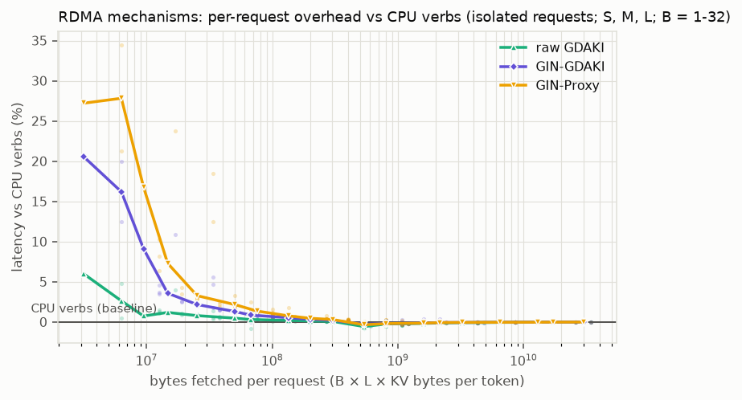

# Remote KV cache for HSTU inference over RDMA: results

Study report, 25 November 2026. Plan and design: `hstu-kv-rdma-study.md`. Code: `examples/hstu-poc` in
recsys-examples, branch `hstu-kv-rdma-poc`. Data, scripts and reproduction: Appendix C.

## Summary

The study asked whether an HSTU ranking request should fetch its user's cached history K/V from a remote host-memory
store over RDMA (one 400 Gb/s NIC per H100) or recompute them, and which RDMA mechanism should move them.

- **Fetching wins only for long histories.** Per request, the break-even is ~14k history tokens for config M and
  ~9–10k for config L, at every batch size. Fetch cost is fixed by the NIC (0.68 ms per 1k tokens for M); recompute
  costs about the same per token below the break-even and more above it. This is the upper end of the pre-analysis
  (6.9k–14.8k).
- **Overlapping requests takes fetching to its NIC limit, not beyond it, so the break-even does not move lower.** With
  later requests' transfers running under earlier requests' compute, a fetch server sustains 96–100% of NIC bandwidth
  ÷ KV bytes per user. Within a 100 ms p99 SLO, one GPU fetching serves 0.58× (1k) to 0.99× (16k) of the users that
  recompute serves for M; fetching leads from ~16k for M and ~12.5k for L, by 1.5× at 24k and 2.2× at 32k for M.
- **Fetching frees the GPU, and the two strategies add up.** A fetched request needs 3.6× (1k) to 36× (16k) less GPU
  time than a recomputed one (M). Placed on a GPU already saturated by a recompute job, a fetch server still served
  90% of its NIC limit within the SLO while the recompute job kept 96–98% of its throughput: ~1.55× the users of the
  recompute job alone (M, 4k). The fetch server's latency then depends on getting SMs; keeping 8 SMs free of the other
  job (green context) restores it.
- **Use CPU verbs, or raw GDAKI where CPU cores are scarce.** All four mechanisms reach line rate and serve identical
  capacity. They differ only on requests under ~3 ms (overhead vs CPU verbs: raw GDAKI ≤ 6%, GIN-GDAKI ≤ 21%,
  GIN-Proxy ≤ 34%) and in CPU use (CPU verbs up to one core per GPU, GIN-Proxy one core always, GDAKI none). On a busy
  GPU they behave the same.
- **A lower break-even needs more bandwidth per GPU or fewer bytes per user**: a 1.5× faster NIC would bring it to
  5k or less for M and a 2× faster one below 0.5k (estimate); FP8 K/V would halve the bytes. Kernel-level tuning of the wait
  for fetched data (PDL, early release of the waiting kernel's SMs) gains nothing measurable, and writing new K/V back
  to the store adds no latency.

## 1. Question and expectations

**The request.** HSTU ranks C candidate items for one user from the user's history of L tokens. Each layer projects
every token into U, V, Q and K and runs causal attention; the output is one score per candidate (here C = 256).
Without a cache, every request recomputes the history through all layers: the dense work grows with L, the attention
with L². With a KV cache, the history's K and V for every layer are kept from an earlier request, and a request
computes only its candidates, which attend to the cached history.

**The question.** If the cache lives in a remote store (host memory of another node), is fetching a user's K/V over
RDMA faster or cheaper than recomputing them, and which RDMA mechanism should move them?
- Fetching costs NIC time: the user's KV bytes ÷ NIC bandwidth (49.4 GB/s per GPU here), plus computing the
  candidates.
- Recomputing costs GPU time: the history's FLOPs ÷ (η × 989 TFLOPS), where η is the achieved fraction of BF16 peak.

**Pre-analysis** (study doc §4, config M). Fetching takes 0.68 ms per 1k history tokens. Recomputing takes
0.5–0.8 ms per 1k tokens at η = 30–50% up to ~8k tokens, and more beyond (attention is quadratic). The predicted
break-even was **6.9k tokens at η = 30% to 14.8k at η = 50%**, with fetching ahead by a growing margin above it. For
MB-sized transfers the RDMA mechanism was not expected to change the transfer time; mechanisms were expected to differ
in per-request overhead, CPU cost and behaviour on a busy GPU.

**What was measured**
1. The cost of one request, recompute vs remote fetch, over history length × batch size, and the break-even (§3.1).
2. Serving capacity within a latency SLO, each strategy on its own with consecutive requests overlapped as far as
   the hardware allows (§3.2), and with the GPU shared with another job (§3.3).
3. The four RDMA mechanisms against each other (§3.4) and kernel-level ways to wait for fetched data (§3.5).
4. Writing new K/V back to the store (§3.6) and all eight GPUs of a node fetching at once (§3.7).

## 2. Setup

### 2.1 Platform

Eos: two DGX H100 nodes, each with 8 × H100 80 GB and 8 × ConnectX-7 NDR 400 Gb/s NICs (GPU k uses NIC k); driver
535.129.03 with CUDA 13.3 forward compatibility, NGC PyTorch 26.07, NCCL 2.32.7 built from source, FBGEMM's HSTU
attention (Hopper kernel, BF16). Node A runs inference; node B holds the KV store in host memory (its GPUs are idle).
Unless stated otherwise, one GPU, its NIC and one store process are used. One NIC delivers 49.4 GB/s of RDMA reads.

### 2.2 Model configurations

| Config | Layers | Hidden | Heads × head dim | Parameters (layers) | Dense FLOPs per token | KV bytes per token (all layers) |
|---|---|---|---|---|---|---|
| S | 3 | 512 | 4 × 128 | 4 M | 8 M | 6 KiB |
| M | 8 | 1024 | 4 × 256 | 42 M | 84 M | 32 KiB |
| L | 8 | 2048 | 8 × 256 | 168 M | 336 M | 64 KiB |

M is the main configuration. L is M at twice the width: 4× the dense compute per token but only 2× the KV bytes. S is
a small reference. All runs use 256 candidates per user, BF16 and random weights (timing does not depend on the
weights).

### 2.3 Strategies and RDMA mechanisms

- **Recompute** (the baseline): no cache; the request processes the history and the candidates.
- **Remote fetch**: the history's K/V are read from the store over RDMA into GPU memory, then only the candidates are
  computed. Four mechanisms:

| Mechanism | Who posts the RDMA reads | Who sees completion | CPU use | Needs an SM to start a transfer |
|---|---|---|---|---|
| CPU verbs (RDMA baseline) | a CPU worker thread (ibverbs) | the worker polls the completion queue and sets per-layer flags in host memory | one core while transfers run | no |
| raw GDAKI | a GPU kernel (DOCA GPUNetIO) rings the NIC doorbell | a GPU kernel polls the completion queue | none | yes |
| GIN-GDAKI | a GPU kernel (NCCL device API) | a GPU kernel | none | yes |
| GIN-Proxy | a GPU kernel hands requests to NCCL's proxy thread, which posts them | the proxy thread | one core at all times | yes |

- **Local hit** (reference only): the K/V are already in GPU memory. This is the cost of the candidates alone, a lower
  bound, not a competitor.

### 2.4 How a remote fetch proceeds

The fetch is posted all at once and consumed layer by layer. When a request starts, the reads of every layer are
posted in layer order, each layer's K and V spread over 4 queue pairs. Before layer l's attention, a 1-thread wait
kernel blocks until layer l's K/V have landed, and only those (it polls the completion queue for raw GDAKI, NCCL's
completion counters for GIN, and a host-mapped flag set by the CPU worker for CPU verbs). Later layers keep
transferring while earlier layers compute, so a transfer-bound request takes its transfer time plus about one
layer's compute. Each request is one CUDA graph.

### 2.5 Batch size and the two measurement modes

- **Isolated requests** (§3.1, §3.4–3.6) measure the cost of one forward pass. A request is a batch of B users
  processed together, each with history L and 256 candidates. A grid point fixes B and L and replays that request
  10–300 times, one at a time, with nothing else running; the result is the mean latency (mean and median differ by
  less than 0.6% at 95% of the points and at most 1.9%). The **cost per user is latency ÷ B**. B stands for how many users a server
  has batched: batching helps recompute (the GPU fills up) but not fetching (the bytes grow with B).
- **Serving** (§3.2, §3.3) measures throughput. Requests are single users arriving as an open-loop Poisson stream at a
  fixed rate; the server forms its own batches (B varies from batch to batch) and overlaps consecutive requests.
  Latency runs from arrival to output, queueing included. A load point **meets the SLO** when the p99 latency is at
  most 100 ms (about 10× the time of one M request at 16k), at least 99% of requests finish within 100 ms with correct
  data, and at least 90% of the offered rate is achieved. **Capacity** is the highest offered load (users/s per GPU)
  that meets the SLO.

## 3. Results

### 3.1 Per-request cost and the break-even

*Per-user cost (request latency ÷ B) of single-user requests (solid) and of batches of 16 (dashed). Remote fetch
uses the fastest mechanism at each point. Local hit (grey) is the candidates' compute alone, for reference.*

- **Fetch cost is set by the NIC and does not fall with batching**: 0.68 ms per 1k history tokens for M and 1.36 ms
  for L, at any B.
- **Recompute gets cheaper per user with batching** as the GPU fills up: M at 1k costs 0.77 ms for one user but
  0.43 ms per user in a batch of 16. Its efficiency rises with history length (attention's share) from 18% of BF16
  peak (M, 1k, B = 1) to 51–58% at 16k–32k.
- **The two cross where attention dominates recompute**, at nearly the same history length for every B:

*Recompute latency ÷ fetch latency per (L, B): red, recompute is faster; blue, fetch is faster. Dots: latency
break-even per batch size. Dashed line: throughput break-even, where fetch's ceiling (NIC rate ÷ KV bytes per user)
equals recompute's ceiling (its best batch size).*

| Config | Latency break-even (B = 1 … 32) | Throughput break-even |
|---|---|---|
| S | 12.9k – 15.0k | 12.7k |
| M | 14.0k – 14.4k | 14.4k |
| L | 9.0k – 9.6k | 9.6k |

- **M lands at the upper end of the pre-analysis** (14.8k predicted at η = 50%; measured η is 45–52% at 12k–16k).
  Near the break-even the cost ratio changes by only ~4% per 1k tokens, so a 10% change in recompute speed (the
  largest difference between this grid and the serving runs, at 16k) moves it by ~2.5k tokens.
- **L breaks even ~5k tokens earlier than M**: its dense compute per token is 4× M's, its KV bytes only 2×. Recompute
  does not become 4× slower because L's larger GEMMs run more efficiently (η = 35% vs 18% at 1k, B = 1).
- **Above the break-even, fetch's lead grows with L**: at 32k and B = 1, fetch is 1.6× faster for M (22.5 vs
  36.4 ms) and 1.8× for L (44.2 vs 79.6 ms).
- **The break-even is very sensitive to bandwidth per GPU.** Below it, fetch and recompute cost about the same per
  token (M: 0.68 vs 0.4–0.8 ms per 1k tokens). Scaling only the transfer part of the measurements, a NIC 1.5× faster
  (~600 Gb/s) moves the break-even to 4–5k for M (B ≥ 4) and below 0.5k for L; 2× (800 Gb/s) below 0.5k for all
  three (estimate).

### 3.2 Serving capacity with requests overlapped

**How each server overlaps requests** (details in Appendix A):
- *Fetch*: a request's transfer is posted as soon as the request arrives, into a ring of per-request KV slots in GPU
  memory, so the NIC streams requests back to back while the GPU computes earlier ones. The GPU runs batches of the
  requests whose data have landed; when it is idle, the oldest request starts at once and its per-layer waits overlap
  its own transfer.
- *Recompute*: dynamic batching (the largest power-of-two batch whose compute fits in half the SLO) or one request at
  a time, whichever serves more at that history length.
- Both keep up to two batches queued on the GPU, so the GPU does not wait for the CPU between batches.

**What overlap can and cannot do.** No schedule serves more than a strategy's ceiling: for fetch, NIC bandwidth ÷ KV
bytes per user (M: 1,472 users/s at 1k, 92 at 16k); for recompute, its compute rate at the best batch size (M: 2,527
at 1k, 94 at 16k). Overlap only brings a server close to its ceiling, so the throughput break-even, where the two
ceilings cross (§3.1), is the best any schedule can reach.

*Users/s per GPU within the SLO (p99 ≤ 100 ms) per history length; dashed lines: the ceilings. Raw GDAKI and
GIN-GDAKI served exactly the capacity of CPU verbs at every point where they were measured (Appendix C).*

- **Fetch runs at its NIC ceiling up to medium histories**: 96–100% of it at 1k–4k for M and 1k–2k for L. The compute
  of earlier requests is hidden behind later transfers.
- **Recompute serves more users up to ~16k for M and ~12k for L.** Capacity of fetch ÷ recompute:

| History | 1k | 2k | 4k | 8k | 12k | 16k | 24k | 32k |
|---|---|---|---|---|---|---|---|---|
| M | 0.58 | 0.60 | 0.66 | 0.78 | 0.93 | 0.99 | 1.49 | 2.19 |
| L | 0.83 | 0.80 | 0.74 | 0.84 | 0.95 | 1.37 | – | – |

- **At long histories the SLO, not the ceiling, limits both servers.** A request then occupies the NIC or the GPU for
  8–36 ms, and with random arrivals the p99 exceeds 100 ms well below the ceiling. Both servers sit on the limit of an
  ideal first-come-first-served queue with the same time per request (figure below): about 80% of the ceiling at
  8 ms per request, 50% at 22 ms and 30% at 36 ms. No schedule can do much better without shorter requests.
- **The SLO break-even is ~16k for M and ~12.5k for L**, above the throughput break-even of §3.1 (14.4k, 9.6k).
  Part of the shift is the GPU: the recompute servers computed 1–10% faster at 8k–16k than the per-request grid did.
  Around the break-even the two strategies are within 7% of each other (M 12k–16k, L 12k), about one load step, which
  is the resolution of these capacities (6% of the ceiling). Beyond it, fetch's shorter requests add to its higher
  ceiling: at 32k, fetching serves 2.2× the users of recompute (M: 22 vs 10 users/s).

*Capacity within the SLO as a share of the ceiling, for every (config, strategy, history length), against the time
one request occupies the bottleneck (1 ÷ ceiling). Dashed: the same share for an ideal first-come-first-served queue
with Poisson arrivals and a fixed time per request (M/D/1, simulated). Points slightly above the curve are sampling
noise of the measured p99.*

- **Fetch needs far less GPU time per user**: 0.11–0.49 ms vs 0.40–36 ms for recompute (M, 1k–32k, compute at the
  best batch size), i.e. 3.6× less at 1k, 11× at 4k and 36× at 16k (L: 4.1× to 42×). At capacity the fetch server's
  GPU is mostly idle; §3.3 uses that idle time.
- **CPU**: CPU verbs used 0.5–1.0 core at capacity (it tracks NIC utilization); raw GDAKI and GIN-GDAKI used none.
- **Correctness**: every 8th fetched batch's newest request was compared with the store's data pattern (94,173
  batches, 0 mismatches), and the ring's re-pointed graphs are bit-identical to a plain forward.

*p99 latency against offered load at 4k and 16k. Each point is one Poisson sample of 5–45 s (a few hundred to
12,000 requests), so near saturation the p99 of neighbouring points can differ by tens of ms.*

### 3.3 Serving on a shared GPU

At its capacity the fetch server leaves most of the GPU idle (§3.2). This experiment fills that idle time with
another job and measures what each side loses. A co-located recompute job (M, 4k, batches of 8 users, 13.5 ms per
batch, 560 users/s alone) runs back to back on its own stream. Next to it, the fetch server (M, 4k or 16k) serves 50%,
75% and 90% of its ceiling. Four conditions: alone; shared; shared with the fetch server on high-priority streams; and
shared with the co-located job confined to a green context of 124 SMs, which leaves 8 SMs to the fetch server.

*p99 latency of the fetch server against its offered load; CPU verbs (blue) and raw GDAKI (green) overlap in every
condition.*

- **The two jobs add up.** At 4k the fetch server still serves 90% of its NIC ceiling (331 users/s) within the SLO,
  while the co-located job keeps 96–98% of its throughput. The GPU and its NIC then serve ~1.55× the users of the
  recompute job alone.
- **The fetch server's latency rises because of compute, not posting.** Sharing raises its p50 at 4k from 3 to 38 ms
  (p99 at 50% load: 11 → 54 ms). At 16k it meets the SLO at 50% load but no longer at 75% (p99 112 ms). Its kernels
  wait for SMs held by the other job's kernels; the transfers are not affected. CPU verbs, which needs no SM to post,
  behaves exactly like raw GDAKI.
- **Stream priority does not help** (identical results): priority orders thread blocks that wait to launch but does
  not preempt running ones.
- **Partitioning the SMs does.** With the co-located job in a 124-SM green context, the fetch server's latency at 16k
  equals its unshared latency, and at 4k it is close (p99 17 / 28 / 56 ms at 50 / 75 / 90% load, vs 11 / 20 / 47 alone
  and 53 / 61 / 87 shared). The co-located job runs 3% slower in its partition and keeps 96–99% of that rate while
  sharing.

### 3.4 RDMA mechanisms compared (CPU verbs as the baseline)

**Bandwidth and capacity.** All four mechanisms reach the NIC limit (49.3–49.4 GB/s) on KV-sized transfers. Request
latencies agree within 1% above ~3 ms per request, and CPU verbs, raw GDAKI and GIN-GDAKI served identical capacities
at every serving point (§3.2; GIN-Proxy was not run in serving).

*Request latency relative to CPU verbs at the same (config, L, B), against the bytes the request fetches. Dots:
grid points; lines: medians.*

**Per-request overhead.** CPU verbs is the fastest on small requests: its worker posts the reads before the
request's graph is launched, so no kernel has to run first. Relative to it, raw GDAKI is at most 6% slower,
GIN-GDAKI 21% and GIN-Proxy 34% (S, 0.5k, B = 1: 0.193 / 0.204 / 0.232 / 0.245 ms). Of the 144 grid points where all
four were measured, 35 differ by more than 1%, all of them requests under 2.9 ms. GIN's extra time is its per-layer
wait kernel, which checks four contexts; folding the wait into the attention kernel recovers 5–10 points of it (§3.5).

**CPU cost.** The GDAKI mechanisms use no CPU core (GIN-GDAKI with `NCCL_RMA_DISABLE=1`; otherwise NCCL's host-RMA
progress thread spins a core). CPU verbs keeps its worker busy while transfers are in flight: 0.5–1.0 core per GPU at
serving capacity, in proportion to NIC utilization. GIN-Proxy's proxy thread keeps a core busy at any load.

**Busy GPU and node scale.** On a GPU shared with another job, CPU verbs and raw GDAKI behave identically (§3.3).
With all eight GPUs fetching, CPU verbs and raw GDAKI reach line rate on every NIC; GIN on Eos does not, because of
how the driver places the host memory of NCCL windows (§3.7).

**Choice of mechanism**

| Situation | Mechanism |
|---|---|
| A CPU core per GPU is available | **CPU verbs**: fastest on small requests, no SM, no NCCL constraints |
| CPU cores are scarce | **raw GDAKI**: no CPU, at most 6% slower on requests under 3 ms |
| Integration with NCCL matters | **GIN-GDAKI** with `NCCL_RMA_DISABLE=1`: no CPU, up to 21% slower on small requests; host-memory windows need correct NUMA placement at node scale |
| – | Not GIN-Proxy: a core always busy and the slowest on small requests |

### 3.5 Waiting for fetched data inside the forward

Each layer's attention must not read K/V before they have landed. Four variants were compared; all gave bit-identical
outputs in a slow-producer test (posting delayed by 2 ms):
- **Wait kernel** (default): a 1-thread kernel before each layer's attention spins until the layer's transfer is
  complete; the stock FBGEMM attention follows.
- **PDL**: the attention kernel (a copy of FBGEMM's) is launched with programmatic dependent launch after the wait
  kernel, which triggers it on entry. The attention's launch and prologue overlap the wait; it blocks in
  `griddepcontrol.wait` before its first K/V load.
- **PDL with early release**: the first kernel only triggers the dependent launch and exits, freeing its CTA and SM at
  once. The attention kernel, launched with PDL, takes over the data dependency: it spins on a per-layer ready flag
  (published by a 1-thread poller on a side stream) before its first K/V load.
- **Fused**: no per-layer kernel at all; the attention kernel spins on the ready flag (same poller).

| Change of mean request latency vs the wait kernel | raw GDAKI | GIN-GDAKI | CPU verbs |
|---|---|---|---|
| PDL | +0.0 … +0.7% | +0.0 … +0.8% | −0.3 … +0.8% |
| PDL, early release | +0.0 … +2.9% | −7.6 … +0.6% | −0.8 … +1.5% |
| Fused | −1.9 … +0.2% | −10.4 … +0.7% | −3.6 … +0.0% |
| CUDA graph off (every kernel launched by the CPU) | up to +162% (+0.35–0.40 ms) | up to +147% | – |

*S, M and L × 0.5k–4k × B = 1 and 4. The extremes are at L ≤ 1k with B = 1; every other point is within ±0.8%.*

- **The data dependency dominates.** A transfer-bound request waits for its last layer's data whatever the launch
  order, so kernel-boundary techniques can only save microseconds per layer.
- **Early release does not pay here because the first kernel does no work.** PDL hides a kernel's launch behind the
  tail of a long-running predecessor; here the predecessor is a trivial trigger, so the extra kernel costs more than
  it hides. The attention also cannot load K/V before the kernels ahead of it have written the candidates' rows.
- **Removing the per-layer kernels (fused) is the only measurable gain**, largest for GIN-GDAKI (−5 to −10% on
  requests under 1 ms). CUDA graphs are essential for small requests.

### 3.6 Writing new K/V back

A request whose user has a cached prefix of P tokens computes S new history tokens plus the candidates and writes the
new tokens' K/V to the store. Each layer's new rows are written as soon as the layer has produced them (GPU-initiated
puts on a side stream, or the CPU worker when the GPU flags the layer). **Durable time** runs from the request's start
until a write-then-read fence on every queue pair has returned. Grid: M, B = 1/2/4/8 × P = 0–16k × S = 256–8k; every
written range was read back and compared (0 mismatched bytes).

- **Writes add no latency**: with and without them, latency differs by −5.6% … +4.5% (median +0.45%), i.e. noise.
- **They complete after the output, by an amount that grows with the bytes written and shrinks with the prefix**
  (more attention per new token to hide behind): at most 0.1 ms for S = 256 at any B and P; at most 0.7 ms at B = 1;
  at B = 8 and S = 8k, 10.8 ms for a new user and 4.3 ms with a 16k prefix.
- **Large writes run at NIC speed**: 2 GiB are durable after 46 ms (46.5–47.1 GB/s).
- The mechanisms tie within ~3%. GPU-initiated writes cost 0.04–0.35 ms of CPU per request; CPU verbs and GIN-Proxy
  keep a core busy while writing.
- A design that must make the new K/V durable before returning the output (so that the user's next request can read
  them at once) pays the durable time instead of the latency.

### 3.7 Node scale (8 GPUs at once)

With all eight GPU–NIC pairs fetching from one store node, CPU verbs and raw GDAKI reach 394 GB/s per node (line rate
on every pair). Served by the earlier batch-at-a-time server (Appendix A), they reached 2,587 / 357 users/s per node
at 4k / 16k (M), 7.2× / 7.9× that server's one-GPU capacity. On Eos, GIN-GDAKI and GIN-Proxy reach only ~230 GB/s
per node (962 / 123 users/s). The cause is page placement, not GIN: the driver puts
every `cuMemCreate(HOST_NUMA)` allocation, which NCCL requires for host-memory windows, on NUMA node 0, so the four
NICs of socket 1 read across the inter-socket link. Raw GDAKI with its store forced onto node 0 reproduces the same
~229 GB/s, and GIN windows in GPU memory reach line rate.

## 4. Conclusions

1. **With one 400 Gb/s NIC per GPU, recompute is the better choice below ~14k history tokens for M and ~9–10k for
   L; above that, fetching is.** This holds per request at every batch size and for throughput. Under a 100 ms p99
   SLO the break-even sits slightly higher (~16k for M, ~12.5k for L), and above it fetching's lead grows quickly
   (M: 2.2× at 32k).
2. **Cross-request overlap is necessary but cannot lower the break-even.** It is what lets a fetch server run at NIC
   line rate, and at long histories both servers are close to the queueing limit of a first-come-first-served
   server. The NIC's bytes per second per user are the hard limit for fetching.
3. **The value of RDMA below the break-even is the GPU time it frees.** A fetched request costs 4–36× less GPU time
   (M, 1k–16k), and fetch and recompute are limited by different resources: on one GPU, a fetch server added 331
   users/s (M, 4k) to a saturated recompute job at a 2–4% cost to that job. The case for RDMA is therefore a hybrid
   server that fetches as many users as the NIC carries and recomputes the rest, rather than fetching instead of
   recomputing.
4. **The RDMA mechanism matters little for throughput.** Use CPU verbs where a CPU core per GPU is available and raw
   GDAKI where it is not; GIN-GDAKI when NCCL integration is worth up to 21% on small requests. Avoid GIN-Proxy.
5. **A GPU shared with other work needs SM isolation to keep the fetch server's latency** (a green context),
   whichever mechanism is used.

## 5. Next steps

- **Hybrid server (P7):** one scheduler that sends each request, or each layer, to fetch or recompute by history
  length and load, to turn the additive capacity of §3.3 into a serving result; M and L with more layers.
- **Fewer bytes per user:** FP8 or otherwise compressed K/V (half the bytes acts like a 2× faster NIC on transfer).
- **More bandwidth per GPU:** two NICs per GPU (e.g. borrowing a neighbour's idle NIC) or 800 Gb/s NICs.
- **In-kernel wait** (the fused variant) for GIN-GDAKI if requests under 1 ms matter.
- **Paged KV and realistic traffic** (mixed history lengths, cache misses; P8) and a remote GPU-memory store (P9).

## Appendix A. Implementation

The POC is `examples/hstu-poc` in recsys-examples (branch `hstu-kv-rdma-poc`); its README lists every file.

- **Model** (`hstu_poc/model.py`): the repository's HSTU layer math with random weights and FBGEMM's Hopper attention
  kernel. `forward_full` recomputes; `forward_cached` takes the history's K/V, computes the candidates and calls a
  per-layer hook before each attention (the wait for fetched data).
- **Transports** (`csrc/`): CPU verbs (RC queue pairs, a worker thread, per-layer host-mapped flags); raw GDAKI (DOCA
  GPUNetIO from NCCL's bundled copy, GPU-side queue pairs, tickets per layer and queue pair); GIN-GDAKI and GIN-Proxy
  (NCCL 2.32.7 device API, 4 read contexts, `NCCL_RMA_DISABLE=1`). The store is plain host memory bound to the NIC's
  NUMA node (CPU verbs, raw GDAKI) or an NCCL host-memory window (GIN).
- **Serving** (`hstu_poc/serving2.py`, driver `bench/p5s.py`):
  - *Remote fetch*: a ring of per-request KV slots in GPU memory. A request's transfer (all layers, each K and V block
    split over the four queue pairs) is posted as soon as the request gets a slot, so the NIC serves requests in
    arrival order while earlier ones compute. A compute batch takes the oldest posted requests whose data have landed
    or will have by the time the GPU starts them (a first-in, first-out model of the NIC); with the GPU idle, the
    oldest request starts at once and its per-layer waits overlap its own transfer. One CUDA graph per batch size
    serves any run of consecutive slots: the attention's K/V tensor is the whole ring, and the batch's
    `cu_seqlens_k`, the candidates' row indices and the request to wait for are rewritten in device memory before
    each replay. A self-test checks that the output is bit-identical to a plain forward. Completion is in order per
    queue pair, so waiting for the batch's newest request covers the older ones. Posting per request matters at long
    histories: a server that fetched whole batches into two alternating regions reached 45–60 users/s at M, 16k.
  - *Recompute*: dynamic batching to the largest power-of-two batch that computes within half the SLO, or strictly
    one request at a time; the better policy is reported per history length.
  - *Both*: up to two batches queued on the GPU, the next one formed just before the GPU frees up; every graph is
    replayed once before serving; every 8th fetched batch's newest request is compared with the store's data pattern
    on a side stream.
- **Isolated-request grid** (`bench/grid.py`, `bench/p2.py`, `bench/p3.py`): one CUDA graph per grid point, requests
  replayed one at a time, GPU-event timing, fetched rows compared with the store's pattern after each point.

## Appendix B. Platform notes (Eos)

- NCCL's host-RMA progress thread spins a CPU core unless `NCCL_RMA_DISABLE=1`; with it, GIN-GDAKI uses no CPU.
- NCCL 2.32.7 requires GIN windows of identical size on every rank.
- GIN reads need at least 4 contexts (queue pairs) for line rate when several large reads queue per context; one
  context caps RDMA reads at ~42 GB/s.
- `cuMemCreate(CU_MEM_LOCATION_TYPE_HOST_NUMA, id = 1)` allocates on node 0 with driver 535.129.03 + CUDA 13.3
  forward compatibility (memory policy and CPU affinity do not change it); `mmap` + `mbind` and `cudaHostAlloc` place
  pages correctly. Probe: `tools/numa_check.cu`.
- No dma-buf on Eos; DOCA falls back to `nvidia_peermem` (the `Failed to create UMEM with DMABUF` lines are harmless).
- Green contexts work, with 8-SM partition granularity on H100. A CUDA graph runs in the context it was captured in:
  to confine a job, capture its graphs on the green context's stream.
- One server's CUDA graphs must not be torn down while another server captures graphs in the same process: when
  Python's cycle collector freed an old server mid-capture, a later first launch faulted (Xid 31 with no kernel
  running). The servers are closed explicitly, every graph is replayed once before serving, and each benchmark
  process builds one server.
- The kernel log is root-only on compute nodes; GPU core dumps (`tools/gpu_core_wrap3.sh`) are the debugging route.

## Appendix C. Data and reproduction

All paths are in the study folder on Eos (`/lustre/fsw/coreai_devtech_all/junyiq/hstu-kv-rdma`); the analysis
scripts are also in the POC's `tools/`.

| What | Result rows | Campaign script | Figure / table script |
|---|---|---|---|
| Per-request grid and break-even (S, M, L; every mechanism, recompute, local hit) | `results/p2c/` | `tools/p2c_grid.sh` | `tools/report_figs.py`, `tools/p2c_breakeven.py` |
| Serving capacity, each strategy alone | `results/p5s/` (`fine_*`: fine load grid at 12k+) | `tools/p5s_runs.sh`, `p5s_runs2.sh`, `p5s_fine.sh` | `tools/p5s_report.py` |
| Serving on a shared GPU | `results/p6s/` | `tools/p6s_runs.sh`, `p6s_prio.sh`, `p6s_green4k.sh` | `tools/p6s_report.py` |
| Writes | `results/p3b/` | `tools/p3_grid2.sh` | `tools/p3_report.py` |
| Waits inside the forward (PDL, early release, fused) | `results/p4c/`, `results/p4b/` | `tools/p4c_grid.sh` | – |
| Node scale | `results/p2/eight_*`, `results/p5b/eight_*` | `tools/p5_runs.sh` | `tools/p5_eight.py` |
| Micro-benchmarks (bandwidth, latency) | `logs/p0/` | `tools/p0.sh` | – |

`tools/make_figs.sh` regenerates every figure from the rows inside the PyTorch container (matplotlib); each report
script prints its tables with `--md`. `results/p2c/` also holds rows of a parked 16-layer configuration (D), and
`results/p2c/superseded/` rows that are not used.

**Serving capacity of every mechanism (coarse load grid; users/s within the SLO, 1 GPU)**

| Config | Mechanism | 1k | 2k | 4k | 8k | 12k | 16k |
|---|---|---|---|---|---|---|---|
| M | CPU verbs | 1,413 | 736 | 353 | 155 | 103 | 66 |
| M | raw GDAKI | 1,413 | 736 | 353 | 155 | 103 | 66 |
| M | GIN-GDAKI | 1,413 | 736 | 353 | 155 | 103 | 66 |
| L | CPU verbs | 736 | 353 | 155 | 66 | 40 | 18 |
| L | raw GDAKI | 736 | 353 | 155 | 66 | 40 | 18 |
| L | GIN-GDAKI | 736 | 353 | 155 | 66 | 40 | 18 |

The coarse grid (load steps of 3–15% of the ceiling, 5–15 s per point) compares the mechanisms. At 12k and longer
the main text uses a finer grid (6% steps, up to 45 s per point) for CPU verbs and recompute, which gives L 33 / 22
users/s at 12k / 16k instead of 40 / 18.
