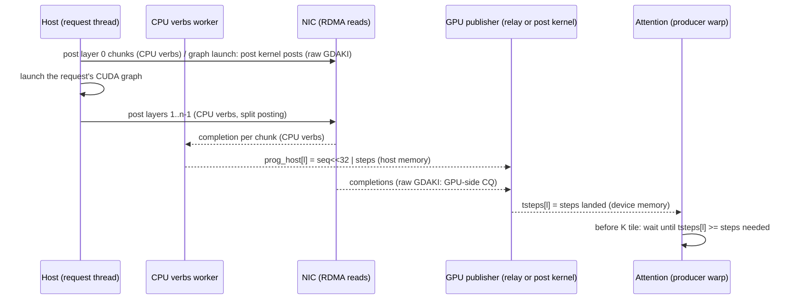
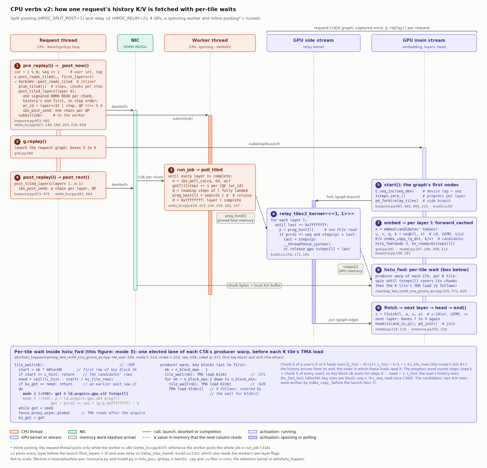
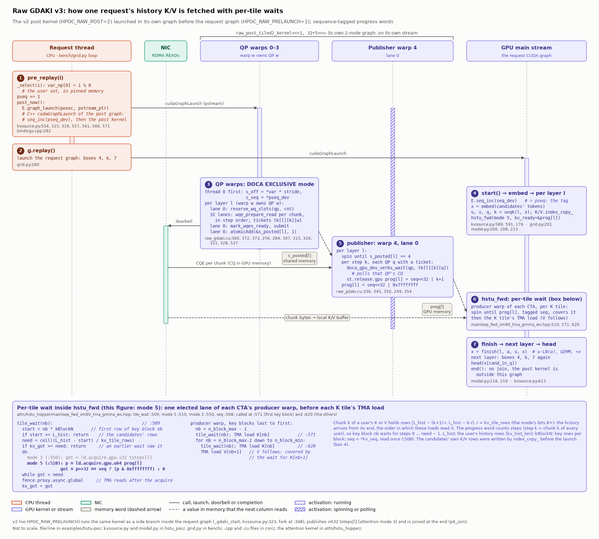

# Per-tile waits: a code walkthrough

How a request's history K/V travels from the remote store into the attention with per-tile waits, for the two fastest
mechanisms (CPU verbs and raw GDAKI) and, briefly, GIN. File and line links are to this POC (`examples/hstu-poc`).
Results are in [results.md](results.md) (§4.2) and [sol.md](sol.md) (timelines, the v2 and v3 options).

## 1. The idea in one paragraph

Without per-tile waits, layer l's attention starts only once all of layer l's history has landed. With them, the
history of every layer is read in **chunks of `tile_rows` rows (128 by default) from the history's end backwards**,
and the attention kernel, which consumes key blocks last to first, checks before each K tile load whether the chunks
covering that tile have landed. A layer's attention therefore runs while its history is still arriving, and only the
work on the last chunk remains after the last byte. Everything below is about three questions: who posts the chunk
reads, who learns that a step of chunks has landed, and how the attention learns it.

Rendered sequence diagrams of one request, at the level of kernels and calls with file:line references:
[CPU verbs v2](figs/per-tile-verbs.png) (§4) and [raw GDAKI v3](figs/per-tile-raw.png) (§5).

## 2. The plan: segments, chunks and steps

- [`RemoteKV.setup`](../hstu_poc/kvsource.py#L249) builds, per request variant, the **segment table**: per layer, per
  user, one K and one V segment `[remote offset, local offset, bytes, user]` ([line 276](../hstu_poc/kvsource.py#L276)).
  User u's history of layer l is two contiguous byte ranges, locally rows `[k_off[u], k_off[u] + L_u)` of the layer's
  K and V buffers, remotely the user's slot in the store.
- [`RemoteKV._tile_setup`](../hstu_poc/kvsource.py#L301) picks the chunk size: `tile_rows` = max(128, enough rows that
  the request posts at most `max_tile_wrs = 2048` reads), rounded up to 64; `tile_bytes = tile_rows × H × d × 2`;
  `tile_steps = ceil(max L / tile_rows)`.
- **Step k of layer l** is chunk k of every segment of the layer, counted from the segment's end: bytes
  `[len − (k+1)·tile_bytes, len − k·tile_bytes)`. Step k therefore holds history rows
  `[L − (k+1)·tile_rows, L − k·tile_rows)` of every user, K and V. Progress is published per layer as "steps 0 … s−1
  have landed on every queue pair", one integer per layer, `tsteps[l]` (0x7fffffff once the layer is complete).

## 3. The attention side (common to every mechanism)

- [`P4._p4_attn`](../hstu_poc/kvsource.py#L166) launches the copied FBGEMM Hopper kernel
  ([attn_ext.hstu_fwd](../hstu_poc/attn_ext.py)) with `kv_ready = &tsteps[l]` and
  `mode = 3 | tile_rows << 8` (`HPOC_DIRECT=1`, CPU verbs only: mode 4, see §7).
- In the kernel's producer warp,
  [`tile_wait`](../attn/hstu_hopper/mainloop_fwd_sm90_tma_gmma_ws.hpp#L509) runs before each K tile load
  ([first tile](../attn/hstu_hopper/mainloop_fwd_sm90_tma_gmma_ws.hpp#L571),
  [next tiles](../attn/hstu_hopper/mainloop_fwd_sm90_tma_gmma_ws.hpp#L620)). For a key block starting at row `start`
  of the user's sequence ([mode 3](../attn/hstu_hopper/mainloop_fwd_sm90_tma_gmma_ws.hpp#L550)):
  - rows at or past `kv_hist_len` are the candidates' own keys, written by this request: no wait;
  - otherwise `need = ceil((L_u − start) / tile_rows)`: the steps that cover rows `[start, L_u)`. Because key blocks
    are consumed last to first, a block needs every step up to the one holding its first row;
  - the elected lane spins on `ld.acquire.gpu` of `tsteps[l]` until it is at least `need`, then issues
    `fence.proxy.async.global` so the TMA (async proxy) loads that follow see the landed bytes. The value it saw is
    kept in a register, so later tiles it already covers skip the load and the fence (attn_v4; no measurable gain,
    see sol.md §7).
- V tiles are loaded after the K tile of the same block, so the K tile's wait covers them.
- The kernel is launched at once, like the fused wait: launch and prologue overlap the transfer, and CTAs whose query
  rows only see landed tiles never wait.

## 4. CPU verbs

*One request with CPU verbs v2 (split posting, relay v2): who runs what, in order, each step with its file:line; the
bottom box is the attention's per-tile wait (§3). Schematic, not to scale.*

**Posting** (request thread, before and right after the graph launch):
- [`VerbsKVSource.pre_replay`](../hstu_poc/kvsource.py#L453) bumps the request's sequence number and calls
  [`_post_now`](../hstu_poc/kvsource.py#L480) →
  [`VerbsKV::post_reads_tiled`](../csrc/verbs_kv.cpp#L627).
- [`plan_tiled`](../csrc/verbs_kv.cpp#L149) computes, for every layer, the number of steps and the number of chunks per
  step (what the worker will count). [`post_tiled_layers`](../csrc/verbs_kv.cpp#L168) builds one RDMA READ per chunk,
  in step order, `wr_id = layer << 32 | step`, every read signaled, chunks spread round-robin over the 4 queue pairs,
  and posts one chained `ibv_post_send` per layer and queue pair.
- **Inline posting**: when the worker is idle, the request thread posts itself (no hand-off).
- **Split posting** (v2, `HPOC_SPLIT_POST=1`): only layer 0 is posted before the graph launch; the job is handed to the
  worker, which starts polling at once; after `g.replay()` the caller's hook
  [`post_replay`](../hstu_poc/kvsource.py#L473) → [`VerbsKV::post_rest`](../csrc/verbs_kv.cpp#L661) posts layers
  1…n−1 from the request thread ([grid.py](../bench/grid.py#L261)). Only for graph replays: an eager forward can block
  the host before a later layer's launch, so eager runs post everything up front
  ([`eager`](../bench/grid.py#L229)).

**Completion** (the worker thread, spinning on its own core):
- [`poll_tiled`](../csrc/verbs_kv.cpp#L234) polls the CQ (64 completions per call), counts completions per
  (layer, step), and whenever the contiguous prefix of complete steps of a layer grows, stores
  `prog_host[l] = seq << 32 | steps` into pinned, GPU-mapped host memory; a complete layer is stored as 0x7fffffff
  ([line 246](../csrc/verbs_kv.cpp#L246)) and its basic flag `flags[l] = seq` is set as well
  ([line 252](../csrc/verbs_kv.cpp#L252)).

**GPU side of the graph** ([`VerbsKVSource.start`](../hstu_poc/kvsource.py#L487)):
- `seq_inc` ([kernel](../csrc/kvutil.cu#L92)) bumps the device copy of the sequence number;
- `tsteps.zero_()` resets the device progress words;
- on a side branch ([`p4_fork`](../hstu_poc/kvsource.py#L213), stream from
  [`side_stream`](../hstu_poc/kvsource.py#L18)), a 1-thread relay kernel copies the host progress into `tsteps[l]`:
  [v1](../csrc/kvutil.cu#L131) reads the layer's flag and its progress word (two PCIe reads per poll),
  [v2](../csrc/kvutil.cu#L158) (`HPOC_RELAY=2`) reads only the progress word, which marks a complete layer. On each
  new value: `__threadfence_system()`, then `st.release.gpu` of `tsteps[l]`;
- the main branch runs the forward; each layer's attention spins in `tile_wait` (§3); `end()` joins the side branch.

## 5. Raw GDAKI (DOCA GPUNetIO, no CPU)

**Posting and completion in one kernel**, launched on a side branch at the start of the graph
([`_gdaki_start`](../hstu_poc/kvsource.py#L323) → [`RawGdakiSource.post`](../hstu_poc/kvsource.py#L599) →
[`RawGdaki::post_gets_tiled`](../csrc/raw_gdaki.cu#L521)). The request's segment table index is read from pinned host
memory (zero-copy descriptor), so no per-request copy precedes it.

- [v1, `raw_post_tiled_kernel`](../csrc/raw_gdaki.cu#L142): one warp per queue pair. Per layer, the warp counts its
  chunks (chunk of segment j at step k goes to QP `(j + k) mod 4`), lane 0 reserves that many WQE slots, the 32 lanes
  write the WQEs in step order ([line 197](../csrc/raw_gdaki.cu#L197)), and each step's ticket (its last WQE on this
  QP + 1) is recorded; lane 0 marks the WQEs ready and rings one doorbell per layer and QP. After **all** layers are
  posted, thread 0 waits for the tickets in (layer, step, QP) order and publishes `tsteps[l]`
  ([line 226](../csrc/raw_gdaki.cu#L226)).
- [v2, `raw_tiled_request`](../csrc/raw_gdaki.cu#L256), launched as
  [`raw_post_tiled2_kernel`](../csrc/raw_gdaki.cu#L360) (`HPOC_RAW_POST=2`):
  - DOCA's **EXCLUSIVE** sharing mode: each QP is owned by one warp for the whole request, so reserve, mark-ready and
    submit use plain loads and stores instead of the GPU-mode lock, CAS and atomics
    ([reserve](../csrc/raw_gdaki.cu#L284), [mark ready](../csrc/raw_gdaki.cu#L320)), and the slot availability check
    is skipped (the previous request's reads were completed and polled first). Posting a layer: ~7.5 → ~2.8 µs.
  - a **separate publisher warp** starts publishing layer l as soon as every QP warp has posted it (a per-layer counter
    in shared memory, [increment](../csrc/raw_gdaki.cu#L328), [wait](../csrc/raw_gdaki.cu#L336)), instead of after the
    whole request ([publish](../csrc/raw_gdaki.cu#L350));
  - step tickets are plain stores of the last WQE of each step (no global atomics).
- The publisher lives in the post kernel, which starts with the request, on purpose: a separate polling kernel
  launched after the posts can find every SM occupied by attention CTAs spinning on its progress (B = 32) and never
  run.
- [v3](../hstu_poc/kvsource.py#L561) (`HPOC_RAW_PRELAUNCH=1`, tried): the v2 post kernel leaves the
  request graph. It sits in its own two-node graph (bump a request counter, post), captured once
  ([`capture_post`](../hstu_poc/kvsource.py#L577)) and launched from C++ on its own stream right before
  the request graph ([`graph_launch`](../csrc/bindings.cpp#L282)). It reads the table index from
  pinned memory and publishes sequence-tagged 64-bit progress words (`raw_publish` with `prog`) that the request graph
  never resets; the attention waits on them with
  [mode 5](../attn/hstu_hopper/mainloop_fwd_sm90_tma_gmma_ws.hpp#L510). Result: sol.md §7.

*One request with raw GDAKI v3: the v2 post kernel in its own graph, launched right before the request graph and
publishing sequence-tagged progress (attention mode 5). Schematic, not to scale.*

## 6. GIN (NCCL device API), briefly

[`gin_post_tiled_kernel`](../csrc/gin_kv.cu#L113): a `gin.get` per chunk (context `(j + k) mod n_ctx`), and after each
step a `flushAsync` per context, whose ticket the same kernel waits for before publishing the step. GIN has no
completion counter for reads, so per-step progress costs a flush per step and context: slow with one or two users per
request (§4.2 of results.md).

## 7. What changes per request, and the hazards found

- **Per request**, outside the graph: the user-set variant (CPU verbs: which segment table to post; GDAKI: the
  zero-copy index) and the sequence number. Inside the graph: `seq_inc`, `tsteps.zero_()`, the side-branch publisher
  or post kernel, the forward, the join.
- **Side stream = capture stream** (fixed): PyTorch hands out streams round-robin from a pool of 32 per priority and
  `torch.cuda.graph` captures on a stream of the default-priority pool, so after enough `torch.cuda.Stream()` calls a
  source's side stream can be the capturing stream itself. The side branch is then captured inline: the spinning
  publisher runs before the forward, which starts only after the last byte (seen as +1 ms at M, 8 users, 1k in a run
  that created extra streams; the published grids were not affected, see sol.md §6.3). Side streams now come from the
  high-priority pool ([`side_stream`](../hstu_poc/kvsource.py#L18)), and `p4_fork` asserts that the side stream is not
  the current one.
- **Eager warm-up with split posting**: an eager forward can block the host inside before a later layer is launched;
  with split posting the remaining layers would never be posted. Split posting is therefore used only for graph
  replays.
- **Graph replays run on the current stream**: `CUDAGraph.replay()` ignores the stream the graph was captured on. Replaying
  v3's post graph from the main stream queued it behind the request graph, whose attention waits for it: a deadlock.
  It is now launched with `cudaGraphLaunch` on its own stream.
- **No resident (persistent) post kernel under PyTorch**: `torch.cuda.graph` synchronizes the whole device on entry
  and the caching allocator's `cudaFree` does too, so a kernel that never exits would hang the process; v3 launches an
  ordinary post kernel per request instead.
- **Direct progress (tried, slower)**: `HPOC_DIRECT=1` lets the attention read the worker's host progress word over
  PCIe (`ld.acquire.sys`, mode 4) and drops the relay kernel; the attention became up to 12 µs per layer slower even
  when it never waited (sol.md §7). Not used.

## 8. Correctness checks

- [`bench/p4_check.py`](../bench/p4_check.py): slow producer (posting delayed by 2 ms; with split posting the second
  part 2 ms later still), KV rows zeroed before each request. Every variant must equal the basic implementation bit
  for bit; a variant with no wait must differ. All per-tile variants (v1, v2, raw GDAKI v3, direct, cached progress)
  pass on CPU verbs and raw GDAKI (M, 2 users, 4k; S, 1 user, 1k; L, 1 user, 0.5k).
- Every grid point compares the last request's fetched rows with the store's seeded data pattern (0 mismatches).
