# Remote KV cache for HSTU inference over RDMA: results

Study report, 25 November 2026. Plan and design: `hstu-kv-rdma-study.md`. Code: `examples/hstu-poc` in
recsys-examples, branch `hstu-kv-rdma-poc`. Data, scripts and reproduction: Appendix C.

## Summary

The study asked whether an HSTU ranking request should fetch its user's cached history K/V from a remote host-memory
store over RDMA (one 400 Gb/s NIC per H100) or recompute them, and how fast the RDMA path can be made, for one
request at a time (plain-run latency) and for a server under load (throughput).

- **Fastest RDMA implementation: per-tile waits, posted by CPU verbs with a spinning worker and split inline posting,
  or without a CPU core by raw GDAKI with exclusive, warp-parallel posting, a publisher warp, and its post kernel
  launched just before the request's graph (per-tile v2 and v3).** The history is posted in 128-row chunks from its
  end and the attention waits per K tile, so each layer computes while it is still arriving. Per-tile waits were
  built and measured on all four mechanisms.
  - CPU verbs is the fastest or within noise of it at every grid point except the smallest requests (0.5k–1k
    history, one or two users), where raw GDAKI is up to 3.9% faster.
  - Raw GDAKI per-tile otherwise ties CPU verbs (at 140 of the 142 points beyond 4k history or 8 users) or trails it,
    by up to 3.8% on small S requests (5.7–6% before v2 and v3) and 1.3% on M and L.
  - GIN pays a flush per chunk step and gains from per-tile waits only from four users per request.
  - The fastest is up to 11% (S), 4% (M) and 2.5% (L) faster per request than basic CPU verbs, most for single users;
    above ~1 ms per request every mechanism transfers at line rate.
- **Per-request break-even: ~13–14k history tokens for M and ~9k for L** (S: 10–13k). It is lowest for single users
  (M 12.8k, L 8.5k, S 9.9k) and equals the throughput break-even from B ≈ 8 (M 14.4k, L 9.7k, S 12.8k). The
  optimizations lowered the single-user break-even by 0.5–5k tokens; it is now within 0.3k tokens of what a
  zero-overhead RDMA at line rate would give, except for S with 1–2 users.
- **Serving: overlapping requests takes fetch to its NIC limit, not beyond.** The serving break-even is ~16k (M) and
  ~12k (L) at a 100 ms p99 target, and ~15k / ~10k when the target is relaxed up to the highest sustained load. Above
  it, fetch serves 1.6–2.2× the users of recompute at 32k (M); below it, 0.6–0.8×. The per-request optimizations do
  not change serving capacity: the NIC is the bottleneck.
- **RDMA frees the GPU, and fetch and recompute add up on one GPU.** A fetched request needs 3.6× (1k) to 36× (16k)
  less GPU time than a recomputed one (M). Next to a recompute job that saturates the GPU, a fetch server still served
  90% of its NIC limit within the 100 ms target at a 2–4% cost to that job (~1.55× the users, M 4k). Keeping 8 SMs
  free of the other job (green context) keeps the fetch server's latency.
- **What would move the break-even further is outside the rules**: more bandwidth per GPU (a 1.5× faster NIC: ~5k for
  M, estimate), fewer bytes per user (FP8 K/V), or a hybrid server that uses both the NIC and the GPU (P7).
- **Speed of light** ([sol.md](sol.md)):
  - With every operation at hardware peak and the transfer at the NIC's payload rate, the break-even would be ~33k
    history tokens for M (~35k S, ~28k L): today's recompute runs 1.7–13× above its SoL, while fetch is within 0–4% of
    its SoL above ~2 ms per request, and fetch serving sits at the limit of an ideal queue at the NIC ceiling
    (within the resolution of the load steps).
  - Per-request timelines put the RDMA path's remaining cost at 7–31 µs per compute-bound small request. The rest of
    the gap to SoL is the candidates' compute (8 attention work tiles on 132 SMs with one user, 105 kernels), which is
    not RDMA work.
- **Small requests stay above the ideal bound.** Below ~30 MB per request (e.g. S up to ~4k for one user) the
  fastest implementation is a median 13% above the ideal bound (perfect overlap of transfer and compute). That bound
  ignores the compute that must wait for the first chunk or follow the last one. Per-tile waits on the GDAKI
  mechanisms lowered this gap only on the smallest single-user requests.

## 1. Goal, rules and expectations

**The request.** HSTU ranks C candidate items for one user from the user's history of L tokens. Each layer projects
every token into U, V, Q and K and runs causal attention; the output is one score per candidate (here C = 256).
Without a cache, every request recomputes the history through all layers: the dense work grows with L, the attention
with L². With a KV cache, the history's K and V for every layer are kept from an earlier request, and a request
computes only its candidates, which attend to the cached history.

**The question.** If the cache lives in a remote store (host memory of another node), is fetching a user's K/V over
RDMA faster than recomputing them, and what is the best RDMA implementation? Two targets: the latency of one request
(plain run) and the throughput of a server under a latency target. Two baselines: recompute (no cache), and the
basic RDMA implementation (CPU verbs, a wait kernel before each layer).
- Fetching costs NIC time: the user's KV bytes ÷ NIC bandwidth (49.4 GB/s per GPU here), plus computing the
  candidates.
- Recomputing costs GPU time: the history's FLOPs ÷ (η × 989 TFLOPS), where η is the achieved fraction of BF16 peak.

**What may be optimized.** Input and output are fixed; the K/V live in host memory of a remote node and are needed in
the local GPU. Only the remote-fetch path is optimized: how transfers are posted, ordered, waited for and scheduled.
Anything that would also speed up recompute (CUDA graphs, batching, serving overlap) is applied to both strategies.
Excluded: other transfer paths (local or remote GPU memory, NVLink, host memory of the same node), fewer bytes (FP8 or
compressed K/V change the output), more than one NIC per GPU, and recomputing part of the history (the hybrid server,
P7).

**Pre-analysis** (study doc §4, config M). Fetching takes 0.68 ms per 1k history tokens. Recomputing takes
0.5–0.8 ms per 1k tokens at η = 30–50% up to ~8k tokens, and more beyond (attention is quadratic). The predicted
break-even was **6.9k tokens at η = 30% to 14.8k at η = 50%**, with fetching ahead by a growing margin above it. For
MB-sized transfers the RDMA mechanism was not expected to change the transfer time; mechanisms were expected to differ
in per-request overhead, CPU cost and behaviour on a busy GPU.

**What was measured**
1. Plain-run latency of recompute, a local hit and every RDMA mechanism with every optimization, over history length
   × batch size × model configuration (§4).
2. Serving capacity from a 100 ms p99 target up to the highest sustained load, each strategy on its own with
   consecutive requests overlapped (§5.1–5.4), and on a GPU shared with another job (§5.5).
3. CPU cost and node scale of the mechanisms (§6) and writing new K/V back to the store (§7).

## 2. Setup

### 2.1 Platform

Eos: two DGX H100 nodes, each with 8 × H100 80 GB and 8 × ConnectX-7 NDR 400 Gb/s NICs (GPU k uses NIC k); driver
535.129.03 with CUDA 13.3 forward compatibility, NGC PyTorch 26.07, NCCL 2.32.7 built from source, FBGEMM's HSTU
attention (Hopper kernel, BF16). Node A runs inference; node B holds the KV store in host memory (its GPUs are idle).
Unless stated otherwise, one GPU, its NIC and one store process are used. One NIC delivers 49.4 GB/s of RDMA reads.

### 2.2 Model configurations

| Config | Layers | Hidden | Heads × head dim | Parameters (layers) | Dense FLOPs per token | KV bytes per token (all layers) |
|---|---|---|---|---|---|---|
| S | 3 | 512 | 4 × 128 | 4 M | 8 M | 6 KiB |
| M | 8 | 1024 | 4 × 256 | 42 M | 84 M | 32 KiB |
| L | 8 | 2048 | 8 × 256 | 168 M | 336 M | 64 KiB |

M is the main configuration. L is M at twice the width: 4× the dense compute per token but only 2× the KV bytes. S is
a small reference. All runs use 256 candidates per user, BF16 and random weights (timing does not depend on the
weights).

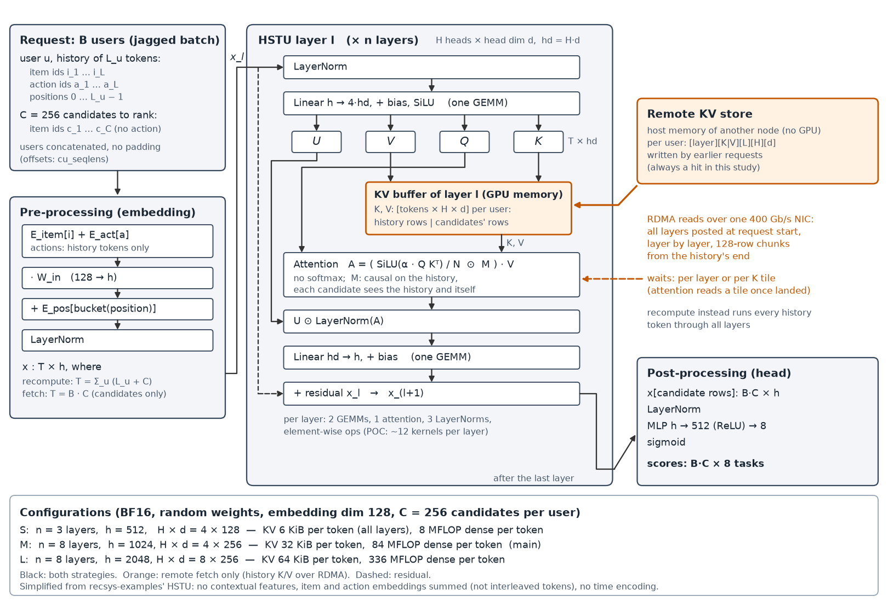

*The model as run by the POC (`hstu_poc/model.py`): a request is a jagged batch of B users; pre-processing embeds
every token computed now (recompute: history and candidates; fetch: candidates only); each HSTU layer projects to U,
V, Q, K with one GEMM, writes K and V into the layer's KV buffer (fetch: after the history rows that arrive over
RDMA), runs the SiLU attention (no softmax; causal on the history, each candidate attends to the history and itself),
and projects back with a residual; the head scores the candidates.*

### 2.3 Strategies and RDMA mechanisms

- **Recompute** (the baseline): no cache; the request processes the history and the candidates.
- **Remote fetch**: the history's K/V are read from the store over RDMA into GPU memory, then only the candidates are
  computed. Four mechanisms:

| Mechanism | Who posts the RDMA reads | Who sees completion | CPU use | Needs an SM to start a transfer |
|---|---|---|---|---|
| CPU verbs (RDMA baseline) | a CPU worker thread (ibverbs) | the worker polls the completion queue and sets per-layer flags in host memory | one core while transfers run | no |
| raw GDAKI | a GPU kernel (DOCA GPUNetIO) rings the NIC doorbell | a GPU kernel polls the completion queue | none | yes |
| GIN-GDAKI | a GPU kernel (NCCL device API) | a GPU kernel | none | yes |
| GIN-Proxy | a GPU kernel hands requests to NCCL's proxy thread, which posts them | the proxy thread | one core at all times | yes |

- **Local hit** (reference only): the K/V are already in GPU memory. This is the cost of the candidates alone, a lower
  bound, not a competitor.

### 2.4 How a remote fetch proceeds

The fetch is posted all at once and consumed layer by layer. When a request starts, the reads of every layer's
history K/V are posted in layer order, spread over 4 queue pairs, so the NIC streams while the GPU computes. Each
request is one CUDA graph. Before layer l's attention uses its K/V, the request waits for them. The three ways to wait
(§3) differ in how much of the layer must have landed and in which kernel waits:
- **Wait kernel (basic):** a 1-thread kernel before each layer's attention spins until the whole layer has landed;
  the attention is launched after it.
- **Fused wait:** no separate kernel. The attention kernel is launched at once and its load warp spins until the whole
  layer has landed, so the attention's launch and setup overlap the wait.
- **Per-tile wait:** the history is sent in 128-row chunks from its end, the order in which the attention reads it,
  and the attention waits before each key tile only for the chunks that tile needs. A layer's attention runs while the
  layer is still arriving.

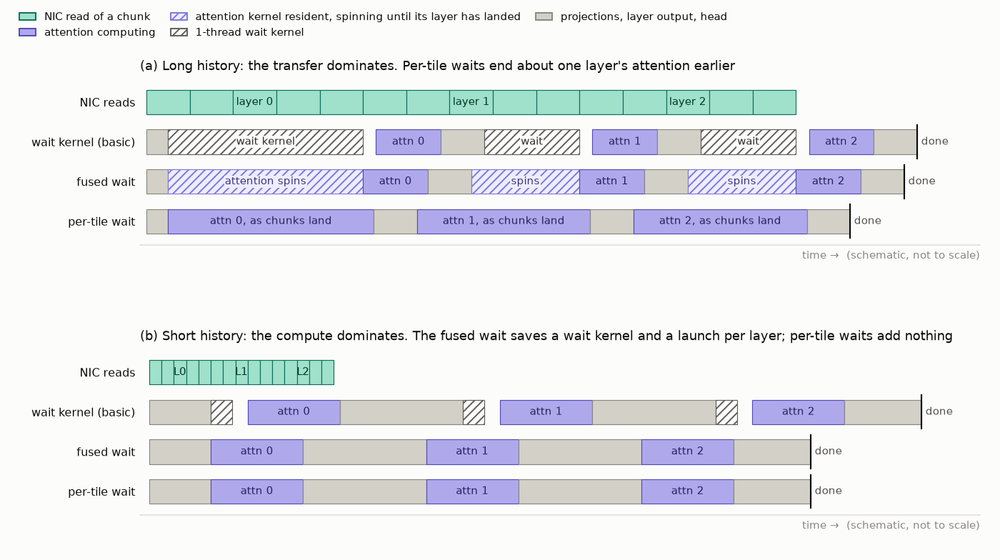

*Schematic, not to scale: one request of three layers. (a) Long history, the transfer dominates: with a wait per
layer (basic or fused) each attention starts only once its whole layer has landed, so the request ends about one
layer's attention after the last byte; with per-tile waits it ends shortly after it. (b) Short history, the compute
dominates: the data are in GPU memory before the compute needs them; the basic variant still pays a wait kernel and a
launch per layer, which the fused wait removes, and per-tile waits add nothing.*

Who posts the reads and who tells the GPU what has landed depends on the mechanism. The figure below compares the two
fastest. GIN-GDAKI works like raw GDAKI through NCCL's device API: a `get` per read, and a flush ticket per layer or
chunk step in place of completion tickets. GIN-Proxy hands each request to NCCL's CPU proxy thread, which posts it
(§2.3).

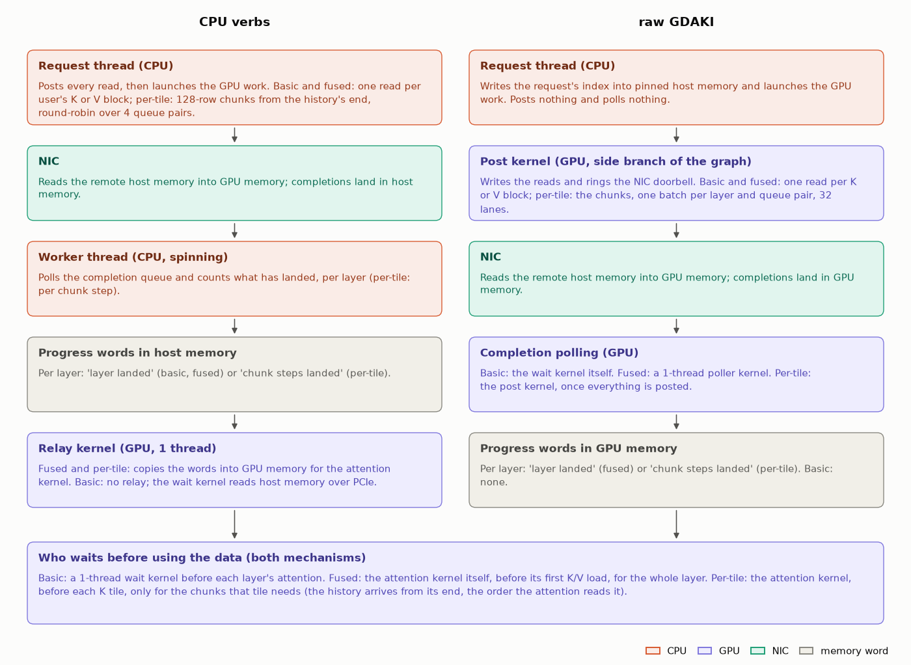

*CPU verbs: the CPU posts the reads, a spinning CPU worker reports progress, and a 1-thread relay kernel copies it
into GPU memory. Raw GDAKI: the GPU posts (a post kernel on a side branch of the graph) and the GPU reports progress;
with per-tile waits the post kernel itself reports it once everything is posted, because a separate polling kernel can
be starved of SMs by attention blocks spinning on its progress.*

### 2.5 Batch size and the two measurement modes

- **Plain run** (§4) measures the latency of one forward pass. A request is a batch of B users processed together,
  each with history L and 256 candidates. A grid point fixes B and L and replays that request 10–1000 times, one at
  a time, with nothing else running. Latency is measured on the host from the moment the request is issued (before
  any posting or launch) until the output is seen complete; the result is the mean (mean and median differ by less
  than 1.1% at 95% of the points). The **cost per user is latency ÷ B**. B stands for how many users a server has
  batched: batching helps recompute (the GPU fills up) but not fetching (the bytes grow with B).
- **Serving** (§5) measures throughput. Requests are single users arriving as an open-loop Poisson stream at a fixed
  rate; the server forms its own batches (B varies from batch to batch) and overlaps consecutive requests. Latency
  runs from arrival to output, queueing included. **Capacity** at a p99 target X is the highest offered load whose
  p99 latency is at most X (≥ 99% of requests within X) with correct data and ≥ 90% of the offered rate achieved.
  Targets: 100 ms (about 10× one M request at 16k), 200 ms, 500 ms and 1 s, plus **sustained**: the highest load the
  server keeps up with (≥ 97% of the offered rate achieved, p99 ≤ 2 s). Beyond it the queue grows without bound and
  every request eventually times out.
- **Batching in serving** is dynamic in both servers (§5.1). It matters for recompute only: at M, 1k its best batch
  size doubles the compute ceiling (1,299 → 2,527 users/s) and requests are served in batches of 26 on average at
  capacity; by 4k the gain is 1.3× and from ~12k one request at a time serves as much or more within 100 ms. Fetch
  serving is NIC-bound: a single request's compute is shorter than its transfer, batches average 1.0–1.14 requests at
  capacity, and batching changes fetch capacity by at most ~1% (M, 1k).

## 3. RDMA optimizations

| Level | Optimization | What it does | Applies to |
|---|---|---|---|
| Mechanism | transport | CPU verbs (baseline), raw GDAKI, GIN-GDAKI, GIN-Proxy | – |
| Posting | spinning worker | the CPU worker busy-polls for new requests instead of sleeping on a condition variable (no wake-up delay; one core always busy) | CPU verbs |
| Posting | inline posting | the request thread posts the reads itself when no request is in flight (no hand-off to the worker) | CPU verbs |
| Posting | zero-copy descriptor | the post kernel reads the request's segment-table index from pinned host memory written by the CPU, instead of a per-request device copy of the table | raw GDAKI, GIN |
| Posting | side-branch posting | the post kernel runs on a parallel branch of the request's graph, so the candidates' compute starts at once; the main branch joins it before the first wait | raw GDAKI, GIN |
| Posting | adaptive contexts | a request uses only as many GIN contexts as a layer has data segments (no flush and wait on empty contexts) | GIN |
| Waiting | wait kernel (basic) | a 1-thread kernel before each layer's attention spins until the layer has landed | all |
| Waiting | PDL | the attention is launched with programmatic dependent launch behind the wait kernel, which triggers it on entry; the attention's launch and prologue overlap the wait | all |
| Waiting | PDL, early release | the first kernel only triggers the dependent launch and exits (its CTA and SM are free at once); the PDL-launched attention takes over the data dependency and spins on the layer's ready word before its first K/V load | all |
| Waiting | fused wait | no per-layer kernel: a 1-thread poller on a side branch publishes per-layer ready words and the attention kernel spins on its layer's word before its first K/V load | all |
| Waiting | per-tile wait | the history is posted in chunks of 128 rows from its end backwards (the attention consumes key blocks last to first); per layer, the number of chunks landed is published to a device word, and the attention's load warp waits before each K tile only for the chunks that tile needs: a layer's attention runs while the layer is still arriving. CPU verbs: the worker counts completions, a 1-thread relay copies the count to the GPU. Raw GDAKI and GIN: a completion ticket per chunk step and queue pair (GIN: a flush per step and context); once everything is posted, the post kernel itself waits for the tickets in order and publishes the count | all |
| Posting | batched, warp-parallel WQE posting | for per-tile waits on raw GDAKI: per layer and queue pair, the queue pair's warp reserves the slots of all the layer's chunk reads at once, writes the WQEs in parallel (one per lane), marks them ready and rings one doorbell, instead of one DOCA `get` (slot reservation, ready mark, doorbell) per chunk | raw GDAKI |
| Posting | exclusive queue pairs, publisher warp (per-tile v2) | each queue pair belongs to one warp for the whole request, so DOCA's posting calls run in EXCLUSIVE mode (plain stores instead of a lock, CAS and atomics; no slot availability check), and a separate warp publishes each layer's progress as soon as that layer is posted instead of after the whole request (posting a layer: 7.5 → 2.8 µs) | raw GDAKI |
| Posting | split posting (per-tile v2) | only layer 0 is posted before the graph launch; the request thread posts the other layers right after it, while the worker already polls | CPU verbs |
| Waiting | one-read relay (per-tile v2) | the worker marks a complete layer in its progress word, so the relay kernel reads one word per poll instead of a flag and a word | CPU verbs |
| Posting | post graph before the request graph (per-tile v3) | the v2 post kernel moves into its own two-node graph (bump a request counter, post), launched from C++ on its own stream right before the request's graph; it publishes sequence-tagged progress words that the request graph never resets | raw GDAKI |
| Serving | overlapped requests | a request's transfer is posted on arrival into a ring of per-request KV slots; batches are formed from landed requests; one graph per batch size, re-pointed per batch; two batches queued on the GPU | all |
| Serving | fused wait, spinning worker | as above, inside every batch graph | all |

Every option and wait variant was checked with a slow producer (posting delayed by 2 ms, KV rows zeroed before each
request): outputs are bit-identical to the basic implementation on every mechanism, and a variant without any wait
produces different outputs. Every grid point and every 8th served batch compares fetched rows with the store's data
pattern: 0 mismatches.

Considered and not pursued:
- **Stream memory-operation waits** (`cuStreamWaitValue32` instead of a wait kernel): still launches the attention only
  after the wait; the fused wait already removes the per-layer kernels and has the attention resident.
- **RDMA writes pushed by the store's CPU**: the same bytes over the same link; reads already reach line rate.
- **Queue-pair and chunk tuning**: every mechanism already runs at line rate from ~1 ms per request; below that, the
  cost is posting and waiting, which the optimizations above address (per-tile chunks of 64 rows gave the same
  latency as 128).
- **Aggregating GIN's chunk reads** (`ncclGinOptFlagsAggregateRequests`, so that only each step's flush submits): the
  flush does not submit aggregated reads (the request never completed), and with one user each step has a single read
  per context to aggregate anyway. NCCL's GIN API has no completion counter for reads, so per-step progress on GIN
  costs a flush per step.

## 4. Plain-run latency

### 4.1 Recompute vs remote fetch

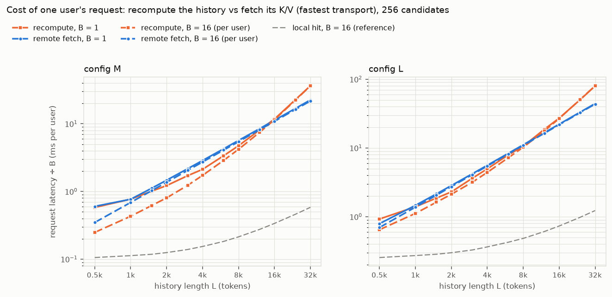

*Per-user cost (request latency ÷ B) of single-user requests (solid) and of batches of 16 (dashed). Remote fetch
uses the fastest implementation at each point (§4.2). Local hit (grey) is the candidates' compute alone, for
reference.*

- **Fetch cost is set by the NIC and does not fall with batching**: 0.68 ms per 1k history tokens for M and 1.36 ms
  for L, at any B.
- **Recompute gets cheaper per user with batching** as the GPU fills up: M at 1k costs 0.78 ms for one user but
  0.43 ms per user in a batch of 16. Its efficiency rises with history length (attention's share) from 18% of BF16
  peak (M, 1k, B = 1) to 51–58% at 16k–32k.
- **The two cross where attention dominates recompute**:

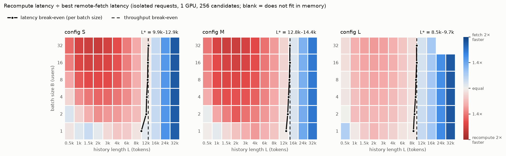

*Recompute latency ÷ fetch latency per (L, B), fetch by its fastest implementation: red, recompute is faster; blue,
fetch is faster. Dots: latency break-even per batch size. Dashed line: throughput break-even, where fetch's ceiling
(NIC rate ÷ KV bytes per user) equals recompute's ceiling (its best batch size).*

| Config | Latency break-even (B = 1 … 32) | Throughput break-even |
|---|---|---|
| S | 9.9k – 12.9k | 12.8k |
| M | 12.8k – 14.4k | 14.4k |
| L | 8.5k – 9.7k | 9.7k |

- **The break-even rises with B and settles at the throughput break-even from B ≈ 8.** Single users break even
  earlier because per-tile waits (§4.2) hide most of their compute behind the transfer, while batched recompute is
  more efficient per user.
- **M lands near the upper end of the pre-analysis** (14.8k predicted at η = 50%; measured η is 46–52% at 12k–16k).
- **L breaks even ~4–5k tokens earlier than M**: its dense compute per token is 4× M's, its KV bytes only 2×.
  Recompute does not become 4× slower because L's larger GEMMs run more efficiently (η = 35% vs 18% at 1k, B = 1).
- **Above the break-even, fetch's lead grows with L**: at 32k and B = 1, fetch is 1.7× faster for M (21.8 vs
  36.4 ms) and 1.85× for L (43.4 vs 80.3 ms).
- **The break-even is very sensitive to bandwidth per GPU.** Below it, fetch and recompute cost about the same per
  token (M: 0.68 vs 0.4–0.8 ms per 1k tokens). Scaling only the transfer part of the measurements, a NIC 1.5× faster
  (~600 Gb/s) would move the break-even to 4–5k for M (B ≥ 4) and below 0.5k for L; 2× (800 Gb/s) below 0.5k for all
  three (estimate).

### 4.2 The fastest RDMA implementation

**How to read the percentages.** Figures and tables in this section give the latency of an implementation relative to
a reference (basic CPU verbs unless stated): **negative = lower latency (faster)**, positive = slower. The text says
"faster" or "slower" instead of a sign.

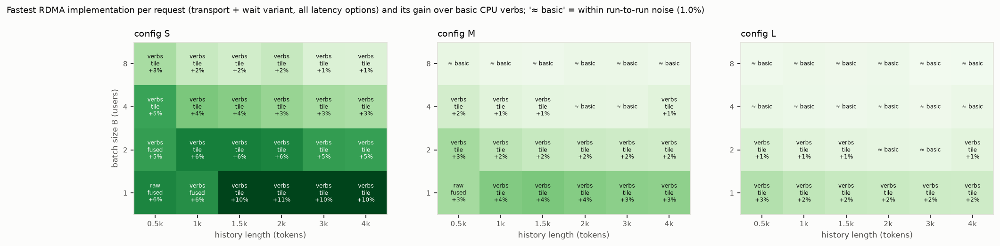

*Per grid point, the fastest implementation (left) and the fastest that needs no CPU core (right: raw GDAKI or
GIN-GDAKI), with its latency relative to basic CPU verbs (negative = faster); '≈ basic' = within the run-to-run noise
of a repeated basic run
(0.95% at the 95th percentile). Up to 4k history and B = 8 all 27 implementations were measured; elsewhere the basic,
fused-wait and per-tile implementations of each mechanism. The modes were measured in several allocations (different
GPU/NIC pairs); the table below compares the per-tile implementations on one pair.*

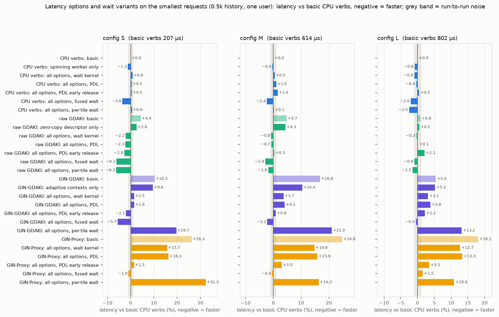

*Every implementation on the smallest requests (0.5k history, one user): latency relative to basic CPU verbs
(negative = faster). The per-tile rows come from other GPU/NIC pairs than the rest, which shifts them by up to ~3% on
these requests; the table below compares them on one pair.*

- **Per-tile waits are the fastest wait on CPU verbs and raw GDAKI.** CPU verbs per-tile is the fastest or within
  noise of the fastest at 68 of 72 grid points up to 4k (B ≤ 8) and at all 142 points beyond (history ≥ 6k or
  B ≥ 16). It is faster than basic CPU verbs by up to 10.6% for S, 4.0% for M and 2.5% for L on single-user
  requests, less with larger batches (B = 8: up to 2.8% for S, within noise for M and L; B ≥ 16: within noise).
  Unlike the other options, per-tile waits keep their gain at long histories: against the fused wait they cut 8–9%
  from every single-user S request up to 32k, 3.1% for M and 1.6% for L.
- **Without a CPU core, raw GDAKI per-tile is the fastest**; from four users GIN-GDAKI per-tile is within noise of
  it. On one GPU/NIC pair, raw GDAKI per-tile beats CPU verbs per-tile on the smallest S requests (0.5k: −3.2% with
  one user, −1.4% with two). Elsewhere it ties (47 of 72 points up to 4k; 140 of 142 beyond) or trails, by up to 5.9%
  for S (most with one user at 1–2k) and by at most 2.3% for M and L.
- **GIN gains from per-tile waits only with several users per request.** NCCL's GIN API has no completion counter
  for reads, so per-step progress costs a flush per step and context. With one or two users each step has one read
  per context, and the request takes up to 2.3× its line-rate transfer time (GIN-GDAKI, S, one user, 4k). From four
  users GIN-GDAKI per-tile ties CPU verbs per-tile. GIN-Proxy per-tile is worse still: its proxy thread handles every
  read and every flush.

| Same GPU/NIC pair; history 0.5k–4k, B = 1–8 (72 points) | Median | Range | First faster / tie / slower |
|---|---|---|---|
| raw GDAKI per-tile vs CPU verbs per-tile | +0.5% | −3.2% (S, 1 user, 0.5k) … +5.9% (S, 1 user, 1.5k) | 2 / 47 / 23 |
| GIN-GDAKI per-tile vs CPU verbs per-tile | +0.6% | 0.0% … +107% (S, 1 user, 4k) | 0 / 43 / 29 |
| GIN-Proxy per-tile vs CPU verbs per-tile | +17% | +0.1% … +214% (S, 1 user, 4k) | 0 / 11 / 61 |
| raw GDAKI per-tile vs raw GDAKI fused wait | −1.3% | −7.7% (S, 1 user, 4k) … +0.4% (M, 1 user, 0.5k) | 42 / 30 / 0 |
| GIN-GDAKI per-tile vs GIN-GDAKI fused wait | −0.5% | −2.7% (S, 4 users, 1.5k) … +85% (S, 1 user, 4k) | 24 / 28 / 20 |
| GIN-Proxy per-tile vs GIN-Proxy fused wait | +15% | −1.2% (M, 4 users, 0.5k) … +173% (S, 1 user, 4k) | 1 / 19 / 52 |
| raw GDAKI per-tile: batched posting vs one DOCA `get` per chunk | +0.2% | −16.6% (S, 1 user, 1.5k) … +1.6% (S, 2 users, 4k) | 12 / 46 / 14 |
| raw GDAKI per-tile: warp-parallel vs one-thread batches (18 points, 2 runs each) | −0.1% | −1.0% (S, 1 user, 4k) … +0.7% (M, 1 user, 0.5k) | 1 / 17 / 0 |

*Latency of the first implementation relative to the second (negative = first faster); tie = within the run-to-run
noise (0.95%). CPU verbs per-tile measured on two pairs differs by a median 0.1% (at most 3.3%).*

- **Posting is on raw GDAKI's critical path**: the NIC starts on a layer only once its reads are written and the
  doorbell rung. One slot reservation, ready mark and doorbell per layer and queue pair, instead of one DOCA `get` per
  chunk, saves up to 17% (S, one user, 1.5k) and is neutral on larger requests. Writing each batch with the queue
  pair's 32 lanes instead of one thread saves up to 1% more (S, one user, 4k; within noise elsewhere). Other changes to
  raw GDAKI per-tile, same pair (S, M, L with 1 and 8 users, 0.5k–4k):
  - a doorbell every 4 reads instead of one per layer: up to 2.5% faster in a variant with a slower posting loop
    (S, 8 users); not measured with warp-parallel posting;
  - a publisher that tests the step tickets without blocking and fences once per pass instead of once per ticket:
    no gain (within ±1%);
  - round-robin placement of the chunks over the queue pairs, as CPU verbs does: 0.2–4.2% slower.
- **Per-tile v2 and v3** (§3): per-request timelines ([sol.md](sol.md) §6) showed where small requests lose time on
  the RDMA path:
  - on CPU verbs, inline posting of every layer delayed the graph launch by up to 60 µs, and the relay needed two
    PCIe reads per poll;
  - on raw GDAKI, the post kernel took 7.5 µs per layer and published nothing until every layer was posted (the first
    step 82 µs into the request for M), and it could start only once the request's graph had launched.

  The v2 options address the first two points and v3 the last. Same GPU/NIC pair, small grid (72 points), two
  campaigns:

| Same GPU/NIC pair | Median | Range | First faster / tie / slower |
|---|---|---|---|
| CPU verbs per-tile v2 vs v1 (results/p2t_v2) | −0.0% | −0.9% (S, 1 user, 1.5k) … +0.1% | 0 / 72 / 0 |
| raw GDAKI per-tile v2 vs v1 (results/p2t_v2) | −0.1% | −2.8% (S, 1 user, 1.5k) … 0.0% | 13 / 59 / 0 |
| raw GDAKI per-tile v3 vs v2 (results/p2t_v3) | −0.1% | −2.1% (L, 1 user, 0.5k) … +0.5% | 5 / 67 / 0 |
| raw GDAKI per-tile v3 vs CPU verbs per-tile v2 (results/p2t_v3) | +0.2% | −3.9% (S, 2 users, 0.5k) … +3.8% (S, 1 user, 1.5k) | 4 / 57 / 11 |

  - CPU verbs v2 ran faster than v1 on the small single-user requests (S 0.5–1k, M 0.5k, L 0.5k) in all three runs on
    this pair, by 0.2–0.9% in this grid and by 0.8–3.5% in two timeline runs. Its latency also varied less between
    runs: S, one user, 0.5k took 200.6–202.4 µs against 202.9–207.9 µs for v1. Elsewhere the two tie.
  - Raw GDAKI v2 is faster than v1 on 13 small requests (up to 2.8%) and never slower; v3 is faster than v2 on 5
    more (S 0.5–1k, M and L 0.5k: 1.1–2.1%), never slower: its first byte leaves ~8 µs earlier. Raw GDAKI v3 is the
    fastest of all at S 0.5–1k with one or two users and M 0.5k with one (up to 3.9%) and trails CPU verbs v2 by at
    most 3.8%, on S requests of 0.5–4k (v1: 5.7%). Its first doorbell still rings ~7–10 µs after CPU verbs'.
  - Tried and not kept: caching the observed progress in the attention's tile check (ties everywhere); the attention
    reading the worker's progress word over PCIe instead of a relay (up to 11% slower: system-scope acquire loads in
    its load warp).
- **The options matter most for the mechanisms that were slow.** On single-user requests at 0.5k, basic GIN-Proxy is
  18–26% slower than basic CPU verbs and basic GIN-GDAKI 5–17%. With every option and the fused wait, GIN-Proxy is
  within 1.5% of basic CPU verbs and GIN-GDAKI up to 6% faster. For GIN, adaptive contexts and removing the per-layer
  wait kernel do most of it; for raw GDAKI (+4.7% → −2.9% on M), side-branch posting.
- **Wait variants**, every other option on, change vs the wait kernel:

| Mechanism | PDL | PDL, early release | Fused wait | Per-tile wait |
|---|---|---|---|---|
| CPU verbs | −1.0 … +0.6% | −2.7 … +1.4% | −4.8 … 0.0% | −9.3 … −0.3% (median −1.3%) |
| raw GDAKI | −0.3 … +0.4% | −1.0 … +2.4% | −4.1 … +0.2% | −7.6 … −0.2% (median −1.2%) |
| GIN-GDAKI | −0.1 … +0.6% | −5.4 … +0.3% | −7.7 … +1.2% | −2.5 … +86% (median −0.4%) |
| GIN-Proxy | −0.8 … +0.9% | −15.1 … +0.4% | −16.9 … +0.8% | −1.6 … +175% (median +12.8%) |

  *History ≤ 4k, B ≤ 8, S/M/L. The medians of PDL, early release and the fused wait are 0.0 ± 0.1%: their gains are
  on requests under ~1 ms. The per-tile column compares runs from different allocations.*

  - **PDL changes nothing**: it overlaps the attention's launch with a wait kernel that does no work.
  - **Early release helps only where the wait itself is slow** (GIN): the trigger kernel exits at once and the
    attention takes over the wait. Where the wait kernel is cheap (raw GDAKI) the extra kernel can cost up to 2.4%.
  - **The fused wait removes the per-layer kernels**, which pays on requests under ~1 ms.
  - **Per-tile waits change what can overlap**: a layer's attention runs while the layer is still arriving, so only
    the compute after the last tile remains exposed. This pays wherever a layer's compute is not negligible against
    its transfer, at every history length, as long as tracking the chunks costs little (not on GIN with few users).
- **CUDA graphs are essential for small requests**: launching every kernel from the CPU adds up to 0.4 ms per request
  (+162% for raw GDAKI at 0.5k).

### 4.3 How close to the bound

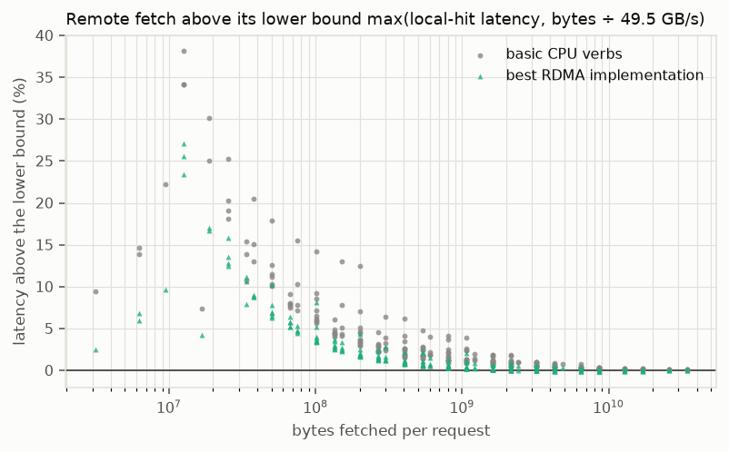

*Plain-run latency of basic CPU verbs and of the fastest implementation, relative to the ideal bound: the larger of
the local-hit latency (the compute alone) and the transfer at the measured line rate (49.5 GB/s), i.e. perfect
overlap of compute and transfer.*

- **With a wait per layer, nothing is left.** A layer's compute cannot start before all of the layer has landed, so a
  request needs at least max(transfer + one layer's compute, one layer's transfer + all compute). The fastest
  per-layer implementation (the fused wait) is within −0.3% (median) and +1.4% (worst) of that bound at every grid
  point.
- **Per-tile waits go below it, toward the ideal bound.** From 30 MB per request (≈ 0.6 ms of transfer) the fastest
  implementation is a median 0.6% above the ideal bound; the exceptions, up to 11%, are requests whose transfer and
  compute take about equally long (single-user M at 1k, S at 0.5k with B = 16). Below 30 MB it is a median 13% above
  it (up to 27% for S at 0.5k with B = 4). What remains is compute that no transfer can overlap: the candidates'
  projections before the first tile lands, the last layer's output and the head after the last one.
- **Against a full speed-of-light model** ([sol.md](sol.md)), which also bounds the compute at hardware peak, the
  fastest implementation is within 0–4% of its SoL above ~2 ms per request. The last byte lands 4–14 µs after the SoL
  transfer end (one user, up to 4k). What remains on small requests is the candidates' compute: the local hit runs
  5–22× its SoL with one user, and ~45 µs of compute follow the last byte against 2–6 µs at SoL. That is not RDMA
  work.
- **The break-even is now close to that of an ideal RDMA.** With fetch at exactly the ideal bound (a zero-overhead
  RDMA at line rate), the break-even would be 12.5k for M and 8.3k for L at B = 1 (measured 12.8k and 8.5k), and within
  0.3k of the measured one at every batch size for M and L and from B = 4 up for S. The exception is S with 1–2 users
  (7.3k and 11.4k ideal vs 9.9k and 12.1k measured), whose 3-layer, sub-millisecond requests are dominated by compute
  that cannot overlap the transfer. For the break-even, the remaining limit is NIC bandwidth against GPU compute.
  Small requests keep the gap above with the per-tile waits of every mechanism.

## 5. Serving throughput

### 5.1 Servers and ceilings

**How each server overlaps requests** (details in Appendix A):
- *Fetch*: a request's transfer is posted as soon as the request arrives, into a ring of per-request KV slots in GPU
  memory, so the NIC streams requests back to back while the GPU computes earlier ones. The GPU runs batches of the
  requests whose data have landed; when it is idle, the oldest request starts at once and its per-layer waits overlap
  its own transfer. Measured with basic CPU verbs (§5.2) and with the optimizations of §3 (raw GDAKI or CPU verbs
  with the fused wait, §5.3–5.4).
- *Recompute*: dynamic batching (the largest power-of-two batch whose compute fits in a cap: 50 ms for the 100 ms
  target, 500 ms for the relaxed ones) or one request at a time, whichever serves more.
- Both keep up to two batches queued on the GPU, so the GPU does not wait for the CPU between batches.

**What overlap can and cannot do.** No schedule serves more than a strategy's ceiling: for fetch, NIC bandwidth ÷ KV
bytes per user (M: 1,472 users/s at 1k, 92 at 16k); for recompute, its compute rate at the best batch size (M: about
2,400 at 1k, 87 at 16k). Overlap only brings a server close to its ceiling, so the throughput break-even, where the
two ceilings cross (§4.1), is the best any schedule can reach.

### 5.2 Capacity within a 100 ms p99 target

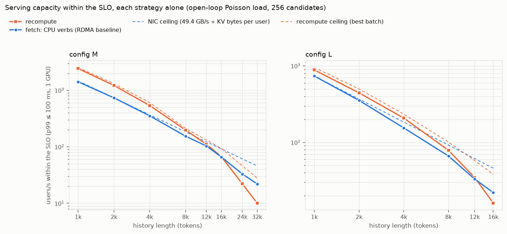

*Users/s per GPU within p99 ≤ 100 ms per history length (fetch: basic CPU verbs); dashed lines: the ceilings. Raw
GDAKI and GIN-GDAKI served exactly the capacity of CPU verbs at every point where they were measured (Appendix C).*

- **Fetch runs at its NIC ceiling up to medium histories**: 96–100% of it at 1k–4k for M and 1k–2k for L. The compute
  of earlier requests is hidden behind later transfers.
- **Recompute serves more users up to ~16k for M and ~12k for L.** Capacity of fetch ÷ recompute:

| History | 1k | 2k | 4k | 8k | 12k | 16k | 24k | 32k |
|---|---|---|---|---|---|---|---|---|
| M | 0.58 | 0.60 | 0.66 | 0.78 | 0.93 | 0.99 | 1.49 | 2.19 |
| L | 0.83 | 0.80 | 0.74 | 0.84 | 0.95 | 1.37 | – | – |

- **At long histories the latency target, not the ceiling, limits both servers.** A request then occupies the NIC or
  the GPU for 8–36 ms, and with random arrivals the p99 exceeds 100 ms well below the ceiling. Both servers sit on the
  limit of an ideal first-come-first-served queue with the same time per request (figure below): about 80% of the
  ceiling at 8 ms per request, 50% at 22 ms and 30% at 36 ms. No schedule can do much better without shorter
  requests.
- **Around the break-even the two strategies are within 7% of each other** (M 12k–16k, L 12k): about one load step,
  the resolution of these capacities (6% of the ceiling). The crossings, ~16k for M and ~12k for L, are therefore
  uncertain by a few thousand tokens. Beyond them fetch's shorter requests add to its higher ceiling: at 32k, fetching
  serves 2.2× the users of recompute (M: 22 vs 10 users/s).

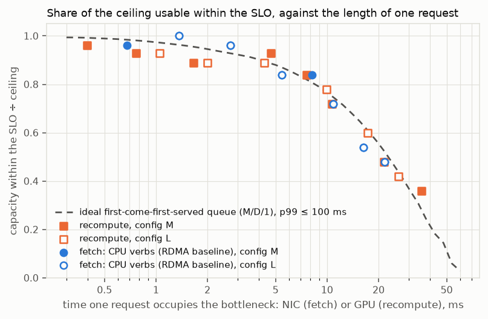

*Capacity within p99 ≤ 100 ms as a share of the ceiling, for every (config, strategy, history length), against the
time one request occupies the bottleneck (1 ÷ ceiling). Dashed: the same share for an ideal first-come-first-served
queue with Poisson arrivals and a fixed time per request (M/D/1, simulated). Recompute ceilings come from three
replays at server start, which run up to 10% faster than under sustained load at 12k–32k, so recompute's points sit
slightly low and left. Points slightly above the curve are sampling noise.*

- **Fetch needs far less GPU time per user**: 0.11–0.49 ms vs 0.40–36 ms for recompute (M, 1k–32k, compute at the
  best batch size), i.e. 3.6× less at 1k, 11× at 4k and 36× at 16k (L: 4.1× to 42×). At capacity the fetch server's
  GPU is mostly idle; §5.5 uses that idle time.
- **Correctness**: every 8th fetched batch's newest request was compared with the store's data pattern (0
  mismatches), and the ring's re-pointed graphs are bit-identical to a plain forward.

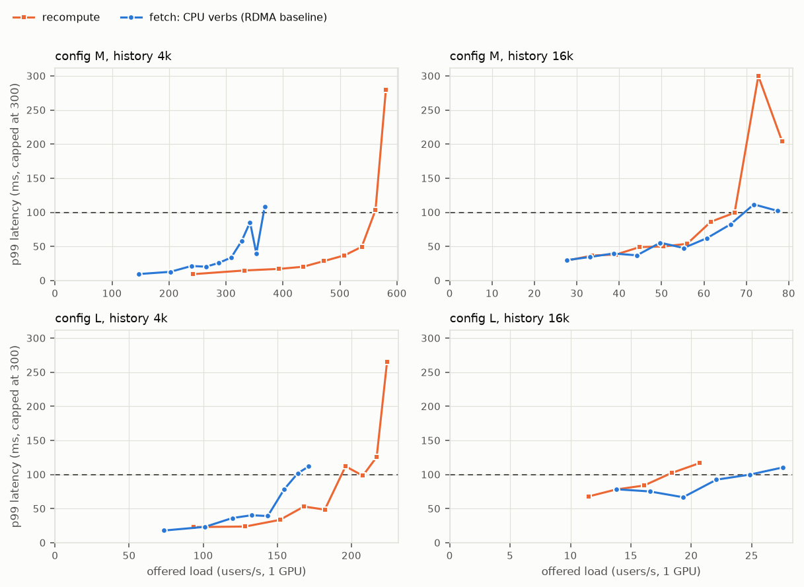

*p99 latency against offered load at 4k and 16k. Each point is one Poisson sample of 5–45 s (a few hundred to
12,000 requests), so near saturation the p99 of neighbouring points can differ by tens of ms.*

### 5.3 Relaxed latency targets and sustained throughput

There is no fixed latency budget for this workload, so capacity was also measured at relaxed p99 targets and up to the
highest load each server sustains before its queue, and with it every request's latency, grows without bound.

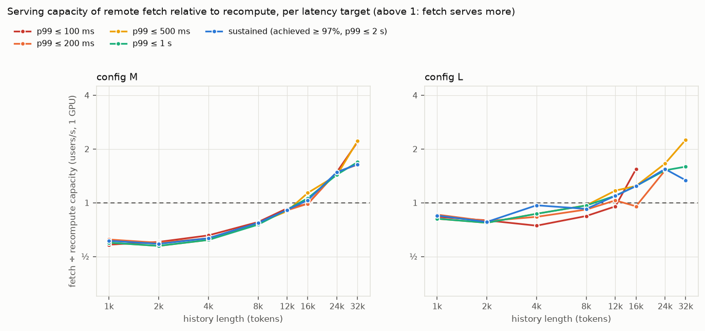

*Capacity of remote fetch ÷ capacity of recompute per history length, for each latency target. 100 ms: the campaign
of §5.2 (fetch with basic CPU verbs). Relaxed targets: a second campaign that sweeps every load up to saturation
(fetch with raw GDAKI and the fused wait; recompute may batch up to 500 ms of compute or run one request at a time,
the better of the two), with identical load steps and durations for both strategies.*

| Target | Break-even, M | Break-even, L | Fetch ÷ recompute at 32k, M |
|---|---|---|---|
| p99 ≤ 100 ms | ~16k | ~12k | 2.2 |
| p99 ≤ 200 ms | ~16k | 12k–16k (within 5%) | 1.7 |
| p99 ≤ 500 ms | ~14k | ~9k | 2.2 |
| p99 ≤ 1 s | ~14k | ~9k | 1.7 |
| sustained | ~15k | ~10k | 1.6 |

- **Relaxing the target lets both servers approach their ceilings.** Sustained, fetch delivers 97–99% of the NIC
  ceiling at every history length (M, 1k: 1,464 of 1,472 users/s) and recompute 84–100% of its compute rate (near
  saturation the 97% criterion is within the Poisson noise of a 5–40 s run, so single points can fall short).
- **The break-even then sits where the ceilings cross**: ~15k for M and ~10k for L, the throughput break-even of §4.1
  (14.4k, 9.7k). Between 12k and 16k (M) and 8k and 16k (L) the two strategies are within ~10% of each other at every
  target, so the crossing moves by a few thousand tokens with the target but never below ~14k (M) and ~9k (L).
- **Below the break-even the target does not matter**: at 1k–8k fetch serves 0.6–0.8× of recompute's users for M and
  0.65–0.95× for L at every target. The strict target only widens fetch's lead above the break-even, where
  recompute's requests are the longer ones.

### 5.4 Optimized vs basic fetch in serving

Basic CPU verbs, CPU verbs with the spinning worker and the fused wait, and raw GDAKI with the fused wait serve the
same capacity at every target where all were measured (M, sustained: 1,456 / 1,457 / 1,464 users/s at 1k, 362 at
4k, 90 at 16k; L: 728 / 731 at 1k, 184 at 4k, 46 at 16k). In serving the NIC is the bottleneck at short histories and
the transfer dominates at long ones; the microseconds the optimizations save per request disappear in the NIC's
queue. The choice of mechanism for serving is therefore one of CPU cost (§6), not speed. Per-tile waits were not
built into the serving ring (each request would need its own progress words). They shorten only the compute exposed
after a request's last chunk lands, and the identical capacities of the basic and fused waits show that this is not
what limits serving.

### 5.5 Sharing the GPU

At its capacity the fetch server leaves most of the GPU idle (§5.2). This experiment fills that idle time with
another job and measures what each side loses. A co-located recompute job (M, 4k, batches of 8 users, 13.5 ms per
batch, 560 users/s alone) runs back to back on its own stream. Next to it, the fetch server (M, 4k or 16k, basic) serves
50%, 75% and 90% of its ceiling. Four conditions: alone; shared; shared with the fetch server on high-priority
streams; and shared with the co-located job confined to a green context of 124 SMs, which leaves 8 SMs to the fetch
server.

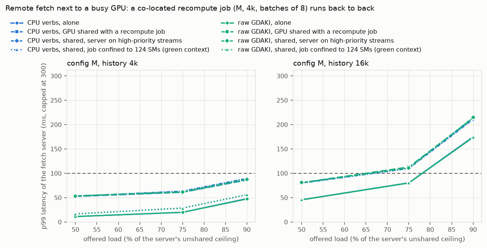

*p99 latency of the fetch server against its offered load; CPU verbs (blue) and raw GDAKI (green) overlap in every
condition.*

- **The two jobs add up.** At 4k the fetch server still serves 90% of its NIC ceiling (331 users/s) within the 100 ms
  target, while the co-located job keeps 96–98% of its throughput. The GPU and its NIC then serve ~1.55× the users of
  the recompute job alone.
- **The fetch server's latency rises because of compute, not posting.** Sharing raises its p50 at 4k from 3 to 38 ms
  (p99 at 50% load: 11 → 54 ms). At 16k it meets the target at 50% load but no longer at 75% (p99 112 ms). Its
  kernels wait for SMs held by the other job's kernels; the transfers are not affected. CPU verbs, which needs no SM
  to post, behaves exactly like raw GDAKI.
- **Stream priority does not help** (identical results): priority orders thread blocks that wait to launch but does
  not preempt running ones.
- **Partitioning the SMs does.** With the co-located job in a 124-SM green context, the fetch server's latency at 16k
  equals its unshared latency, and at 4k it is close (p99 17 / 28 / 56 ms at 50 / 75 / 90% load, vs 11 / 20 / 47 alone
  and 53 / 61 / 87 shared). The co-located job runs 3% slower in its partition and keeps 96–99% of that rate while
  sharing.

## 6. RDMA mechanisms: CPU cost, node scale and choice

**CPU cost.** The GDAKI mechanisms use no CPU core (GIN-GDAKI with `NCCL_RMA_DISABLE=1`; otherwise NCCL's host-RMA
progress thread spins a core). Basic CPU verbs keeps its worker busy while transfers are in flight: 0.5–1.0 core per
GPU at serving capacity, in proportion to NIC utilization; with the spinning worker, one core always. GIN-Proxy's
proxy thread keeps a core busy at any load.

**Node scale (8 GPUs at once).** With all eight GPU–NIC pairs fetching from one store node, CPU verbs and raw GDAKI
reach 394 GB/s per node (line rate on every pair). Served by an earlier batch-at-a-time server (Appendix A), they
reached 2,587 / 357 users/s per node at 4k / 16k (M), 7.2× / 7.9× that server's one-GPU capacity. On Eos, GIN-GDAKI
and GIN-Proxy reach only ~230 GB/s per node (962 / 123 users/s). The cause is page placement, not GIN: the driver
puts every `cuMemCreate(HOST_NUMA)` allocation, which NCCL requires for host-memory windows, on NUMA node 0, so the
four NICs of socket 1 read across the inter-socket link. Raw GDAKI with its store forced onto node 0 reproduces the
same ~229 GB/s, and GIN windows in GPU memory reach line rate.

**Choice of mechanism**

| Target | Implementation |
|---|---|
| Lowest latency, a CPU core per GPU available | CPU verbs, spinning worker, inline posting, per-tile waits (on the smallest requests of one or two users raw GDAKI is up to 3% faster) |
| Lowest latency, no CPU core | raw GDAKI, zero-copy descriptor, side-branch posting, batched warp-parallel posting, per-tile waits; from four users per request GIN-GDAKI per-tile is equivalent |
| Throughput | any mechanism (all NIC-bound and identical); raw GDAKI needs no CPU |
| Integration with NCCL | GIN-GDAKI with adaptive contexts (`NCCL_RMA_DISABLE=1`): the fused wait for one or two users per request, per-tile waits from four; host-memory windows need correct NUMA placement at node scale |
| – | GIN-Proxy only with the fused wait (otherwise up to 26% slower on small requests, per-tile waits more), and it keeps a core busy |

## 7. Writing new K/V back

A request whose user has a cached prefix of P tokens computes S new history tokens plus the candidates and writes the
new tokens' K/V to the store. Each layer's new rows are written as soon as the layer has produced them (GPU-initiated
puts on a side stream, or the CPU worker when the GPU flags the layer). **Durable time** runs from the request's start
until a write-then-read fence on every queue pair has returned. Grid: M, B = 1/2/4/8 × P = 0–16k × S = 256–8k; every
written range was read back and compared (0 mismatched bytes).

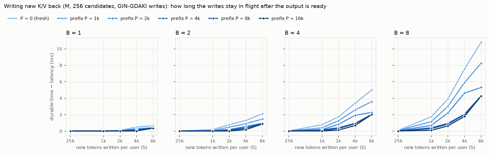

- **Writes add no latency**: with and without them, latency differs by −5.6% … +4.5% (median +0.45%), i.e. noise.
- **They complete after the output, by an amount that grows with the bytes written and shrinks with the prefix**
  (more attention per new token to hide behind): at most 0.1 ms for S = 256 at any B and P; at most 0.7 ms at B = 1;
  at B = 8 and S = 8k, 10.8 ms for a new user and 4.3 ms with a 16k prefix.
- **Large writes run at NIC speed**: 2 GiB are durable after 46 ms (46.5–47.1 GB/s).
- The mechanisms tie within ~3%. GPU-initiated writes cost 0.04–0.35 ms of CPU per request; CPU verbs and GIN-Proxy
  keep a core busy while writing.
- A design that must make the new K/V durable before returning the output (so that the user's next request can read
  them at once) pays the durable time instead of the latency.

## 8. Conclusions

1. **Plain-run latency.** The fastest RDMA path is CPU verbs with the spinning worker, split inline posting and
   per-tile waits (v2); without a CPU core, raw GDAKI with the zero-copy descriptor, exclusive warp-parallel posting
   with a publisher warp, its post kernel launched just before the request's graph, and per-tile waits (v3), which is
   also the fastest of all on the smallest requests (S 0.5–1k with one or two users, M 0.5k). The gains over basic CPU
   verbs are where per-request overhead or the per-layer pipeline matter: single users and small batches (up to 11% for
   S, 4% for M, 2.5% for L). From ~30 MB per request the fastest implementation is a median 0.6% above the ideal bound
   (perfect overlap of transfer and compute); below that it is a median 13% above.
2. **Break-even.** Fetching beats recomputing above ~13–14k history tokens for M and ~9k for L (S: 10–13k); single
   users cross earliest. RDMA-side optimization lowered the single-user break-even by 0.5–5k tokens and left at most
   0.3k to an ideal RDMA (except S with 1–2 users). The batched break-even, equal to the throughput break-even, is fixed
   by NIC bandwidth against batched recompute.
3. **Serving.** Cross-request overlap is necessary, since it takes fetch to its NIC ceiling, but cannot lower the
   break-even. At a 100 ms p99 target both servers sit at the queueing limit of a first-come-first-served server; with
   relaxed targets they approach their ceilings and the break-even moves to where the ceilings cross (~15k for M,
   ~10k for L). The mechanism and the per-request optimizations do not change serving capacity.
4. **Below the break-even, the value of RDMA is the GPU time it frees.** Fetch and recompute are limited by different
   resources, and on one GPU their capacities add up (~1.55× the users at M, 4k). The case for RDMA below the
   break-even is therefore a hybrid server that fetches as many users as the NIC carries and recomputes the rest, not
   fetching instead of recomputing.
5. **Mechanism.** For lowest latency, CPU verbs with every option and per-tile waits if a CPU core per GPU is free;
   otherwise raw GDAKI with every option and per-tile waits (within noise of CPU verbs at most points, up to 3.8% behind
   on small S requests). For throughput, any mechanism (choose by CPU cost). For NCCL integration, GIN-GDAKI with
   adaptive contexts: the fused wait for one or two users per request, per-tile waits from four (GIN's per-step
   flushes cost more than the overlap gains with few users). GIN-Proxy only with the fused wait.
6. **A GPU shared with other work needs SM isolation to keep the fetch server's latency** (a green context), whichever
   mechanism is used.
7. **Within the rules of §1, the break-even and serving capacity are at their limits.** The break-even is within 0.3k
   tokens of an ideal RDMA (except S with 1–2 users) and serving sits at the NIC ceiling or the queueing limit; moving
   either needs more bandwidth per GPU, fewer bytes per user or the hybrid server. Small requests (below ~30 MB) stay
   a median 13% above the ideal bound. Timelines against a speed-of-light model attribute that gap to the candidates'
   compute (not RDMA) plus 7–31 µs of RDMA-path overhead per compute-bound request; the RDMA-side ideas left are each
   worth 1–3 µs ([sol.md](sol.md), §9).

## 9. Next steps

- **What is left within the rules of §1** ([sol.md](sol.md) §6–8). Per-request timelines against a speed-of-light
  model show the NIC at 99.7% of its payload rate during the transfer and the last byte landing 4–14 µs after the
  SoL transfer end (CPU verbs, one user up to 4k). The rest of the gap is the compute after the last byte (40–120 µs
  against 2–23 µs at SoL) and, on compute-bound requests, the compute itself. That is not RDMA work, and it would also
  speed up recompute. On compute-bound requests the RDMA path adds 7–31 µs to the local hit. Remaining RDMA-side
  candidates, each worth an estimated 1–3 µs per request:
  1. *An earlier first doorbell on raw GDAKI*: its first byte still leaves ~7–10 µs after CPU verbs' (v3's post graph
     launch, layer 0 posted on the GPU). A kernel that stays resident across requests is not possible under PyTorch
     (graph capture and the caching allocator synchronize the whole device).
  2. *Sequence-tagged progress words for CPU verbs* (raw GDAKI v3 has them): no per-request reset node in the graph.
  3. *Progress written into GPU memory by the CPU (GDRCopy)*: no relay kernel. Reading the worker's host progress
     word from the attention over PCIe was tried and is slower (system-scope acquire loads in the load warp: up to
     +12 µs per layer).
  4. *Each chunk step spread over all queue pairs* when a step has fewer chunks than queue pairs (one user).
  5. *Fewer completions*: one per step and queue pair instead of one per read.

  Tried without gain: a non-blocking publisher, round-robin chunk placement on raw GDAKI, aggregated GIN reads,
  caching the observed progress in the attention's tile check, direct progress reads over PCIe.
- **Faster candidates' compute (both strategies)**: an attention that splits the keys across CTAs when there are few
  queries (fetch's attention runs 8 work tiles on 132 SMs with one user, ~19× its roofline), fused GEMM prologues and
  epilogues, fewer kernels. By the rules of §1 this is a general optimization to apply to recompute as well, where it
  moves the break-even toward the SoL break-even of ~33k for M.
- **Hybrid server (P7):** one scheduler that sends each request, or each layer, to fetch or recompute by history
  length and load, to turn the additive capacity of §5.5 into a serving result; M and L with more layers.
- **Fewer bytes per user:** FP8 or otherwise compressed K/V (half the bytes acts like a 2× faster NIC on transfer).
- **More bandwidth per GPU:** two NICs per GPU (e.g. borrowing a neighbour's idle NIC) or 800 Gb/s NICs.
- **Paged KV and realistic traffic** (mixed history lengths, cache misses; P8) and a remote GPU-memory store (P9).

## Appendix A. Implementation

The POC is `examples/hstu-poc` in recsys-examples (branch `hstu-kv-rdma-poc`); its README lists every file.

- **Model** (`hstu_poc/model.py`): the repository's HSTU layer math with random weights and FBGEMM's Hopper attention
  kernel. `forward_full` recomputes; `forward_cached` takes the history's K/V, computes the candidates and calls a
  per-layer hook before each attention (the wait for fetched data), or hands the attention to the source (the fused,
  early-release and per-tile variants use a copy of FBGEMM's kernel with an in-kernel wait,
  `attn/hstu_hopper/mainloop_fwd_sm90_tma_gmma_ws.hpp`).
- **Per-tile waits** split every K/V segment into chunks posted from the segment's end backwards, step by step
  (step k = the k-th chunk from the end of every segment), all signaled. Chunk rows: 128, or more when needed to keep a
  request at ≤ 2,048 reads. Per layer, a device word zeroed at the request's start holds the number of steps landed;
  in the attention kernel's load warp, before each K tile, the elected thread waits until the steps covering that
  tile's history rows have landed (acquire load, then a proxy fence before the TMA load). Who publishes the steps:
  - *CPU verbs* (`post_reads_tiled`): the worker counts completions per (layer, step) and publishes
    (sequence << 32) | steps in host-mapped memory; a 1-thread relay kernel copies it to the device word.
  - *Raw GDAKI* (`post_gets_tiled`, one warp per queue pair; chunk (segment j, step k) on queue pair (j + k) mod 4):
    per layer, lane 0 reserves the slots of all the layer's chunk reads on its queue pair, the 32 lanes write the
    WQEs in parallel (one per lane, in step order), and lane 0 marks them ready once and rings one doorbell. The WQE
    index of each step's last read on a queue pair is that step's ticket.
  - *GIN* (`post_gets_tiled`, one warp per context): the warp's lanes issue a step's chunk reads with one `get` each,
    then lane 0 takes a flush ticket for the step.
  - On both GDAKI paths the post kernel then waits for the tickets in step order and publishes the count. The
    publisher has to be resident before the attention: as a separate kernel launched after the posts, it can be
    starved of SMs by attention CTAs that spin on its progress once the attention fills the GPU (a deadlock seen at
    B = 32).
  - *Per-tile v2* (`HPOC_SPLIT_POST=1 HPOC_RELAY=2`, `HPOC_RAW_POST=2`): CPU verbs posts layer 0 before the graph
    launch and the rest right after it (graph replays only; an eager forward can block before a later layer's launch)
    and relays one progress word per poll; raw GDAKI's post kernel v2 owns each queue pair exclusively and publishes
    from a separate warp as soon as each layer is posted.
  - *Raw GDAKI v3* (`HPOC_RAW_PRELAUNCH=1`): the v2 post kernel is captured in its own two-node graph and launched with
    `cudaGraphLaunch` on its own stream right before the request's graph (a `CUDAGraph.replay()` from Python would run
    on the current stream, behind the request graph that waits for it); it publishes `seq << 32 | steps` words, and
    the attention compares the tag with the request's sequence number (wait mode 5). A code walkthrough of the whole path, with links:
    `examples/hstu-poc/docs/per-tile-walkthrough.md`.
  - Graph side branches use streams from PyTorch's high-priority pool: a default-priority side stream can be the
    capturing stream itself after 32 stream allocations, which captures the branch inline (a spinning publisher then
    runs before the compute).
- **Transports** (`csrc/`): CPU verbs (RC queue pairs, a worker thread, per-layer host-mapped flags; optional
  spinning worker and inline posting); raw GDAKI (DOCA GPUNetIO from NCCL's bundled copy, GPU-side queue pairs,
  tickets per layer and queue pair; optional zero-copy descriptor); GIN-GDAKI and GIN-Proxy (NCCL 2.32.7 device API,
  4 read contexts, `NCCL_RMA_DISABLE=1`; optional zero-copy descriptor). The store is plain host memory bound to the
  NIC's NUMA node (CPU verbs, raw GDAKI) or an NCCL host-memory window (GIN). The per-request options and wait variants
  live in `hstu_poc/kvsource.py`.
- **Serving** (`hstu_poc/serving2.py`, driver `bench/p5s.py`):
  - *Remote fetch*: a ring of per-request KV slots in GPU memory. A request's transfer (all layers, each K and V block
    split over the four queue pairs) is posted as soon as the request gets a slot, so the NIC serves requests in
    arrival order while earlier ones compute. A compute batch takes the oldest posted requests whose data have landed
    or will have by the time the GPU starts them (a first-in, first-out model of the NIC); with the GPU idle, the
    oldest request starts at once and its per-layer waits overlap its own transfer. One CUDA graph per batch size
    serves any run of consecutive slots: the attention's K/V tensor is the whole ring, and the batch's
    `cu_seqlens_k`, the candidates' row indices and the request to wait for are rewritten in device memory before
    each replay. A self-test checks that the output is bit-identical to a plain forward. Completion is in order per
    queue pair, so waiting for the batch's newest request covers the older ones. With the fused wait, each batch
    graph has a 1-thread poller on a side branch. Posting per request matters at long histories: a server that
    fetched whole batches into two alternating regions reached 45–60 users/s at M, 16k.
  - *Recompute*: dynamic batching to the largest power-of-two batch whose compute fits the cap, or strictly one
    request at a time; the better policy is reported per history length and target.
  - *Both*: up to two batches queued on the GPU, the next one formed just before the GPU frees up; every graph is
    replayed once before serving; every 8th fetched batch's newest request is compared with the store's data pattern
    on a side stream.
- **Plain-run grid** (`bench/grid.py`, `bench/p2.py`): one CUDA graph per grid point, requests replayed one at a
  time, host-clock and GPU-event timing, fetched rows compared with the store's pattern after each point.

## Appendix B. Platform notes (Eos)

- NCCL's host-RMA progress thread spins a CPU core unless `NCCL_RMA_DISABLE=1`; with it, GIN-GDAKI uses no CPU.
- NCCL 2.32.7 requires GIN windows of identical size on every rank.
- GIN reads need at least 4 contexts (queue pairs) for line rate when several large reads queue per context; one
  context caps RDMA reads at ~42 GB/s.
- `cuMemCreate(CU_MEM_LOCATION_TYPE_HOST_NUMA, id = 1)` allocates on node 0 with driver 535.129.03 + CUDA 13.3
  forward compatibility (memory policy and CPU affinity do not change it); `mmap` + `mbind` and `cudaHostAlloc` place
  pages correctly. Probe: `tools/numa_check.cu`.
- No dma-buf on Eos; DOCA falls back to `nvidia_peermem` (the `Failed to create UMEM with DMABUF` lines are harmless).
- Green contexts work, with 8-SM partition granularity on H100. A CUDA graph runs in the context it was captured in:
  to confine a job, capture its graphs on the green context's stream.
- One server's CUDA graphs must not be torn down while another server captures graphs in the same process: when
  Python's cycle collector freed an old server mid-capture, a later first launch faulted (Xid 31 with no kernel
  running). The servers are closed explicitly, every graph is replayed once before serving, and each benchmark
  process builds one server.
- Processes that share an allocation need distinct rendezvous ports (`HPOC_MASTER_PORT`; enroot's PyTorch hook
  overrides `MASTER_PORT`).
- The kernel log is root-only on compute nodes; GPU core dumps (`tools/gpu_core_wrap3.sh`) are the debugging route.

## Appendix C. Data and reproduction

All paths are in the study folder on Eos (`/lustre/fsw/coreai_devtech_all/junyiq/hstu-kv-rdma`); the analysis
scripts are also in the POC's `tools/`.

| What | Result rows | Campaign script | Figure / table script |
|---|---|---|---|
| Plain-run latency: every mechanism × option × wait variant, recompute, local hit (S, M, L) | `results/p2t/` (per-tile waits: `*.t.tile`) | `tools/p2t_grid.sh` | `tools/p2t_report.py`; `tools/p2t_to_p2c.py` + `tools/report_figs.py`, `tools/p2c_breakeven.py` |
| Per-tile waits: controls on the same GPU/NIC pair | `results/p2t_ctl/A`, `results/p2t_ctl/B`; posting ablations: `results/p2t_tile_ext11/` vs `results/p2t_tile_v1/` (batched vs one `get` per chunk), `results/p2t_post/` (warp-parallel vs one thread) | `tools/p2t_grid.sh` (`P2T_OUT`) | `tools/p2t_ctl.py` |
| Serving within 100 ms, each strategy alone | `results/p5s/` (`fine_*`: fine load grid at 12k+) | `tools/p5s_runs.sh`, `p5s_runs2.sh`, `p5s_fine.sh` | `tools/p5s_report.py` |
| Serving at relaxed targets and up to saturation | `results/p5x/` | `tools/p5x_runs.sh` | `tools/p5x_report.py` |
| Serving on a shared GPU | `results/p6s/` | `tools/p6s_runs.sh`, `p6s_prio.sh`, `p6s_green4k.sh` | `tools/p6s_report.py` |
| Writes | `results/p3b/` | `tools/p3_grid2.sh` | `tools/p3_report.py` |
| Node scale | `results/p2/eight_*`, `results/p5b/eight_*` | `tools/p5_runs.sh` | `tools/p5_eight.py` |
| Micro-benchmarks (bandwidth, latency) | `logs/p0/` | `tools/p0.sh` | – |
| Per-request timelines, per-tile v2 and v3, speed of light | `results/tl*/` (`*.timeline.rank0.jsonl`), `results/p2t_v2/` (small grid, same pair: per-tile v1 and v2), `results/p2t_v3/` (raw GDAKI v3, raw GDAKI v2, CPU verbs v2), `results/sol_lat/` (RDMA and PCIe latencies, kernel breakdown, SoL tables) | `tools/tl_grid.sh`, `tools/p2t_grid.sh` (level `t2`); `tools/pcie_pingpong.cu`, `ib_read_lat` | `tools/sol.py`, `tools/tl_report.py`, `tools/tl_compare.py`, `tools/sol_figs.py`, `tools/model_diagram.py`; see `sol.md` |

`tools/make_figs.sh` regenerates every figure from the rows inside the PyTorch container (matplotlib); each report
script prints its tables with `--md`. Earlier grids with GPU-event timing and the basic implementations
(`results/p2c/`, `results/p4b/`, `results/p4c/`) agree with `results/p2t/` within 1–2%.

**Serving capacity of every mechanism (basic implementations, 100 ms target, coarse load grid; users/s, 1 GPU)**

| Config | Mechanism | 1k | 2k | 4k | 8k | 12k | 16k |
|---|---|---|---|---|---|---|---|
| M | CPU verbs | 1,413 | 736 | 353 | 155 | 103 | 66 |
| M | raw GDAKI | 1,413 | 736 | 353 | 155 | 103 | 66 |
| M | GIN-GDAKI | 1,413 | 736 | 353 | 155 | 103 | 66 |
| L | CPU verbs | 736 | 353 | 155 | 66 | 40 | 18 |
| L | raw GDAKI | 736 | 353 | 155 | 66 | 40 | 18 |
| L | GIN-GDAKI | 736 | 353 | 155 | 66 | 40 | 18 |

The coarse grid (load steps of 3–15% of the ceiling, 5–15 s per point) compares the mechanisms. At 12k and longer
the main text uses a finer grid (6% steps, up to 45 s per point) for CPU verbs and recompute, which gives L 33 / 22
users/s at 12k / 16k instead of 40 / 18.
