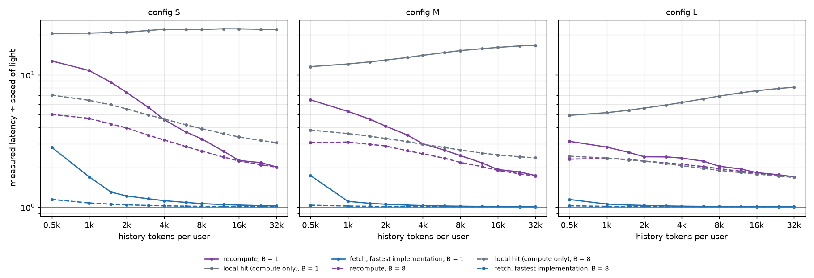
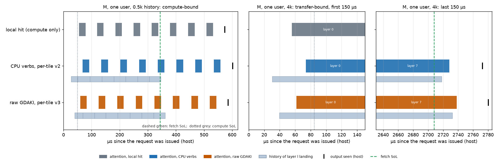
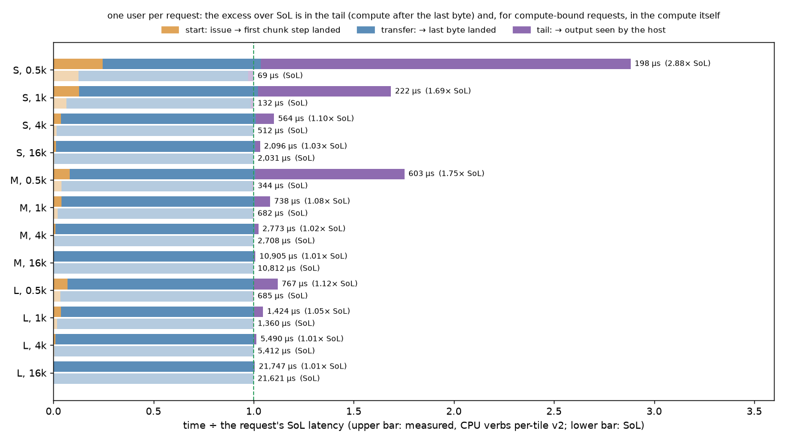

# Speed of light of a remote-KV HSTU request, and where the RDMA path stands

Study note, 25 November 2026. Companion of [results.md](results.md) (setup in §2 there). Model, calculator and
figures: `tools/sol.py`, `tools/sol_figs.py`; per-request timelines: `bench/grid.py --timeline`, `tools/tl_report.py`;
data: `results/tl*`, `results/sol_lat` (Appendix).

## Summary

- **Speed of light (SoL)** here means the latency of one request if every operation ran at the peak of the hardware
  resource it needs (tensor cores, HBM, SFU, NIC, PCIe) and operations were arranged as tightly as their data
  dependencies allow. It is computed per grid point for recompute and for remote fetch (§1–3).
- **At SoL, recompute is much faster than today and fetch is not.** Recompute's SoL is 1.7–13× below its measured
  latency (it runs at 8–58% of tensor peak); fetch's SoL is the NIC transfer, which the measurements already reach.
  At SoL the **break-even moves to ~35k (S), ~33k (M) and ~28k (L) history tokens**, against 10–14k (S/M) and 9k (L)
  measured: the measured break-even owes much to recompute's inefficiency (§3).
- **Serving at SoL**: the fetch ceiling is the NIC's payload rate (M, 1k: 1,481 users/s). Measured sustained 1,464/s
  (99%); within a 100 ms p99 target the server reaches 92–103% of an ideal M/D/1 queue with the SoL service time at
  1k–16k, i.e. the queue's limit within the resolution of the load steps (§4). Recompute serves 1/1.7–1/3 of its SoL
  ceiling.
- **Measured against SoL (plain run, fastest RDMA implementation)**: 1.00–1.04× above ~2 ms per request, 1.05–1.13×
  around 0.5–1.5 ms, and 1.7–2.9× on the smallest single-user requests (S 0.5–1k, M 0.5k), which are bound by
  the GPU compute of the candidates (§5).
- **Per-request timelines** (§6) split each request into start (issue → first chunk landed), transfer and tail
  (last byte → output seen):
  - during the transfer the NIC runs at 99.7% of its payload SoL;
  - the last byte lands 4–14 µs after the SoL transfer end for one user up to 4k (CPU verbs; raw GDAKI 25–40 µs);
  - what remains is **the compute after the last byte** (40–120 µs against 2–23 µs at SoL), plus, on
    compute-bound requests, the compute itself (the local hit runs 5–22× its SoL with one user).
- **RDMA-attributable time left** (vs the local hit, compute-bound requests S and M at 0.5k): 7–31 µs per request,
  from a later first attention (posting before the graph launch, a larger graph) and ~1.4 µs per layer while a progress publisher kernel
  runs beside the compute (§6.2).
- **This round's RDMA optimizations** (§7), each checked bit-exact under a slow producer:
  - CPU verbs, split posting + a one-read relay (v2): up to 3.5% faster on small single-user requests;
  - raw GDAKI, exclusive-QP posting + a separate publisher warp (v2): posting a layer 7.5 → 2.8 µs, the first
    published step 82 → 48 µs (M), up to 1.9% faster;
  - raw GDAKI, the post kernel in its own graph, launched from C++ just before the request graph (v3): the first step
    lands 7–9 µs earlier again, up to 2.1% faster than v2; raw GDAKI is now up to 3.9% faster than CPU verbs on the
    smallest single-user requests and at most ~1.4% slower elsewhere;
  - a robustness fix: a side branch could be captured inline;
  - no gain: cached progress checks in the attention; slower: progress read by the attention directly over PCIe.
- **What is left is mostly not RDMA**: the attention runs with 8 work tiles on 132 SMs for one user, plus 105
  kernels per request (M) and a ~45 µs tail of output GEMM, LayerNorm and head. These would also speed up recompute,
  so by the rules they belong to a general compute optimization of both strategies (§8). On the RDMA side, the ideas
  left are each worth 1–3 µs per request (§8).

## 1. Hardware limits

| Resource | Peak used for the SoL | Source |
|---|---|---|
| Tensor cores, BF16 dense | 989.4 TFLOPS | H100 SXM5 spec (132 SMs, 4,096 FLOP/clk/SM, 1.83 GHz) |
| HBM3 | 3.35 TB/s | spec |
| SFU (exp2, rcp, tanh …) | 3.87 Tops/s | 16 per clk per SM |
| FP32 instructions | 33.4 T/s | 128 lanes per SM, 1.98 GHz |
| NIC, RDMA read payload | 49.68 GB/s | 400 Gb/s NDR, 4 KiB MTU, 26 B of headers per packet (measured streams: 49.6) |
| PCIe Gen5 x16 (NIC → GPU) | 63 GB/s | above the NIC rate, never the bottleneck |
| Host → GPU notification | 1.2 µs | measured: host–GPU–host round trip through mapped memory 2.4–2.6 µs (median) |
| GPU → host notification | 1.2 µs | same path |
| First byte of an RDMA read | 3.35 µs | measured: `ib_read_lat`, 2–64 B, typical (128 KiB: 9.0 µs) |
| CUDA graph, 1 kernel, launch → event seen | 6.4 µs | measured (software path, not used as SoL) |

## 2. The least operations, and their roofline

With full fusion a request is: the embedding; per layer one projection GEMM (LayerNorm prologue, bias + SiLU
epilogue, K/V written straight into the KV buffer), one attention (SiLU scores, no softmax) and one output GEMM
(LayerNorm(A) ⊙ U prologue, bias + residual epilogue); the candidates' head. Fetch adds the history's K/V transfer.
T tokens are computed: recompute T = B(L + C), fetch T = B·C (C = 256); hd = H·d.

| Operation | Tensor FLOPs | HBM bytes (read once) | SFU ops |
|---|---|---|---|
| embedding | 2·T·128·h | gathers T·(128·2 + h)·2 + output T·h·2 | – |
| projection GEMM | 2·T·h·4hd | T·h·2 + h·4hd·2 + T·4hd·2 | T·4hd |
| attention, recompute | 4·hd·B·(L(L+1)/2 + C(L+1)) | Q, K, V, O of T tokens | H·pairs |
| attention, fetch: history keys | 4·hd·B·C·L | B·L·2hd·2 (the fetched K/V) | H·B·C·L |
| attention, fetch: candidates' own keys | 4·hd·B·C | Q, K, V, O of B·C tokens | H·B·C |
| output GEMM | 2·T·hd·h | 2·T·hd·2 + hd·h·2 + 2·T·h·2 | – |
| head (LN, MLP 512 → 8) | 2·B·C·(h·512 + 512·8) | B·C·h·2 + weights | – |
| RDMA transfer (fetch) | – | B·L·n·2hd·2 over the NIC | – |

Each operation's time is the largest of its FLOPs ÷ 989.4 T, bytes ÷ 3.35 TB/s, SFU ops ÷ 3.87 T and FP32
instructions ÷ 33.4 T. Two examples (`tools/sol.py ops M B L`):

| M, one user, 1k history | per layer, recompute (1,280 tokens) | per layer, fetch (256 tokens) |
|---|---|---|
| projection GEMM | 10.7 GFLOP, 21.5 MB → 10.9 µs, tensor-bound | 2.15 GFLOP, 11.0 MB → 3.3 µs, HBM-bound (weights) |
| attention | 3.2 GFLOP, 10.5 MB → 3.3 µs, tensor-bound | 1.07 GFLOP, 4.2 MB of K/V → 1.3 µs, HBM-bound; candidates' own keys 0.6 µs |
| output GEMM | 2.7 GFLOP, 12.6 MB → 3.8 µs, HBM-bound | 0.54 GFLOP, 4.2 MB → 1.3 µs, HBM-bound |
| whole request (8 layers, embedding, head) | 148 µs (78% of it tensor-bound) | compute 55 µs; transfer 33.5 MB → 679 µs |

| M, 8 users, 16k | recompute | fetch |
|---|---|---|
| whole request | 48.5 ms (94% tensor-bound: attention 4.6 ms per layer) | compute 1.5 ms; transfer 4.3 GB → 86.5 ms |

Fetch's attention over cached K/V has arithmetic intensity C = 256 FLOP/byte, just below H100's ridge
(989 / 3.35 = 295): with 256 candidates it is bound by reading the fetched K/V from HBM, not by the tensor cores.

## 3. SoL of one request (plain run)

**Recompute**: the operations form one dependency chain (each layer needs the previous one), so
SoL = t_in + Σ operations + t_out.

**Fetch**: two resources work in parallel, the NIC (the transfer) and the GPU (the candidates' compute), linked by
data dependencies. The transfer starts at t_rdma (3.35 µs: post + first read's round trip, no GPU involved) and
streams layer after layer at 49.68 GB/s, each layer's history from its end. The GPU starts at t_in, embeds the
candidates and runs the layer chain; the history part of layer l's attention is split into the streamed tiles, and
tile k can run only once it has landed (the order the attention consumes them). The SoL is the end of this schedule
plus t_out (`sol.sol_fetch`). With per-layer waits (a layer's attention waits for the whole layer) the same schedule
gives the "layer-granular" bound of results.md §4.3.

| Config | Users | History | Recompute SoL | Fetch SoL | Recompute ÷ fetch at SoL | Measured (§5) |
|---|---|---|---|---|---|---|
| M | 1 | 1k | 0.148 ms | 0.682 ms | 0.22 | 1.04 |
| M | 1 | 16k | 6.07 ms | 10.81 ms | 0.56 | 1.07 |
| M | 8 | 4k | 5.60 ms | 21.62 ms | 0.26 | 0.65 |
| L | 1 | 16k | 14.86 ms | 21.62 ms | 0.69 | 1.24 |

**Break-even at SoL** (history where fetch SoL = recompute SoL): **S 35.0k, M 33.1k, L 28.2k**, the same for every
batch size (at SoL recompute's cost per user does not fall with batching; it already runs at peak), and equal to the
throughput break-even. Measured: S 9.9–12.9k, M 12.8–14.4k, L 8.5–9.7k (results.md §4.1). Fetch's cost per token is
the NIC's (M: 32 KiB per token → 0.66 µs); recompute's at SoL is 0.085 µs (dense) + 1.7·10⁻⁵ µs × L (attention),
which reaches 0.66 µs only at ~33k.

## 4. SoL of serving

- **Ceilings**: fetch = min(NIC payload rate ÷ KV bytes per user, GPU rate for the candidates' compute at SoL);
  recompute = 1 ÷ its SoL time per user in a large batch (weights amortized). The NIC bound is 18–60× below fetch's
  GPU bound, so fetch serving is NIC-bound everywhere.
- **Latency under stable serving**: with Poisson arrivals and a fixed service time S (the ceiling's inverse), the best
  any single-server schedule can do is an M/D/1 queue: at 90% load the mean sojourn is 5.5·S and the p99 about
  26·S. The highest load with p99 ≤ 100 ms (the study's target) follows from the queue (`sol.md1_capacity`).

| Config | History | NIC ceiling | GPU ceiling (fetch) | Recompute SoL ceiling | Fetch at p99 ≤ 100 ms, SoL (M/D/1) | Fetch latency at 90% load, mean / p99 | Measured fetch: sustained / p99 ≤ 100 ms | Recompute SoL ÷ measured |
|---|---|---|---|---|---|---|---|---|
| M | 1k | 1,481 /s | 26,311 /s | 7,144 /s | 1,465 /s | 4.0 / 17.6 ms | 1,464 / 1,447 /s | 3.0× |
| M | 4k | 370 /s | 14,694 /s | 1,430 /s | 346 /s | 16.0 / 70.5 ms | 362 / 357 /s | 2.5× |
| M | 16k | 93 /s | 5,312 /s | 165 /s | 68 /s | 64 / 282 ms | 91 / 66 /s | 1.9× |
| M | 32k | 46 /s | 2,869 /s | 48 /s | 24 /s | 128 / 564 ms | 46 / 18 /s | 1.7× |
| L | 1k | 740 /s | 8,470 /s | 2,040 /s | 721 /s | 8.0 / 35 ms | 731 / 720 /s | 2.3× |
| L | 4k | 185 /s | 5,613 /s | 473 /s | 160 /s | 32 / 141 ms | 184 / 147 /s | 2.3× |
| L | 16k | 46 /s | 2,389 /s | 67 /s | 24 /s | 128 / 564 ms | 46 / 18 /s | 1.8× |

*Measured: raw GDAKI or CPU verbs with the fused wait, the relaxed-target campaign (results.md §5.3); its load steps
are 6% of the ceiling apart, so "p99 ≤ 100 ms" capacities are resolved to about one step (M 32k: 18 of 24/s).*

- **Fetch serving is at its SoL.** Sustained, it delivers 98–100% of the NIC ceiling. Within the 100 ms target it
  reaches 92–103% of the M/D/1 limit at 1k–16k; at 32k (M) and 16k (L) the next load step (55% of the ceiling) already
  exceeds the queue's limit (52%), so the measured 40% step is the best the grid could show. No schedule can beat that
  queue without shorter service times, i.e. more bandwidth or fewer bytes (outside the rules).
- **Recompute serving is 1.7–3× below its SoL** (tensor efficiency 33–60%): this, not RDMA, is where serving
  capacity could still grow, and it moves the break-even the wrong way for fetch.

## 5. Measured latency against SoL (plain run)



*Latency ÷ SoL, one user (solid) and eight (dashed), P2t grid (results/p2t). Fetch: the fastest implementation per
point. Local hit: the candidates' compute alone, against the fetch compute SoL.*

Same session, one GPU/NIC pair (results/tl4), CPU verbs per-tile v2 as fetch:

| Config | Users | History | Recompute: SoL / measured | Local hit: SoL / measured | Fetch: SoL / measured | Fetch ÷ SoL |
|---|---|---|---|---|---|---|
| S | 1 | 0.5k | 0.015 / 0.188 ms | 0.009 / 0.189 ms | 0.069 / 0.201 ms | 2.93 |
| S | 1 | 4k | 0.109 / 0.500 ms | 0.016 / 0.347 ms | 0.512 / 0.571 ms | 1.12 |
| S | 1 | 16k | 1.04 / 2.31 ms | 0.038 / 0.849 ms | 2.03 / 2.10 ms | 1.04 |
| M | 1 | 0.5k | 0.091 / 0.589 ms | 0.050 / 0.570 ms | 0.344 / 0.601 ms | 1.75 |
| M | 1 | 1k | 0.148 / 0.777 ms | 0.055 / 0.657 ms | 0.682 / 0.745 ms | 1.09 |
| M | 1 | 4k | 0.707 / 2.13 ms | 0.085 / 1.18 ms | 2.71 / 2.78 ms | 1.03 |
| M | 1 | 16k | 6.07 / 11.64 ms | 0.205 / 3.29 ms | 10.81 / 10.91 ms | 1.01 |
| M | 8 | 0.5k | 0.675 / 2.07 ms | 0.271 / 1.03 ms | 2.71 / 2.81 ms | 1.03 |
| M | 8 | 16k | 48.5 / 92.0 ms | 1.51 / 3.75 ms | 86.5 / 86.8 ms | 1.00 |
| L | 1 | 0.5k | 0.296 / 0.931 ms | 0.147 / 0.721 ms | 0.685 / 0.769 ms | 1.12 |
| L | 1 | 4k | 2.12 / 4.94 ms | 0.217 / 1.34 ms | 5.41 / 5.50 ms | 1.02 |
| L | 8 | 16k | 118.8 / 213.5 ms | 3.35 / 5.95 ms | 172.9 / 173.5 ms | 1.00 |

All 24 points: `results/sol_lat/sol_vs_measured.md`.

- **Fetch is within 0–4% of its SoL once the transfer exceeds ~2 ms**, and within 5–13% from ~0.5 ms.
- **Below that the candidates' compute dominates**, and it is far from its own SoL: the local hit takes 5–22× its
  SoL with one user (1.7–7× with eight), so fetch requests of S at 0.5–1k and M at 0.5k sit 1.7–2.9× above their
  SoL. Recompute is 1.7–13× above its SoL.

## 6. Where a fetched request's time goes: per-request timelines

`bench/grid.py --timeline N` runs N more isolated requests with a traced copy of the request's graph and records
(globaltimer, mapped to the host clock by a 200-sample calibration, ±0.5 µs):
- graph start and end;
- per layer, the attention's earliest CTA entry, latest CTA exit and last data wait that had to spin;
- every published progress step (the GPU publisher; for CPU verbs also the worker's own view);
- the host's posting, launch and completion times.

Traced requests take −1.5 … +0.4% of the untraced latency (one stamp kernel at each end of the graph; the host
waits for the worker to go idle between traced requests).



*Median request of 20; M, one user; CPU verbs per-tile v2 and raw GDAKI per-tile v3 from one session (results/tl6),
the local hit from results/tl4. Left: 0.5k history, compute-bound: the data land long before the attention needs them
(bars below each row: each layer's history landing). Middle and right: 4k, transfer-bound: start and end.*



*Each request split into start (issue → first chunk step landed), transfer (→ last byte landed) and tail (→ output
seen by the host), measured (upper bar) and at SoL (lower bar), in units of the SoL latency. CPU verbs per-tile v2,
one user.*

### 6.1 Transfer-bound requests (≥ ~1 ms)

| Piece | Measured (CPU verbs v2) | SoL | What it is |
|---|---|---|---|
| start | first chunk step seen landed after 17–51 µs | 8.6–24.5 µs (3.35 µs + the first step's bytes) | ~5 µs of posting before the reads go out, 4 queue pairs sharing the NIC (with one user a step holds only 2 chunks, so steps 0 and 1 land together), the worker's view of the completion |
| transfer | 49.6–50.0 GB/s | 49.68 GB/s | at line rate |
| last byte | 4–14 µs after the SoL transfer end (one user, ≤ 4k); +0.3% on long transfers | – | the start offset, and the transfer at 99.7% of the payload SoL |
| tail | 46–64 µs (one user), 60–121 µs (eight) | 2–23 µs | ~10 µs until the last layer's attention has consumed the last tile (relay hop ~3–5 µs + the tile's compute), then the output GEMM, LayerNorms and head (35–105 µs, 10+ kernels), then 4 µs until the host sees the event |

Raw GDAKI starts its transfer later: in v2 the post kernel runs only once the request graph has launched (first step
seen at 34–72 µs, last byte 25–40 µs after the SoL transfer end). v3 launches it from the host just before the graph
(first step at 28–64 µs, last byte 20–33 µs after the SoL end); CPU verbs posts from the request thread before
anything else (last byte 5–21 µs after). Raw GDAKI's publisher writes device memory directly, which saves the relay
hop at the end.

### 6.2 Compute-bound requests (S 0.5–1k, M 0.5k, one user)

The data land before the attention needs them (no spinning data waits); the request is the candidates' compute plus
what the RDMA path adds to it. M, one user, 0.5k: local hit 0.570 ms, CPU verbs v2 0.601 ms, raw GDAKI v2 0.596 ms.

| Where the extra 26–31 µs come from | CPU verbs v2 | raw GDAKI v2 |
|---|---|---|
| first attention starts later than in the local hit (56 µs) | +12 µs: posting layer 0 before the launch (5 µs), a larger graph (seq_inc, progress reset, side branch) | +6 µs: larger graph |
| each attention | +0.6 µs (23.5 vs 22.9 µs) | +0.6 µs |
| ops between attentions | +1.4 µs per layer (42.9 vs 41.5 µs) while the publisher kernel runs beside them | same |

The compute itself (Nsight Systems, local hit, M, one user, 0.5k; untraced 0.570 ms, compute SoL 0.050 ms):

| Kernels per request | Count | GPU time | Against SoL |
|---|---|---|---|
| attention (FBGEMM Hopper) | 8 | 187 µs | 23 µs each; 8 work tiles (1 user × 4 heads × 2 query blocks) on 132 SMs; SoL 1.25 µs each (HBM-bound) |
| GEMMs (cuBLAS) | 19 | 108 µs | 256-row GEMMs, ~4× their roofline |
| LayerNorm, element-wise, gather/scatter | 78 | 209 µs | fused away at SoL |
| gaps between kernels | – | ~10% of the span | graph launch per kernel |

## 7. RDMA optimizations of this round

| Change | Mechanism | Result (same GPU/NIC pair, latency change; tie = within 0.95%) |
|---|---|---|
| **Side streams from the high-priority pool** (robustness) | all | a side branch could be captured inline when PyTorch's pooled side stream happened to be the capturing stream (after 32 stream allocations), and the compute then started only after the last byte: +19% at M, 8 users, 1k in a run that allocated extra streams. The published grids were not affected (their allocation pattern cannot collide) |
| **Split posting**: post layer 0, launch the graph, post the rest | CPU verbs | −2.5 to −4.0% on S/M/L with one user at 0.5–1k, ties elsewhere |
| **Relay v2**: one PCIe read per poll (the worker marks a complete layer in its progress word) | CPU verbs | −1.0 to −2.2% on the same points |
| both (= **CPU verbs per-tile v2**) | CPU verbs | −1.1 to −3.5% (S 0.5–1k, M 0.5k, L 0.5k with one user; two runs), ties elsewhere |
| **Post kernel v2**: DOCA EXCLUSIVE mode per queue pair (no locks or atomics), no slot availability check, a publisher warp that publishes each layer as soon as it is posted | raw GDAKI | posting a layer 7.5 → 2.8 µs; first published step 82 → 48 µs (M); −0.8 to −1.9% (S 1k, M 0.5k), ties elsewhere |
| Cached progress in the attention's tile check (skip the load and fence for covered tiles) | both | tie everywhere (0/24 points beyond noise) |
| **Direct progress**: the attention reads the worker's host progress word over PCIe, no relay kernel | CPU verbs | slower: up to +8.5% (S, 8 users, 0.5k) and +10.7% (L, 1 user, 0.5k); attention 36 vs 24 µs per layer even without waiting. Rejected |
| Post kernel launched by the host before the request graph, from Python | raw GDAKI | no gain (+2.9% to −1.3% vs v2): the Python launch (stream context, argument checks) takes 12–15 µs, as long as the graph launch it replaces |
| **Post graph (v3)**: the v2 post kernel in its own two-node graph (bump a request counter, post), launched with `cudaGraphLaunch` from C++ on its own stream just before the request graph; sequence-tagged progress words, nothing reset by the request graph | raw GDAKI | first step 7–9 µs earlier; −1.0 to −2.1% vs v2 (S 0.5–1k, M 0.5k, L 0.5k with one user), ties elsewhere, never slower |
| A resident (persistent) post kernel | raw GDAKI | not possible under PyTorch: graph capture and the caching allocator synchronize the whole device, which never completes while a kernel stays resident |

After this round, same pair and session (results/tl6): raw GDAKI per-tile v3 is faster than CPU verbs per-tile v2 at
S 0.5k and 1k and M 0.5k with one user (−3.9%, −3.3%, −2.6%), slower at S 4k and M 1k with one user (+1.3%, +1.4%),
and ties at the other 19 points. On the small grid (72 points, results/p2t_v3): v3 vs v2 5 / 67 / 0 (faster / tie /
slower); v3 vs CPU verbs v2 4 / 57 / 11, faster by up to 3.9% (S 0.5–1k with one or two users, M 0.5k), slower by up
to 3.8% (S 0.5–4k, M 1k with one user). Details: results.md §4.2.

## 8. What is left

**RDMA side** (each estimated at 1–3 µs per request, so ≤ 1% beyond ~0.3 ms):
- raw GDAKI's first doorbell still rings ~7–10 µs after CPU verbs' (the graph launch of the post kernel and posting
  layer 0 on the GPU): it trails CPU verbs by ~15 µs at the last byte, 1–1.4% on single-user requests of 1–4k;
- sequence-tagged progress words for CPU verbs too (raw GDAKI v3 has them), dropping the reset node from the graph;
- for compute-bound requests, launching the graph before posting anything (CPU verbs);
- spreading each step over all queue pairs when a step has fewer chunks than queue pairs (one user): the first step
  and the last ones would land half a step earlier.

**Not RDMA** (would also speed up recompute, so they belong to a general optimization of both strategies):
- an attention kernel that splits the keys across CTAs when there are few queries (decode-style): fetch's attention
  runs 8 work tiles on 132 SMs with one user and is ~19× its roofline (M, 0.5k);
- fused GEMM prologues and epilogues (the 78 LayerNorm, element-wise and gather kernels: ~37% of the local hit);
- fewer, larger kernels for the 40–120 µs tail after the last byte.

For the break-even and serving capacity the limit is NIC bandwidth against compute: at SoL fetch only wins beyond
~33k history (M), and recompute's distance from its SoL, not RDMA, is what separates the measured break-even from
that point.

## Appendix: data and reproduction

| Data | Content |
|---|---|
| `results/tl` | first timeline campaign (ext_v14 / attn_v3): every wait variant, recompute and local hit; its fused and per-tile runs predate the side-stream fix (originals in `results/tl_prefix`) |
| `results/tl2` | old vs v2 per-tile, and each CPU verbs option alone (ext_v15 / attn_v3) |
| `results/tl3` | cached vs reloaded progress check (attn_v4) |
| `results/tl4` | same-session comparison: old, v2 and direct per-tile, recompute and local hit (ext_v15 / attn_v5) |
| `results/tl5`, `results/tl6` | raw GDAKI post kernel before the request graph: launched from Python (tl5), as its own graph launched from C++ (v3, tl6); with raw v2 and CPU verbs v2 (ext_v17 / ext_v18, attn_v6) |
| `results/sol_lat` | `ib_read_lat`, host–GPU ping-pong and graph launch latency, Nsight Systems kernel breakdown, SoL tables |

```bash
tools/tl_grid.sh JOB "verbs.t2.tile raw.pl.tile raw.t2.tile recompute"   # timelines (level t2 = v2, pl = raw v3)
tools/tl_report.py results/tl4                                                       # per-request split vs SoL
tools/tl_compare.py results/tl4 verbs.t2.tile:verbs.t.tile                           # same-pair comparison
tools/sol.py ops M 1 1024; tools/sol.py grid; tools/sol.py serving                   # SoL model
python tools/sol_figs.py docs/figs                                                   # figures (container)
```
